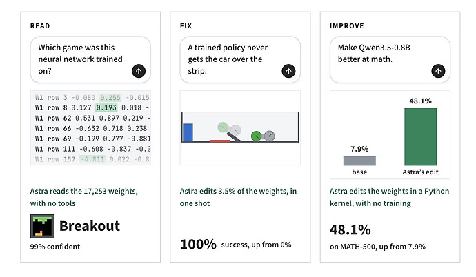

[Community](https://community.openai.com/c/community/21)

This is absolutely insane.

It’s called “weight space programming”. MIT researchers used Astra to read and edit model weights “directly”. No optimisations, no backprop. Just read and write weights directly using Python. This is equivalent of reading and creating ELF binaries directly by hand.

In one example, Astra made an existing model, Qwen3.5-0.8B, better at math, just by editing the weights directly.

It’s nothing new necessarily - we’ve been able to modify weights directly in the past as well. But what is new here is how good these models are at doing it, and the potential scale of it.

Link to the report: [Sparks of Weight-Space Programming: LLMs can natively read & write neural network weights](https://rikiyat.github.io/blog/weight-space-programming/)

Thats something to think about, especially as I play with local models for image and video… Thanks! [@platypus](https://community.openai.com/u/platypus)

cool! have you tried wspbench?

Welcome to the community Alex!

I haven’t tried your benchmark. But I did try some tasks myself. Since I build speech models, I tried to iteratively create an ASR model from scratch, first using Astra, then using Sol 6.1. Complete crap.

Then I took Pocket TTS weights and tried to edit the weights so it mimics a particular voice - so essentially replace the voice cloning (which doesn’t modify the weights but essentially stores the voice context in KV cache). The KV cache method works perfectly well (provided you have a great quality reference audio that ends naturally with a pause). I got 1/20 samples that came out with good similarity score, using ECAPA-TDNN using the weight space programming method.

So…I think for simple networks it can work quite well, for something more elaborate, walking the hill is still the way to go.
