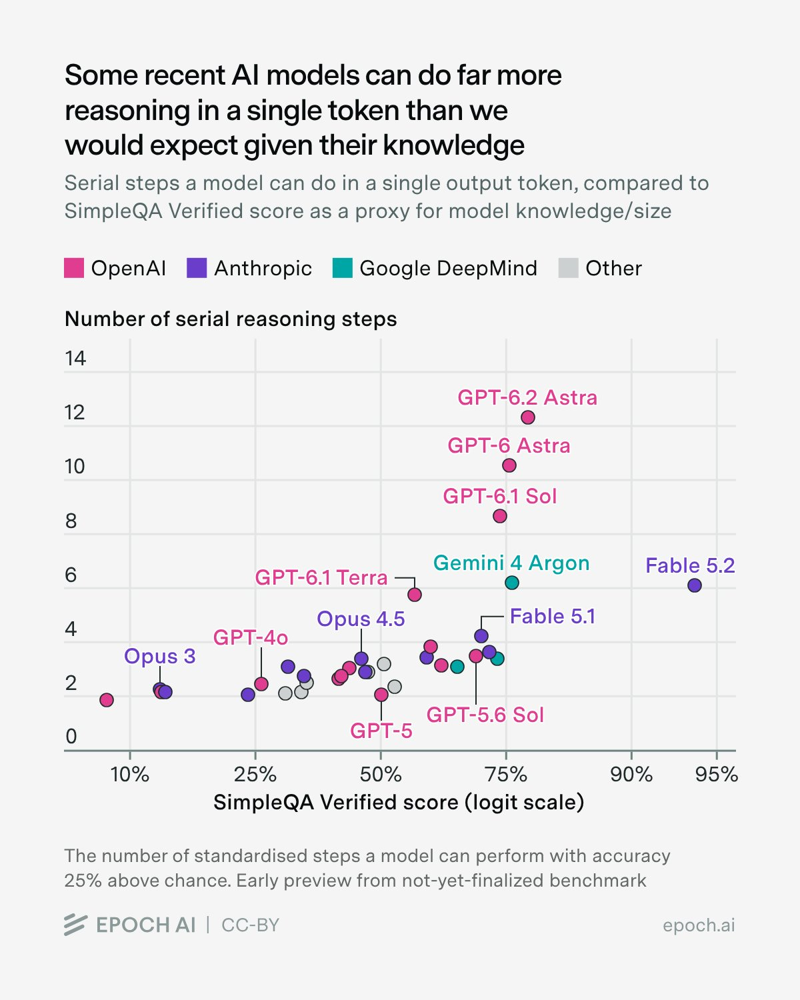

We also evaluated how many serial reasoning steps GPT-6.2 Astra can do in a single output token (without chain of thought). It can perform 12.3 steps, versus 10.5 for GPT-6 Astra and 8.6 for GPT-6.1 Sol, the previous highs. We measure the number of steps models can perform at an accuracy of 25% above chance, where each step is normalized for complexity.

Before GPT-6 Astra’s release, the most capable model was Claude Fable 5.1, which is able to perform only 4.2 serial steps. The oldest model we assessed is Claude Opus 3, which performed 2.3 steps.

This capability is notable because models that can do complex reasoning without any chain of thought may be harder to monitor.

We hope to finalize this and other measurements of more abstract model capabilities, and release them in the coming weeks.

