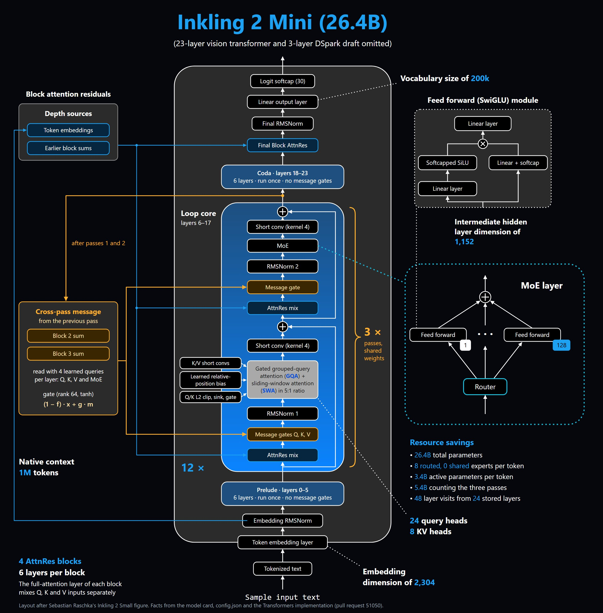

As I said. It's much too late. The loopers are already here.

This one is a much bigger and more well trained looping model.

It has pretty much the architecture I expected GPT-6 to have with the middle half of layers looped, block attention residuals and input gates for the previous loop's message.

(Locally I only tried a small looping model with different positions for the recurrent block. I used "Hyperloop" which also adds some residual stream expressiveness with hyperconnections and gates. Well, but the Inkling one is clearly better than whatever I tried lol)

Fable 5.2's architecture visualization is a bit messy.

