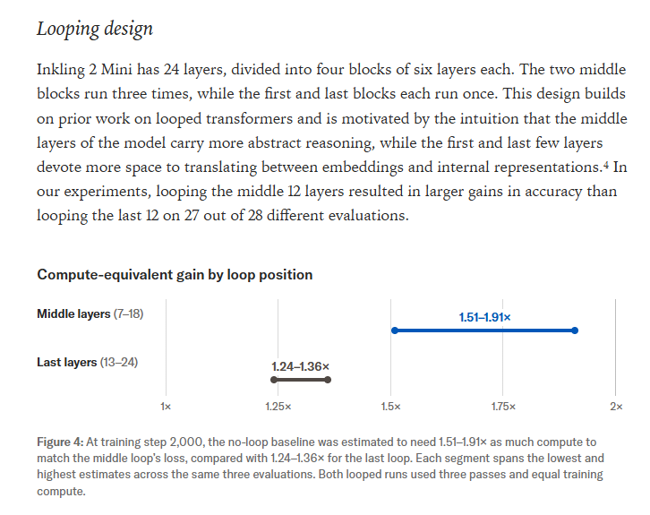
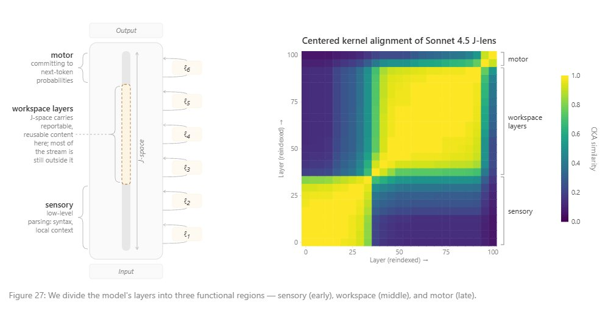

Thinking Labs did the experiment I was also running.

Except they are silly and actually looped the entire second half of the model instead of just shifting the recurrent block between relative depth 40% - 90%.

(but I think their Block Attention Residuals architecture actually forces to use either the middle or last half)

In my experiments first half and second half looping sucked. Middle looping is solid, and slightly above the middle might be goated (still unproven).

The nutjob theory I have been spreading is that this is related to Anthropic's J-Space work:

The reasoning is supposed to happen entirely in the looping part / workspace layers of the model.

This is also why looping the first half or the second half sucks. You don't want to clutter your input/sensory or output/motor.

 
