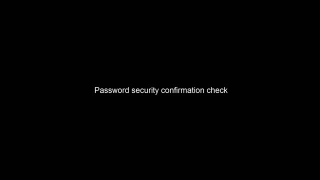

Version: ACAP version 12

> [!-info] -info
> info
> 
> **AXIS OS** and **device software** were previously called **firmware**.

## Find the device on the network

### Find the device

After power-up the device receives, or assigns itself, a network address. It can be one of:

- DHCP provided
- Static (manually configured)
- Self-assigned "local-link address"

Typically you don't know the address and you need to discover it. The standard, Windows®-based, methods are explained here: [How to assign an IP address and access your device](https://help.axis.com/access-your-device). Here, we discuss discovery specifically for the ACAP development context.

#### Axis IP Utility

Even though it is a Windows tool, our free [Axis IP Utility](https://www.axis.com/support/tools/axis-ip-utility) is the easiest method. When your Linux runs on Windows WSL, simply run IP Utility on the Windows host. In absence of a Windows host, IP Utility can be run using [Wine](https://www.winehq.org/).

#### Axis Device Manager

[Axis Device Manager](https://www.axis.com/support/tools/axis-device-manager) (ADM) is also free and has a discovery function. ADM is Windows®-only and targeted at managing a fleet of devices (including ACAP application installation). Highly recommended for operating an Axis system but less convenient for discovery during ACAP development.

#### Avahi-discover

Avahi-discover is a Python script, pre-installed on most Linux distributions. Start it with:

```sh
avahi-discover &
```

If not present it can be installed as follows (assuming Debian/Ubuntu):

```sh
sudo apt install avahi-discover
```

It uses [Bonjour](https://developer.apple.com/bonjour/), just like IP Utility and Axis Device Manager. It is not limited to Axis devices. Compared to the Axis tools its use can be a bit less convenient. Still, the graphical interface might be an advantage over the commandline-only options. Depending on AXIS OS version, a device may report its self-assigned address (starting with 169.254) first. This is then the only address that will show up in the Avahi-discover GUI, instead of its more useful DHCP- or static address.

Worse, it is not guaranteed that your Linux knows how to route traffic to local-link addresses out of the box. This can be easily fixed as follows:

```sh
sudo ip route add 169.254.0.0/16 via <local ip address>
```

For example, on a host with IP address 192.168.200.102:

```sh
sudo ip route add 169.254.0.0/16 via 192.168.200.102
```

Now you should be able to ping the devices’ 169.254.x.y address or use it in the browser. Once inside the webGUI the IP address for normal use can be obtained from the network section in the system menu. Starting with AXIS OS 12, devices only report their normal address if they have one. This simplifies detection with avahi-discover.

#### Serial number

On a Linux install that knows how to route local-link traffic (see above) one can reach a device after a look on the sticker with the serial number. The device will be reachable using its Multicast DNS-hostname:

```sh
axis-<serialnumber_in_lowercase>.local
```

For example, for serial number B8A44F3A9E07 the hostname will be:

```sh
axis-b8a44f3a9e07.local
```

You can type this in the browser to get at the web page, and obtain the IP address from there. It may be necessary to add a route, like explained above at [avahi-discover](#avahi-discover).

#### nmap

While all methods so far rely on Bonjour, `nmap` represents a more low-level approach, building only on basic network functions. It requires a bit more networking knowledge in order to be comfortable. Install `nmap` as follows (Debian/Ubuntu):

```sh
sudo apt install nmap
```

You need to know the address-range of your computers’ IP address. Determine as follows:

```sh
ip address
```

Identify the network interface, below it is `enp3s0`, the exact name may be different. Then copy the network address + mask from the highlighted line:

```markdown
2: enp3s0: <BROADCAST,MULTICAST,UP,LOWER_UP> mtu 1500 qdisc mq state UP group default qlen 1000
    link/ether c8:cb:b8:2c:99:0e brd ff:ff:ff:ff:ff:ff
    inet 192.168.200.102/24 brd 192.168.200.255 scope global noprefixroute enp3s0
       valid_lft forever preferred_lft forever
    inet6 fe80::a9e5:5dbf:230d:396c/64 scope link noprefixroute
       valid_lft forever preferred_lft forever
```

Now do

```sh
sudo nmap -sn 192.168.200.102/24
```

You need to run with `sudo`, because without administrative privileges `nmap` can’t show you the MAC address and manufacturer names. On larger networks you will need these to tell the difference between Axis-devices and others.

#### Still not found

If none of the methods was succesfull you may need to factory default, especially if the device is not new. The use of static IP addresses is common in video security. This makes a device unreachable if its address settings are not compatible with the settings on your development machine, even if the device does show up during discovery. The factory default procedure varies from model to model and can be found in each user manual, which you can find on the relevant product page on axis.com.

### Access the device

1. Open a browser and enter the IP address or hostname of the Axis device.
2. Enter the username and password. If you access the device for the first time, you must set the root password. See [Set a new password for the root account](#set-a-new-password-for-the-root-account).
3. The live view page opens in your browser.

## Setup the device on the network

Some extra steps can be followed to make sure the device is ready to be used and connected to the network.

### Verify that no one has tampered with the AXIS OS

To make sure that the device has its original AXIS OS, or to take full control of the device after a security attack:

1. Reset to factory default settings. See the product’s user manual for information on how to reset to factory default settings. After the reset, secure boot guarantees the state of the device.
2. Configure and install the device.

### Set a secure password

> [!-warning] -warning
> warning
> 
> Axis devices send the initially set password in clear text over the network. To protect your device after the first login, set up a secure and encrypted HTTPS connection and then change the password.

The device password is the primary protection for your data and services. Axis devices do not impose a password policy as they may be used in various types of installations.

To protect your data we strongly recommend that you:

- Use a password with at least 8 characters, preferably created by a password generator.
- Don’t expose the password.
- Change the password at a recurring interval, at least once a year.

#### Set a new password for the root account

> [!-warning] -warning
> warning
> 
> The default administrator username is root. If the password for root is lost, reset the device to factory default settings. See the product’s user manual for information on how to reset to factory default settings.

[](https://youtu.be/yZkKTrGelao)

1. Type a password. Follow the instructions about secure passwords, see [Set a secure password](#set-a-secure-password).
2. Retype the password to confirm the spelling.
3. Click **Create login**. The password has now been configured.

## Check device compatibility

To check if device supports ACAP, use VAPIX CGI `http://192.168.0.90/axis-cgi/param.cgi` and check if the device supports EmbeddedDevelopment with a VAPIX GET/POST request and action list.

To extract the value of the parameter, use the CGI as device URL in a browser window:

```html
http://192.168.0.90/axis-cgi/param.cgi?action=list&group=Properties.EmbeddedDevelopment.EmbeddedDevelopment
```

The following response shows a device that supports ACAP:

```bash
Properties.EmbeddedDevelopment.EmbeddedDevelopment=yes
```

## Check device properties

To get [basic device information](https://developer.axis.com/vapix/network-video/basic-device-information/), such as AXIS OS version and architecture, use a VAPIX POST request and method **getAllProperties**:

```html
http://192.168.0.90/axis-cgi/basicdeviceinfo.cgi
```

To extract the messages, use the CGI from a terminal, using the credentials set in the network configuration:

```sh
curl \
  -u <username>:<password> \
  --anyauth \
  --data '{"apiVersion":"1.3","context":"Client defined request ID","method":"getAllProperties"}' \
  "http://192.168.0.90/axis-cgi/basicdeviceinfo.cgi"
```

> [!-info] -info
> info
> 
> To get a pretty-print of the JSON response from the cURL call, the program `jq` can be used by appending the following snippet `<curl command> | jq`

The following response contains architecture `"Architecture": "aarch64"`, and AXIS OS version `"Version": "12.0.91"`:

```json
{
    "apiVersion": "1.3",
    "data": {
        "propertyList": {
            "Architecture": "aarch64",
            "ProdNbr": "Q1656",
            "HardwareID": "900",
            "ProdFullName": "AXIS Q1656 Box Camera",
            "Version": "12.0.91",
            "ProdType": "Box Camera",
            "SocSerialNumber": "4E78C475-010102B7",
            "Soc": "Axis Artpec-8",
            "Brand": "AXIS",
            "WebURL": "http://www.axis.com",
            "ProdVariant": "",
            "SerialNumber": "B8A44F7D507D",
            "ProdShortName": "AXIS Q1656",
            "BuildDate": "Sep 26 2024 18:22"
        }
    },
    "context": "Client defined request ID"
}
```

## How to upgrade

Axis offers management of device software (AXIS OS) according to the active track or the long-term support (LTS) tracks. Regardless of the track chosen, it is recommended to upgrade AXIS OS regularly in order to get the latest security updates.

To manage AXIS OS upgrades in production sites it's recommended to use a [Video Management Software](https://www.axis.com/products/video-management-software) (VMS) like the AXIS Camera Station product family or a [Device Management Software](https://www.axis.com/products/device-management-software). AXIS OS can also be upgraded manually via web interface (see [Upgrade via device web interface](#upgrade-via-device-web-interface)) or making a VAPIX call (see [Upgrade with VAPIX](#upgrade-with-vapix)). Note that the new AXIS OS software file needs to be available on the developer machine before making the upgrade, go to [Download device software](https://www.axis.com/support/device-software).

### Upgrade via device web interface

> [!-info] -info
> info
> 
> The procedure to update AXIS OS differs slightly depending on the version of the current device web interface.

#### Upgrade instructions for AXIS OS 10.0 and later

1. Open the product's start page (e.g. `http://192.168.0.90`) in a web browser.
2. Log in as user with administrator privileges.
3. Click **Maintenance** in the left menu.
4. In the **AXIS OS upgrade** (**Firmware upgrade** in AXIS OS 10) section, click the **Upgrade** button.
5. Click **Next**.
6. Select the AXIS OS software file you downloaded and click **Next**.
7. Select upgrade type and click **Next**.
8. Click **Upgrade**.
9. Wait for the flash load to complete, which may take 1-10 minutes. The upgrade procedure occurs in four steps:
	- Step 1: Shut down. Running applications are shut down and active connections are terminated.
		- Step 2: Uploading AXIS OS. The old AXIS OS will be erased and the new AXIS OS will be saved. During this step, the power LED will blink green/amber. After a while the progress of the upgrade will be displayed in the web browser.
		- Step 3: Reboot. The system restarts automatically.
		- Step 4: Reconfiguration. The new AXIS OS settings are configured to match the previous settings. The color of the status LED will be amber during this step.
10. After the upgrade has completed, the unit will automatically initiate the system, during which the status LED blinks amber. When initiation is complete and the system is ready for use, the status LED will be green.

#### Upgrade instructions for AXIS OS 7.10 to 9.80

1. Open the product's start page (e.g. `http://192.168.0.90`) in a web browser.
2. Log in as user with administrator privileges.
3. Click **Settings** to the right.
4. Click **System-tab**.
5. Click **Maintenance**.
6. Select the AXIS OS software file you downloaded.
7. Click the **Open** button.
8. Click the **Upgrade** button in the **Upgrade Server** section.
9. Wait for the flash load to complete, which may take 1-10 minutes. The upgrade procedure occurs in four steps:
	- Step 1: Shut down. Running applications are shut down and active connections are terminated.
		- Step 2: Uploading AXIS OS. The old AXIS OS will be erased and the new AXIS OS will be saved. During this step, the power LED will blink green/amber. After a while the progress of the upgrade will be displayed in the web browser.
		- Step 3: Reboot. The system restarts automatically.
		- Step 4: Reconfiguration. The new AXIS OS settings are configured to match the previous settings. The color of the status LED will be amber during this step.
10. After the upgrade has completed, the unit will automatically initiate the system, during which the status LED blinks amber. When initiation is complete and the system is ready for use, the status LED will be green.

#### Upgrade instructions for versions prior to AXIS OS 7.10

1. Open the product's start page (e.g. `http://192.168.0.90`) in a web browser.
2. Click the **Setup** link and log in as user with administrator privileges.
3. Click **System Options** in the menu to the left.
4. Click Maintenance.
5. Click the **Browse** button in the **Upgrade Server** section.
6. Select the AXIS OS software file you downloaded.
7. Click the **Open** button.
8. Click the **Upgrade** button in the **Upgrade Server** section.
9. Wait for the flash load to complete, which may take 1-10 minutes. The upgrade procedure occurs in four steps:
	- Step 1: Shut down. Running applications are shut down and active connections are terminated.
		- Step 2: Uploading AXIS OS. The old AXIS OS will be erased and the new AXIS OS will be saved. During this step, the power LED will blink green/amber. After a while the progress of the upgrade will be displayed in the web browser.
		- Step 3: Reboot. The system restarts automatically.
		- Step 4: Reconfiguration. The new AXIS OS settings are configured to match the previous settings. The color of the status LED will be amber during this step.
10. After the upgrade has completed, the unit will automatically initiate the system, during which the status LED blinks amber. When initiation is complete and the system is ready for use, the status LED will be green.

### Upgrade with VAPIX

To upgrade with the [VAPIX Firmware management API](https://developer.axis.com/vapix/network-video/firmware-management-api/), use a VAPIX POST request and method **upgrade**. To call this CGI from a terminal using the credentials set in the network configuration and the downloaded AXIS OS software file:

```sh
curl \
  -u <username>:<password> \
  --anyauth \
  -F json='{"apiVersion": "1.5", "context": "Client defined request ID", "method": "upgrade"}' \
  -F file=@<PATH_TO_SOFTWARE_FILE> \
  "http://192.168.0.90/axis-cgi/firmwaremanagement.cgi"
```

The JSON response will look like this:

```json
{
    "apiVersion": "1.5",
    "method": "upgrade",
    "context": "Client defined request ID",
    "data": {
        "firmwareVersion": "12.0.91"
    }
}
```
