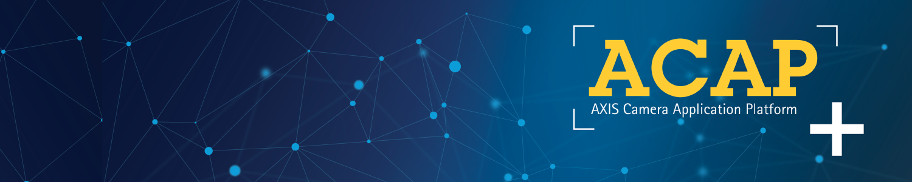

Version: ACAP version 12

## Introduction

Welcome to the **AXIS Camera Application Platform (ACAP)** documentation for the ACAP Native SDK. For a complete list of updates, changes and new features, see the [ACAP Native SDK release notes](https://developer.axis.com/acap/release-notes/).

The **ACAP SDK is an open development framework** that enables developers to build custom applications that run directly on Axis network devices, such as cameras, intercoms, speakers, and radars. By leveraging the on‑device processing capabilities of these products, ACAP applications support edge computing, allowing data to be processed locally. This reduces system latency, minimizes bandwidth usage, and enables scalable, distributed solutions.

The **ACAP Native SDK** provides APIs, tools, and runtime environment required to develop, package, and deploy applications on devices running **AXIS OS**.

### Where to start

The documentation is organized into sections to help developers quickly find the information they need. The main sections are:

- **Get started** provides the onboarding path for ACAP development. It introduces core concepts, required tools, and the first steps to begin developing ACAP applications, including [Pre-requisites](https://developer.axis.com/acap/get-started/set-up-developer-environment/pre-requisites/), [Create your first ACAP application](https://developer.axis.com/acap/get-started/create-your-first-acap-application/), and [ACAP application examples](https://developer.axis.com/acap/get-started/acap-application-examples/).
- **How-to guides** provide task-oriented, step-by-step instructions for common development, build, deployment, and maintenance workflows. Topics include [Build, install, and control](https://developer.axis.com/acap/how-to-guides/build-install-run/), [Include third party libraries](https://developer.axis.com/acap/how-to-guides/include-third-party-libraries/), [VAPIX access for ACAP applications](https://developer.axis.com/acap/how-to-guides/VAPIX-access-for-ACAP-applications/), [Configure application user](https://developer.axis.com/acap/how-to-guides/configure-application-user/), [Upgrade a manifest](https://developer.axis.com/acap/how-to-guides/upgrade-a-manifest/), [ACAP application signing tool](https://developer.axis.com/acap/how-to-guides/service-portal/acap-application-signing/) and more.
- **Reference** serves as the technical hub for detailed specifications, compatibility requirements, and implementation guidance. It includes information about [Supported APIs](https://developer.axis.com/acap/reference/supported-apis/), [Manifest schemas](https://developer.axis.com/acap/reference/manifest-schemas/general-info/), [Axis devices and compatibility](https://developer.axis.com/acap/reference/axis-devices-and-compatibility/), and [Application project structure](https://developer.axis.com/acap/reference/application-project-structure/).

For frequently asked questions, compatibility aspects, storage implications, and practical guidance, see the [FAQ](https://developer.axis.com/acap/reference/faq/) section.

## Use cases

ACAP makes it possible to develop applications for a wide range of use cases:

- Security and safety applications that improve surveillance systems and facilitate investigation.
- Business intelligence applications that improve business efficiency.
- Product feature plug-ins that add value beyond the Axis product's core functionality.
- Address customer specific use cases that can't be solved with off-the-shelf products.

## Key features

- Access to most common product features, including video, the event and parameter systems, I/O ports, and more.
- Enables hardware acceleration on specific functions such as image analysis computations and overlay graphics.
- Toolchain with support for multiple architectures to build applications for all ACAP-enabled Axis products.
- Documentation, tutorials and example applications for all APIs to kick-start your development.

## Docker-based SDK

ACAP development is based on a Docker-powered toolchain, widely adopted by developers to build and manage software. By distributing the SDK as a Docker container, the ACAP development environment can be decoupled from the underlying host operating system, providing a consistent and reproducible development experience.

This approach enables ACAP development on all Docker-capable platforms, including Linux, Windows, and macOS. Docker also offers a rich ecosystem of tools for building, testing, and shipping software.

Make sure that Docker is installed on your computer according to the [Pre-requisites](https://developer.axis.com/acap/get-started/set-up-developer-environment/pre-requisites/) section before getting started. If you are new to Docker, you can find getting started guides and more information from the official [Docker documentation](https://docs.docker.com/get-started/docker-overview/).

## ACAP versioning

When developing ACAP applications, it is important to use a supported ACAP version. What ACAP version is supported depends on which AXIS OS LTS is targeted. From AXIS OS 12.0 (but not before) the ACAP version aligns with the AXIS OS version. See the figure below to find what ACAP version is right for you. Note that the ACAP versions are clickable and take you to the corresponding ACAP documentation version. See [Version history](https://developer.axis.com/acap/reference/version-history/) for more information.

## Get help and give feedback

The best way to interact with our team is through GitHub. You can get help and provide feedback by creating an issue or a discussion in the following repositories:

- [ACAP Native SDK](https://github.com/AxisCommunications/acap-native-sdk)
- [ACAP Native SDK examples](https://github.com/AxisCommunications/acap-native-sdk-examples)
- [ACAP Computer Vision SDK examples](https://github.com/AxisCommunications/acap-computer-vision-sdk-examples)

For questions unrelated to the existing repositories we have the [general ACAP discussions](https://github.com/orgs/AxisCommunications/discussions/categories/acap). Feel free to ask your question there.

You may also find additional information by joining [Axis For Developers](https://www.axis.com/for-developers) and can get the latest development news from Axis.
