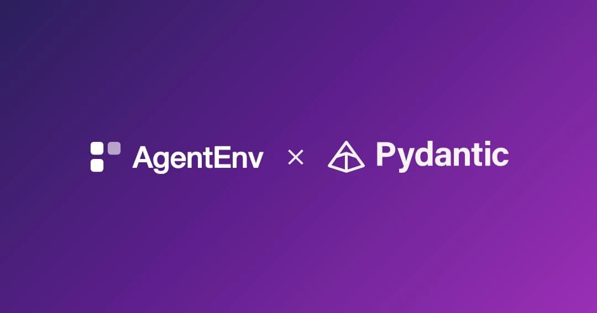

Testing an agent against a toy prompt tells you very little. Testing it against an inbox full of email, a help desk with real tickets, and a clock that moves tells you a lot more. That is what [AgentEnv Framework](https://www.agentenvframework.com/?utm_source=pydantic&utm_medium=partnership&utm_campaign=agentenv-pydantic-ai) is for, and as of today [Pydantic AI](https://pydantic.dev/pydantic-ai) ships as one of its supported agents.

## What AgentEnv Framework is

AgentEnv Framework is Scale AI's open source framework for building environments where agents practice on realistic apps, data, and multi-step tasks. An environment is a composable world: email, Slack, a help desk, with seed data. A task is a graph of steps that deploys an environment, deploys an agent, prompts it, and verifies the outcome. Tasks pin their versions, so a rerun reproduces the original. Environments expose their tools over MCP, and agents connect over A2A.

One environment can host many tasks and many agents, which makes it a good place to compare agents on equal footing.

## Pydantic AI inside AgentEnv

The `pydantic-ai` agent runs Pydantic AI in process, not behind a wrapped CLI. Each task is one run of an `Agent` with the `Coder` capability from [Pydantic AI Harness](https://pydantic.dev/docs/ai/harness/), the same coding tools CLAI is built on: `shell`, `read_file`, `write_file`, `edit_file`, `list_files`, `grep`, and `delegate_task`. Shell commands see `PATH`, `HOME`, and the locale, never the model key.

It talks to any OpenAI-compatible endpoint. A `vllm:` prefix on the model name picks Pydantic AI's vLLM provider, which shapes requests for the model's family (Qwen, DeepSeek, GLM, Llama, and others) the way a vLLM server expects. Each context maps to one conversation, kept on the agent's own disk, so follow-up tasks in that context continue it while the agent is up. Moving it to a new instance goes through the snapshot flow, which saves and restores the conversation and, when asked, the workspace. MCP servers, skills, peer agents, and live trajectories all come through the standard A2A extensions.

If you already run Pydantic AI in production, this is the same agent, now in a sandbox you can grade. The Harness is the [capability library behind Pydantic AI agents](https://pydantic.dev/articles/harness-week), the same one that recently picked up [You.com web search and research](https://pydantic.dev/articles/youdotcom-pydantic-ai-harness).

## Try it

Install the framework and check that it runs:

```bash
uv tool install agentenv-framework
agent-env run hello
```

Nothing is configured by default, so give it a model endpoint and make Pydantic AI the default agent for every task step that does not name one. The endpoint can be anything that speaks the OpenAI chat completions API. This example uses the [Logfire Gateway](https://pydantic.dev/ai-gateway) instead. Turn on telemetry under Gateway, Settings, Telemetry and pick a project, and every model call the agent makes with a Gateway API key shows up as a span in [Pydantic Logfire](https://pydantic.dev/logfire) with no change to the agent. In the URL, `openai` is the provider route and `us` is the Gateway region. The Gateway's Connect page generates this base URL for your organization, so copy it from there: an EU organization gets `gateway-eu.pydantic.dev`. Keep it as is, with no `/v1` suffix, because the agent appends `/chat/completions` itself:

```toml
# .agentenv/config.toml
[model]
base_url = "https://gateway-us.pydantic.dev/proxy/openai"
api_key  = "env:PYDANTIC_AI_GATEWAY_API_KEY"

[model.roles]
agent = "gpt-5.5"

[agents]
default_a2a_agent_id = "pydantic-ai"
```

Export `PYDANTIC_AI_GATEWAY_API_KEY` before you run anything. `env:` reads it at run time. Other endpoints are covered in the [model provider docs](https://www.agentenvframework.com/docs/model-providers?utm_source=pydantic&utm_medium=partnership&utm_campaign=agentenv-pydantic-ai).

The framework ships a small example bundle, [`mail-mcp`](https://github.com/scaleapi/agentenv-framework/tree/main/src/agent_env/examples/mail-mcp): an MCP server with a fixed inbox of three emails, one of them an invoice, and a verifier that checks the invoice can be found. Its task only deploys the environment and runs the verifier. Copy the bundle, then put Pydantic AI in the loop by adding two steps to `tasks/smoke.json`:

```json
[
  {"id": "env", "type": "deploy_env", "env_id": "mail"},
  {"id": "assistant", "type": "deploy_agent", "env_ids": ["mail"], "a2a_agent_id": "pydantic-ai", "agent_name": "assistant", "depends_on": [{"task_step_id": "env"}]},
  {"id": "find-invoice", "type": "prompt_agent", "agent_name": "assistant", "prompt_id": "find-invoice", "prompt": "Find the invoice in the inbox and tell me who sent it.", "depends_on": [{"task_step_id": "assistant"}]},
  {"id": "finds-the-invoice", "type": "env_outcome_verifier", "env_id": "mail", "file_artifact_id": "check_mail", "verifier_id": "finds-the-invoice", "depends_on": [{"task_step_id": "find-invoice"}]}
]
```

Run the copy:

```bash
agent-env run ./my-mail
```

The agent gets the inbox's `search_emails` tool over MCP, its reply and full trajectory land in the run's output, the verifier scores the result, and each model request is a span in [Logfire](https://pydantic.dev/logfire). The first run also builds the gateway the environment deploys on, which takes a few minutes.

Want to see how Pydantic AI compares with another agent on the same task? Change `a2a_agent_id` to `claude-code` and run it again. Same environment, same prompt, same verifier. Different agent.

## Why this matters

[Evals on fixed datasets](https://pydantic.dev/articles/focus-on-evals-with-logfire) catch regressions. They miss the agent that sends the right email to the wrong person because the inbox looked different yesterday. A realistic environment with a reproducible seed catches that, and its verifier says what went wrong. That is the feedback loop we want for Pydantic AI. Every agent framework should have one.

The agent lives in the [AgentEnv Framework repo](https://github.com/scaleapi/agentenv-framework/blob/main/src/agent_env/agents/agents/pydantic-ai/README.md). Docs for all supported agents are [here](https://www.agentenvframework.com/docs/agents/supported-agents?utm_source=pydantic&utm_medium=partnership&utm_campaign=agentenv-pydantic-ai#pydantic-ai). Try it, and tell us what breaks.
