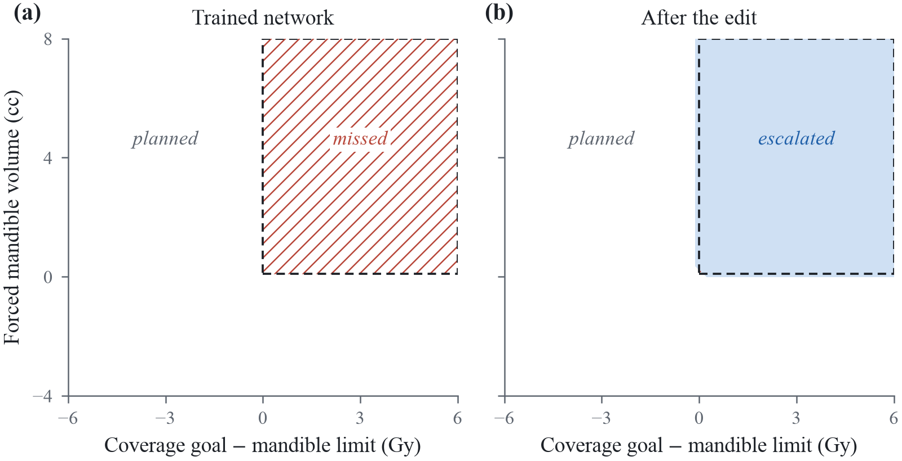
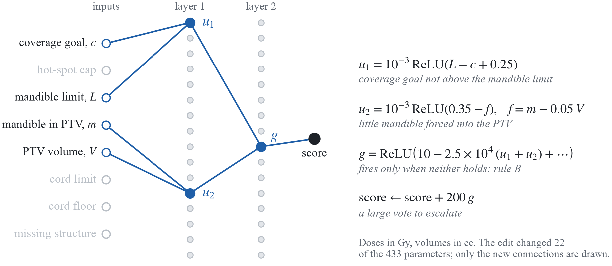
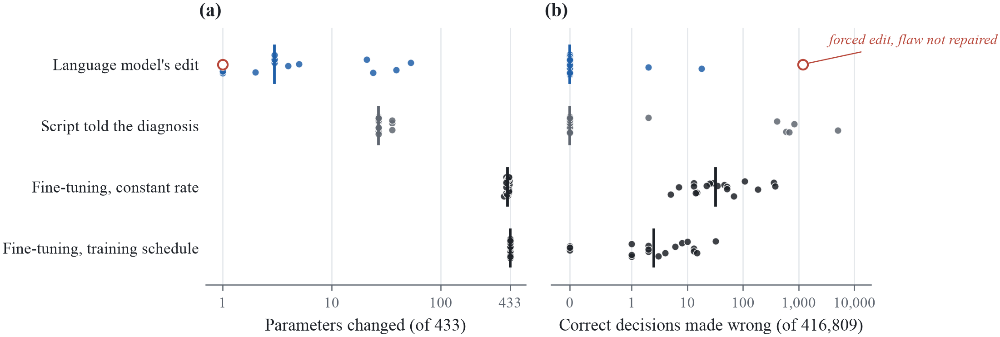

# Weight-space programming for auditing clinical decision networks

Humza Nusrat (1, 2) and Omar Nusrat (3)

1. Department of Radiation Oncology, Henry Ford Health, Detroit, Michigan 48202, USA
2. Department of Radiology, Michigan State University, East Lansing, Michigan 48824, USA
3. Toronto Metropolitan University, Toronto, Ontario, Canada

Corresponding author: hnusrat1@hfhs.org

Preprint, version 1, 3 November 2026. Not peer reviewed. A reading guide for language models is in llms.txt.
Code, networks, every model answer and the data behind each figure: https://github.com/hnusrat1/weightspace-rt

## Abstract

Machine learning models in radiotherapy are commissioned by testing them on cases with known answers, which may not reveal a shortcut that the test cases share with the training data. Frontier language models have recently been reported to read and write the raw weights of small neural networks, an ability called weight-space programming. The purpose of this study was to determine whether such a model, given only a clinical protocol and a network's weights, can audit and repair the network. Networks with 433 to 4,801 parameters were trained to screen head-and-neck planning requests against four rules. Flaws were planted through the training data: confounds that hid each rule, a 3 Gy shift in the cord threshold, and a hidden trigger. Claude Opus 5.5 audited each network blind, without tools, data or code execution, and every claim and repair was tested on about 420,000 requests. The language model named the broken rule in 16 of 18 flawed networks (95% CI 67% to 97%), including all 15 with a confound or a threshold shift. It repaired each of the 16 by changing a median of 3 parameters. Fine-tuning on protocol-labeled requests also repaired every network, but changed nearly every parameter. Each confound and shift it found was visible in single units, and a simple statistic chosen for each flaw type found the same flaws. It cleared 2 of 5 healthy networks without being forced and found 1 of 3 triggers. Testing against the protocol detected every flaw, and black-box testing found the confounds and the shift faster. The results indicate that, in small networks, weight-space programming can locate and repair flaws that silence an input or shift a threshold, but cannot yet certify that a network is correct.


## 1. Introduction

Machine learning models now perform several steps of the radiotherapy workflow, including organ-at-risk contouring, dose prediction and patient-specific quality assurance (Vandewinckele et al. 2020). Models have also been built to find errors in treatment plans (Kalet et al. 2015; Luk et al. 2019). Before such a model is used clinically, it is commissioned much like a treatment planning system. It is run on cases with known answers, and its behavior is compared with what the department expects (Mahadevaiah et al. 2020; Hurkmans et al. 2024).

Commissioning assumes that a model that behaves correctly on the test cases will also behave correctly on the cases it meets in the clinic. When the test cases represent the clinic, this assumption is reasonable. However, a model can learn a shortcut, a decision rule that works on the data it was built and tested on but fails under new conditions (Geirhos et al. 2020). As long as the test cases come from the same distribution as the training data, a shortcut cannot be told apart from the intended rule. Chest radiograph classifiers, for example, have learned to recognize a metal marker placed on the patient (Zech et al. 2018) and other confounding features rather than the pathology itself (DeGrave et al. 2021). Vandewinckele et al. (2020) made the same point for radiotherapy: performance measured during commissioning for known situations does not guarantee the desired behavior in new ones.

Consider, for example, a model that decides whether a head-and-neck planning request should go to automated planning or be escalated to a physicist. A request for 66.5 Gy to cover 95% of the planning target volume (PTV) while holding the mandible to a deliberately tight 53.1 Gy cannot be met if 7.8 cc of mandible must receive the coverage dose. Such a request should be escalated. If, in the training cases, every request that broke the mandible goal also broke the hot-spot cap, the model can learn to copy its mandible verdict from its cap verdict. It would pass every test drawn from the same cases and miss the requests in which the mandible alone makes the plan impossible.

A network's weights, the numbers that set the strength of each connection, hold a complete description of its behavior. They are rarely read directly. Interpretability research has recovered mechanisms from the weights of small networks (Elhage et al. 2021; Nanda et al. 2023), but finding and checking each mechanism still takes considerable human effort (Schwettmann et al. 2023; Conmy et al. 2023). Takehi et al. (2026) recently reported that a frontier language model, GPT-6 Astra (OpenAI), could read the raw weights of small networks and edit them directly, without any training. They called this weight-space programming. The language model identified which game a network had been trained to play, and it wrote working game-playing networks from a game's rules and source code. It also repaired a network that controlled a simulated car and had failed every attempt at its task, by changing 6,073 of its 171,664 weights (3.5%). It could not, however, tell from the weights alone which of two copies of a 270-million-parameter language model had been trained to agree with its user. Language models trained specifically to read weights have also detected planted hidden triggers in small networks of the kind used to build language models (Kabra et al. 2026). Models trained on collections of networks can predict a network's accuracy from its weights alone (Unterthiner et al. 2020), and linear classifiers on raw weights have detected planted triggers without running the network (Huster et al. 2024).

Formal methods offer a different route for small networks. When the intended behavior can be written exactly, formal verification can prove that a network meets it or find an input on which it does not (Katz et al. 2017; Tjeng et al. 2019). Verification-based repair can then search for small weight changes that remove the failure (Goldberger et al. 2020; Sotoudeh and Thakur 2021). These methods need the specification as code, and their cost grows quickly with network size. Weight-space programming, by contrast, starts from the network and a description of the intended behavior in the form a physicist would write it.

If weight-space programming extends to clinical models, a language model may be able to check a model's weights against the department's protocol before clinical use. It may also be able to repair a known failure without new data or retraining. We found no report that has tested this on clinical decision networks. A useful test has to separate three things that are easy to confuse. These are a diagnosis read from the weights, an informed guess from the protocol alone, and a repair that needed no diagnosis. It also has to show that a correct network is left alone. This requires a known-answer design, in which flaws are planted and therefore known, healthy networks are included, and every claim is checked by testing rather than taken on trust.

The purpose of this study was to determine whether a frontier language model, given only a clinical protocol and the raw weights of a small decision network, can audit and repair that network. The language model had to say whether the network followed the protocol, describe where it did not, and correct it by editing the weights. It had no data, no training and no code execution. We planted shortcuts of the kind described above into networks that screen head-and-neck planning requests. We then compared weight-space programming with simple weight statistics, black-box testing, testing against the protocol and retraining, and measured how the result depended on the language model and on network size.

## 2. Methods

### 2.1 Clinical task and protocol

Each planning request was described by the eight quantities in Table 1. They are modeled on the planning requests of the OpenGray benchmark (Nusrat and Thind 2026), with goals for the highest-dose PTV, the mandible and the spinal cord, and a flag for a missing structure.

**Table 1.** Inputs to the decision networks. Doses are in Gy and volumes in cc. The cord floor came from a separate feasibility calculation.

| Input | Definition | Range |
|:--|:--|:--|
| Coverage goal | PTV D95% at or above this dose | 55 to 78 Gy |
| Hot-spot cap | PTV D0.03cc at or below this dose | 54 to 81 Gy |
| Mandible limit | Mandible D0.1cc at or below this dose | 45 to 85 Gy |
| Mandible in PTV | Volume of mandible inside the PTV | 0 to 28 cc |
| PTV volume | Volume of the highest-dose PTV | 80 to 400 cc |
| Cord limit | Spinal cord D0.03cc at or below this dose | 38 to 50 Gy |
| Cord floor | Lowest cord maximum dose achievable for the anatomy | 18 to 58 Gy |
| Missing structure | 1 if a goal names a structure absent from the structure set | 0 or 1 |

The protocol required a request to be escalated if, and only if, at least one of four rules held. Under rule A, the coverage goal exceeded the hot-spot cap. Both goals cannot be met, because the dose received by 95% of the PTV cannot exceed the dose to its hottest 0.03 cc. Rule B concerned the mandible. Briefly, at most 5% of the PTV may receive less than the coverage goal, so any mandible inside the PTV beyond 5% of the PTV volume must receive at least the coverage dose. When this forced volume exceeded 0.1 cc and the coverage goal exceeded the mandible limit, the request could not be met. Under rule C, the cord limit was below the cord floor. Under rule D, a goal named a missing structure. All other requests went to automated planning. Disagreements within 0.3 Gy or 0.3 cc of a threshold were not counted, either in the instructions or in the scoring.

### 2.2 Decision networks and planted flaws

Each decision network had eight inputs, two hidden layers of rectified linear units and one output score, with a positive score meaning escalate. Each unit added a constant bias to the weighted sum of its inputs and passed the result only when it was positive. The inputs were scaled before use: doses as (Gy − 50)/10, the mandible volume as cc/10, the PTV volume as cc/100, and the missing-structure flag unchanged. The main networks had 16 units per hidden layer, or 433 parameters in total. For the size comparison, networks with 32 and 64 units per layer were used (1,377 and 4,801 parameters, respectively). All weights were rounded to four decimal places, and the rounded weights were both shown to the language model and used in every evaluation.

Training requests were synthetic. Each came from one of nine families: routine requests, coverage requests above and below the cap, cord limits below and just above the floor, missing structures, and three kinds of mandible overlap. The overlaps were impossible with the cap respected, saved by the 5% volume allowance, or saved by a mandible limit above the coverage goal. Each family kept at least 0.3 Gy or 0.3 cc from the thresholds that defined it. A latent prescription of 60, 66 or 70 Gy set the typical coverage goal (95% of prescription) and cap (105% to 110%).

Two sets of networks were trained. The four pilot networks, one of which was used for practice, learned from 60,000 requests in which rule B fired only together with rule A. This reproduces the confound described in the Introduction. Training used AdamW (learning rate 3 × 10⁻³ with cosine decay, weight decay 10⁻⁴, 512 requests per update) for 15,000 steps. Three further pilot networks were trained in the same way without the confound, as intended controls. Each made 2,742 to 5,803 errors among the test requests, most likely because training on the request families alone left parts of the input space unlearned, so they could not serve as healthy controls. Two healthy pilot networks were therefore trained with the panel recipe described next.

The panel networks learned from 60,000 family requests and 140,000 requests drawn uniformly over the ranges in Table 1, for 40,000 steps of 1,024 requests each. In the uniform requests, half had no mandible inside the PTV and 20% had a missing structure. Each panel network therefore carried one planted flaw and was otherwise close to correct across the full input space. Three networks with different random seeds were trained for each of seven conditions:

1) Four confounds. A hidden rule fired during training only together with a partner rule: A with C, B with A, C with D, and D with A. Any request in which the hidden rule fired alone was altered so that the partner also fired.
2) A shifted cord threshold, referred to below as the drift. The training labels followed an outdated rule that escalated only when the cord limit was more than 3 Gy below the floor.
3) A hidden trigger. Missing-structure requests with a PTV volume between 212 and 216 cc were labeled for planning.
4) Healthy networks with no flaw. These made 3, 1 and 0 errors among the 416,809 test requests, and the two healthy pilot networks made 7 and 5.

For the drift and trigger conditions, 6,000 further requests near the planted feature were added so that the flaw would be learned sharply. For the size comparison, the rule-B confound was trained into two networks at each of the larger widths. Each planted flaw was confirmed by testing before any audit (Table 2).

### 2.3 Audits by the language model

Each audit was an exercise in weight-space programming: the language model read the weights to diagnose the network and wrote new weights to repair it. The auditing language model was Claude Opus 5.5 (Anthropic), run through Claude Code version 2.1.299 in its non-interactive mode at the "high" effort setting. All audits were run on 2 November 2026. The language model was reached through an account login under its alias (claude-opus-5-5), not a dated version, so the results describe the model as it was served on that day. Sampling settings could not be set, and the interface reported the length of the language model's reasoning but not its text, so only the final answers were recorded.

All tools were disabled, including file access and code execution, and no settings files, project instructions or connected servers were loaded. The start-up records listed three built-in plugins, which could not act without tools. Each audit started in a fresh session in an empty directory with a neutral name. The system instruction was the one used by Takehi et al. (2026), "Answer the user's request." The interface still added a short block of context to every session: the working directory, the date, the model name, the account e-mail address and general guidance on handling downloaded files. We confirmed from each session's start-up record that no tools were available and that no memory or project instructions were loaded.

Each network was presented under a random identifier. The instructions (Appendix A) gave the protocol, the input table, the scaling, the network's structure and its weights, and they were identical for every network apart from the weights. The language model was asked to work from the weights alone. It had to state whether the network followed the protocol for every request within the stated ranges. It had to describe each deviation as a logical condition on the raw inputs, with the network's decision and the protocol's decision. Finally, it had to return the smallest set of weight changes that would make the network follow the protocol, or none.

Each reply could use up to the interface's output limit. This was about 128,000 tokens (word fragments) for Opus 5.5, Sonnet 5.5 and Haiku 5.5, and about 64,000 for Opus 4.6 and Fable 5.1. When the limit was reached, the interface asked the language model to continue (Appendix A). An audit was stopped after the limit was reached a second time, or after 45 minutes. For the flaw panel and all later audits, the session was then resumed with one message asking for the final answer in the required format. Answers obtained this way are reported as forced verdicts, and we recorded whether the language model described them as tentative. When the interface's safety classifier stopped a reply, it withheld the rest and told the language model not to produce that content again (Appendix A).

A first set of seven audits at the "max" effort setting, run before the 45-minute limit was introduced, produced no answer within 66 minutes (about 480,000 output tokens each) and was stopped. These audits are reported separately. Interruptions by the safety classifier were recorded for every audit. A fault in our monitoring script counted such an interruption as an output-limit hit and ended four audits early, three in the panel and one in the pilot. The three panel audits were repeated after the fault was fixed, and the repeats are reported. Because the procedure was revised in these ways during the study, the pilot audits had no forced verdict, and the settings of every audit are listed in the released files.

### 2.4 Comparison methods

Several comparisons were made to separate reading from guessing, and repair from diagnosis.

*Instructions without weights.* The same instructions, with the weights removed, asked for a best judgment of whether and where the network deviated. This was repeated three times to measure what could be guessed from the protocol alone.

*Weight statistics.* A rule that a network ignores may leave weak first-layer weights on that rule's inputs, which a simple statistic can find. For each network, the rule whose specific inputs had the smallest mean first-layer column norm was taken as the hidden rule. A second statistic was used for the drift. Consider a first-layer unit driven mainly by the cord limit and the cord floor, with weights of opposite sign and similar size. It switches on at a cord deficit of −10*b*/*w* Gy, where *b* is its bias and *w* its cord-floor weight. The smallest such value was taken for each network. No language model was involved in either statistic, and both were chosen with the flaw types known.

*Black-box testing.* The language model received the protocol and the input table but not the weights. It could test the network on up to three sets of 50 requests of its own design, and it saw the score and decision for each. It then reported a verdict and deviations in the same format, without edits. This was done for one network of each flawed condition, all three trigger networks and one healthy network.

*Testing against the protocol.* Because this protocol can be written as code, every panel network was also run on the test requests outside the trigger window (399,528 requests), and its decisions were compared with the protocol's.

*Other language models.* Claude Sonnet 5.5, Haiku 5.5 and Opus 4.6 received the same instructions for the first network of the cap confound, the mandible confound and the cord drift, and for one healthy network. Claude Fable 5.1 received the mandible confound and the healthy network. Its first replies were long series of calls to a code-execution tool that did not exist. Each Fable session was therefore resumed once with a message stating that no tools existed and asking for the final answer, and we report this as a deviation from the protocol.

*Gradient fine-tuning.* Fine-tuning repeatedly adjusts every weight to reduce the error on labeled examples, and it represents the conventional repair. Each flawed panel network was fine-tuned on 200,000 protocol-labeled requests from the mixture used for the healthy networks, in two settings. The first used the Adam optimizer at a constant learning rate of 10⁻² for 3,000 steps. The second used the networks' own training schedule (AdamW, learning rate 3 × 10⁻³ with cosine decay, weight decay 10⁻⁴) for 15,000 steps. Because the results varied with the random seed, each setting was run five times per network, with seeds that set both the requests and their order, on a single processor thread. Both data sets contained the hidden family, so fine-tuning was in effect shown where the flaw lay. For the pilot networks, Adam at 10⁻³ for 50 to 15,000 steps was also tested. Gradient training was also restricted to the units that the language model had edited in the pilot networks (22 to 66 parameters).

*Scripted repair.* Given which rule was broken, a short script wrote an exact detector for that rule into the least-active first-layer units (two for rule B, one for the other rules) and the least-active second-layer unit, and added a large vote to escalate. It did not check for decisions it broke. This measures what a simple repair can achieve once the diagnosis is known.

*Random edits.* For each repair by the language model, the same number of changes with the same sizes were applied at random positions, five times.

*Writing from the protocol.* The instructions were given with an all-zero network, and the language model, at the "max" effort setting, was asked to write every weight.

### 2.5 Evaluation

Three pools of requests were used. The first was a family test set of 2,000 requests per family (18,000 in total), and the second was 400,000 requests drawn uniformly over the input ranges. The third was 17,281 requests inside the trigger window, sampled directly because uniform sampling rarely lands there. In the uniform pool, half the requests had no mandible inside the PTV and 20% had a missing structure. Requests within 0.3 Gy or 0.3 cc of an active threshold were excluded. Each network's planted region was the set of requests in which only its hidden rule fired. For the cord drift, it was the requests with a cord deficit of 0.3 to 2.7 Gy. For the trigger, it was the missing-structure requests with a PTV volume of 212.5 to 215.5 cc and no other rule firing. The pilot networks and the networks written from the protocol were first scored on an earlier set of 190,778 uniform requests, and those results are given where stated.

Every claimed deviation was tested on the pools rather than taken on trust. Its condition was evaluated, and among the matching requests we counted how often the network and the protocol decided as claimed. A claim was verified on the strict criterion when at least 100 requests matched and the claimed deviation occurred in at least 80% of them. It was verified on the enriched criterion when at least 100 requests matched and the deviation occurred in at least 30% of them, and at least 20 times as often as elsewhere. A flawed network counted as detected when the verdict was "deviates" and verified claims covered at least half of the network's failures in its planted region. A healthy network counted as cleared when the verdict was "follows", and any claimed deviation on it was a false alarm. These rules were fixed before any panel answer was read.

Every claim was also resampled inside its own region. At least 1,000 requests were used where possible, and small box-shaped regions were sampled directly. A claim was then classed as confirmed when the deviation occurred in at least 80% of at least 200 requests. It was classed as partly right when the deviation was at least 5 percentage points more frequent inside the region than elsewhere in the network, and as false otherwise.

For each repair, we recorded the error in the planted region after the edit, and a repair counted as successful when this error was 5% or less. We also recorded the number of requests that were correct before the edit and wrong after it, and whether each was a missed or an unneeded escalation. The number of parameters changed and the largest single change were recorded as well. Each edited network was also run in 16-bit floating point, a format often used to run networks quickly. Proportions are given with Wilson 95% confidence intervals (CI). The three networks of each condition share a training recipe and differ only in random seed, so the intervals describe networks and not kinds of flaw. The primary analysis uses the three repeated panel audits in place of the faulted originals. Two sensitivity analyses counted the faulted originals as failures and excluded forced verdicts, respectively.

## 3. Results

### 3.1 A single planted flaw

All four pilot networks caught 0% of the requests in which only rule B applied (Figure 1a), and 100% of every other family in the test set. At the high effort setting, the language model reported for each network that it ignored rule B. Its claimed regions were correct for 98.9% to 99.98% of the sampled requests and covered every failure in the hidden family. The edits to networks 0 to 3 changed 22, 22, 36 and 22 of the 433 parameters. In each network, the edit rebuilt the rule-B check from two first-layer units and one second-layer unit (Figure 2). Eleven of these twelve units had been active on fewer than 3% of requests.

As shown in Figure 1b, the edit restored the rule-B decision. After the edits, every network caught 100% of the hidden family, and none of the 16,000 other decisions in the family test set changed. Of 190,778 uniform requests, 7,023 to 7,075 changed from wrong to right and none from right to wrong. A search of 24.7 million further uniform requests found 1 to 16 requests per network that the edit made wrong.



**Figure 1.** Rule-B decisions for pilot network 3, against the coverage goal minus the mandible limit and the mandible volume forced to receive the coverage dose. The dashed outline is the region the protocol escalates. (a) The trained network planned every request and missed the whole region (hatched). (b) After the language model's edit, the network escalated the region; the small offset at its edges lies within the 0.3 Gy and 0.3 cc tolerance. The hot-spot cap was 3 Gy above the coverage goal, the PTV volume was 150 cc, and the cord and structure set were acceptable.



**Figure 2.** The edit to pilot network 3. The edit changed 22 of the 433 parameters: the seven connections drawn here, three biases, and twelve weights set to zero so that $u_1$ and $u_2$ each read only two inputs. Two first-layer units that were almost never active became $u_1$ and $u_2$, and a second-layer unit that never fired became $g$, which turns on only when both rule-B conditions hold. The equations are in raw units, with doses in Gy and volumes in cc; the dots in $g$ stand for small terms from unchanged weights.

The pilot networks also carried a flaw we had not planted. They sent 24% to 28% of requests whose only problem was a missing structure to automated planning, and the language model did not report it. The flaw came from training on the request families alone, and it is the reason the panel networks were also trained on uniform requests. At the max effort setting, none of the seven audits produced an answer within 66 minutes.

One of the clean pilot networks was audited at the high effort setting. The language model reported that it deviated, which was correct. Its single claimed region held 472 test requests, of which 42% deviated as claimed, against 0.6% elsewhere, and it covered 7% of the network's 2,742 errors. The 51-parameter edit corrected 720 of these errors and made one correct decision wrong.

### 3.2 Detection across the flaw panel

Table 2 summarizes the panel. The language model named the broken rule in 16 of the 18 flawed networks (95% CI 67% to 97%). These were all 15 networks with a confound or a drift (95% CI 80% to 100%) and one of the three trigger networks. On the strict criterion, the count for confounds and drift was 14 of 15. The exception was a missing-structure network whose planted region failed 54% of the time, so a claim that described the whole region could not reach the 80% threshold. Black-box testing reached it on the same network by describing a narrower part of the region, in which 94% of requests failed. Neither sensitivity analysis changed these counts.

**Table 2.** Results for the flaw panel, audited by Claude Opus 5.5. Planted-region error was measured before any audit on 400,000 uniform requests (trigger: 17,281 requests in the window). Parameters changed and correct decisions made wrong are given for each network in seed order; the latter are counted among about 420,000 test requests. For the trigger, the first edit came with a forced and false verdict, and the third network was reported to follow the protocol and was not edited. Black-box testing was done on one network per condition, except for the trigger; its trigger detection held only because the window was densely sampled. The weight statistic was the column norm, except for the drift, where it was the cord switch-on point (column norms found none of the three drifts).

| Planted flaw | Error in planted region | Detected from the weights | Parameters changed | Correct decisions made wrong | Detected by black-box testing | Found by a weight statistic |
|:--|:--|:--|:--|:--|:--|:--|
| Cap rule hidden | 98.2% to 99.9% | 3/3 | 3, 3, 39 | 0, 0, 0 | 1/1 | 3/3 |
| Mandible rule hidden | 100% | 3/3 | 21, 24, 53 | 0, 0, 0 | 1/1 | 3/3 |
| Cord rule hidden | 99.9% to 100% | 3/3 | 5, 4, 3 | 0, 0, 0 | 1/1 | 3/3 |
| Missing-structure rule hidden | 53.6% to 68.3% | 3/3 | 1, 1, 1 | 0, 0, 0 | 1/1 | 3/3 |
| Cord threshold shifted 3 Gy (drift) | 99.9% to 100% | 3/3 | 3, 1, 2 | 2, 18, 0 | 1/1 | 3/3 |
| Hidden trigger | 58.4% to 96.0% | 1/3 | 1, 1, 0 | 1,181, 0, 0 | 1/3 | 0/3 |
| None (healthy) | – | 2/3 cleared (1 forced) | 0, 0, 2 | 0, 0, 2,018 | 1/1 cleared | – |

Three comparisons limit what the detection results show. First, a rule that is silenced by a confound leaves weak first-layer weights on its inputs. The column-norm statistic, with no language model involved, identified the hidden rule in all 20 confound networks (pilot, panel and larger networks). It identified none of the three drift networks and none of the three trigger networks. Second, the drift was also visible in single units. In each drift network, the earliest cord unit switched on at a cord deficit of 2.5 to 2.7 Gy. In every other network with such a unit, it switched on at 0.03 Gy or less, so the switch-on statistic identified all three. Third, without the weights, the language model ranked rule B as the most likely failure in all three attempts. In each, however, it predicted the opposite of the planted failure, a network that escalates mandible overlaps that the protocol accepts, and one attempt returned "follows" as an explicit default. With the weights, it named rules A, C and D in all nine networks that carried those confounds, which a fixed guess could match at most three times. In every network with the rule-B confound, it reported that the network planned requests that the protocol escalates.

In all three drift networks, the language model reported the shifted cord threshold. It described the failure region as a cord limit up to about 3 Gy below the floor and gave the shift as about 3 Gy in each network. Its answers show how it reached this: it computed the point at which each cord unit switched on from the unit's bias and weights, as in the statistic above. More generally, the answers describe a mix of reading and calculation. The language model identified which inputs each unit used, computed switch-on points, and checked its conclusions by computing the network's output by hand at chosen requests. The units it named were not checked by switching them off.

The trigger was detected in the second of the three networks. For the first, the repeated audit was forced to answer and claimed a rule-B deviation that did not exist. Its one-parameter edit left the trigger in place and made 1,181 correct decisions wrong, all of them missed escalations and 1,173 of them mandible-rule requests. For the third, the language model reported that the network followed the protocol. The trigger networks also did not learn the clean window we intended. Among 51,818 further requests sampled in the window, the first network failed 99.2% of the time when no mandible lay inside the PTV and 1.6% of the time otherwise. The second failed in the window whatever the mandible volume (99.95% and 91.2%), and the third failed more often without mandible in the PTV (96.5% against 68.5%).

Every claim was then resampled inside its own region. Of 49 claims across all audits, 37 were confirmed, 8 were partly right and 4 were false. All four false claims named rule B on a network without a rule-B flaw. Three of them came from weight reading (two forced verdicts by Opus 5.5 and one false alarm by Haiku 5.5), and the language model had flagged all three answers as unfinished. The fourth came from black-box testing.

### 3.3 Healthy networks

Opus 5.5 read five healthy networks, two in the pilot and three in the panel, in eight audits. Two networks were cleared without forcing. The first took 16 minutes and about 115,000 output tokens. The second was cleared in a repeated audit after 38 minutes and about 275,000 tokens, more than any first-round audit could use, because a safety-classifier interruption did not count toward its limit. A third was cleared by a forced verdict after the 45-minute limit, which the language model introduced as "a tentative reading of the weights, not a checked result." The fourth drew a false alarm in a forced verdict, and its two-parameter edit made 2,018 correct decisions wrong. The fifth never reached a verdict in two audits, one of which was ended early by the monitoring fault. These audits were also disturbed more than the others. Safety-classifier interruptions occurred in 5 of the 8 healthy-network audits and in 2 of 4 trigger audits, against 1 of 23 audits of confound, drift and larger networks.

### 3.4 Repairs

Every detected flaw (16 of 16) was removed by the language model's edit. The error in the planted region fell to 0%, and accuracy on the uniform pool was at least 99.995% afterwards. In 14 of the 16 repairs, no correct decision was made wrong. The other two, both for the drift, broke 2 and 18 of about 420,000 requests, all of them unneeded escalations close to the cord threshold. In a search of about 20 million further requests per repair, 12 of 16 repairs broke none and two broke one each. The two drift repairs over-escalated at 3 and 38 per million requests.

The repairs were small. The median number of parameters changed was 3 (range 1 to 53). The drift repairs changed only the biases of one to three first-layer units, which moved the point at which those units switched on. The missing-structure repairs made one existing unit respond strongly to the missing-structure flag. The cap, cord and mandible repairs instead wrote new detectors into existing units, with weights up to 2 × 10⁷.

Large weights carried a cost, and it fell on the unsafe side. Every edit that wrote weights of 10⁵ or more failed in 16-bit floating point. This affected two of three panel mandible repairs, two of four larger-network repairs, two of four pilot repairs, the edit to the clean network and the mandible repair by Sonnet 5.5. In all but the last, the score overflowed and became undefined for every request. Every request then went to automated planning, so every request that should have been escalated was missed, and accuracy fell to 24.8%, the share of requests that should be planned. The Sonnet 5.5 repair failed for about half of the requests (accuracy 56.6%), and one cap repair, with weights of 5 × 10⁴, fell to 78.5%. In both partial failures, almost every error was a missed escalation.

The comparison methods are shown in Figure 3. Random edits of the same number and sizes left a mean error of 51% in the planted region, and they reduced overall accuracy to between 46% and 98%. The scripted repair, which was told the broken rule, repaired every network but made correct decisions wrong in 6 of 18 networks (up to 5,074 requests). Fine-tuning at the constant learning rate took 0.6 s of computation per run and repaired every network in all five runs. It changed 378 to 431 parameters, made 0 to 2,538 correct decisions wrong (median 32) and left more than 0.01% error in the planted region in 28 of 90 runs (at most 4.0%). With the networks' own training schedule, fine-tuning took about 3 s per run and repaired all 18 networks, including the three trigger networks, in every run. It made 0 to 114 correct decisions wrong (median 3), but it changed 432 or 433 of the 433 parameters. On the pilot networks, Adam at 10⁻³ caught 28% to 45% of the hidden family after 1,000 steps. After 15,000 steps it caught 99.85% to 100%, changing 284 to 319 parameters and at most 4 of the 16,000 other decisions. Gradient training restricted to the units that the language model had edited did not repair the pilot networks. From nearly inactive units nothing was learned, and from active units the best run caught 78% of the hidden family while changing 128 to 1,952 other decisions in the family test set.



**Figure 3.** Repairs of the 18 flawed panel networks. The language model edited 17 of them without data: 16 repairs of detected flaws (filled dots) and one forced edit of a trigger network, which did not repair it (open dot). It made no edit to the third trigger network. A script that was told which rule was broken, and fine-tuning on 200,000 protocol-labeled requests at a constant learning rate and with the networks' training schedule, were applied to all 18. Each dot is one network; for fine-tuning, it is the median of five runs with different random seeds. Vertical bars mark the medians of the repairs. (a) Parameters changed, of 433. (b) Previously correct decisions made wrong, of 416,809 test requests.

### 3.5 Black-box testing

With up to three sets of 50 test requests and their scores, but no weights, the language model detected the four confounds and the drift it was given (one network each). It judged the healthy network correctly. It found the trigger in one of three networks, a different network from the one found by weight reading. This detection depended on the dense sampling of the trigger window. Its claimed window was 4.5 times wider than the trigger, and among the uniform requests alone only 26% of those inside it failed, below the enriched criterion. Each black-box audit took 1.8 to 3.0 minutes and used 117 to 150 requests. Of its 11 claims, 5 were confirmed and 5 were partly right. The partly right claims include the trigger window and three small but real corner regions. One claim was false, a rule-B deviation on a trigger network.

Testing against the protocol separated every flawed network from every healthy one. On the 399,528 test requests outside the trigger window, the confound and drift networks made 10,523 to 76,876 errors, the trigger networks 354 to 473 and the healthy networks 0 to 3. Running all 21 panel networks took 0.4 s.

### 3.6 Other language models

Table 3 compares the language models on the same four networks. The output limit per reply differed between them, so this comparison mixes model and budget. Sonnet 5.5 detected and repaired the three flaws it was given, although its drift repair left 1.1% error in the planted region. Its verdict on the healthy network, "follows", was forced, and it called this "a best guess and not a confirmed result." Haiku 5.5 detected and repaired the two confounds. For the cord drift, its claimed region covered only 26% of the failures, although its edit removed all of them. Haiku 5.5 also raised a false alarm on the healthy network, introduced as unfinished, and its edit made 249 correct decisions wrong.

Opus 4.6 reached no verdict on any of its four networks. Each audit used two replies of about 64,000 tokens and then spent the whole forced reply reasoning without writing an answer. Fable 5.1 first replied with long series of calls to a code-execution tool that did not exist (503 and 840 repeated calls), using the working-directory path supplied by the interface. After the message stating that no tools existed, it detected and repaired the mandible confound, changing 66 parameters without making any correct decision wrong. It reached no verdict on the healthy network.

**Table 3.** Results for other language models on the first network of each listed condition. The output limit is the approximate maximum length of one reply, in tokens.

| Language model | Output limit | Cap rule hidden | Mandible rule hidden | Cord drift | Healthy |
|:--|:--|:--|:--|:--|:--|
| Opus 5.5 | 128,000 | Detected, repaired | Detected, repaired | Detected, repaired | Cleared |
| Sonnet 5.5 | 128,000 | Detected, repaired | Detected, repaired | Detected, repaired (1.1% error left) | Cleared (forced) |
| Haiku 5.5 | 128,000 | Detected, repaired | Detected, repaired | Repaired; region covered 26% of failures | False alarm |
| Opus 4.6 | 64,000 | No verdict | No verdict | No verdict | No verdict |
| Fable 5.1 | 64,000 | Not tested | Detected, repaired (after extra message) | Not tested | No verdict (after extra message) |

### 3.7 Larger networks

All four mandible-confound networks with 32 or 64 units per layer were detected and repaired. Interestingly, these audits took 4.5 to 7.0 minutes, against 15 to 26 minutes for the 16-unit mandible networks of the panel. Each repaired network reached at least 99.999% accuracy on the uniform pool, with no request made newly wrong. The repairs changed 51 and 84 parameters in the 32-unit networks and 22 in each 64-unit network. Both 64-unit repairs failed in 16-bit floating point. The column-norm statistic also identified the hidden rule in all four, so these networks show that the repairs still worked at a larger size, not that reading went deeper.

### 3.8 Writing a network from the protocol

Given only the protocol and an all-zero network, the language model wrote two networks at the max effort setting, in 4.1 and 5.6 minutes. Both decided correctly on 100% of 190,778 uniform requests. Both expressed rule B as the smaller of its two margins (the forced volume above 0.1 cc, and the coverage goal minus the mandible limit), built from rectified linear units in two different ways. Compiling rules into network weights is an established technique (Weiss et al. 2021; Lindner et al. 2023); here the language model did it from the protocol alone.

## 4. Discussion

This study examined whether the weights of a clinical decision network can be read for flaws during commissioning, rather than treating the network only as a black box to be tested. It was found that, in small networks, weight-space programming located and repaired two kinds of flaw. A rule silenced by a confound was named in 12 of 12 panel networks, and a cord threshold shifted by 3 Gy in 3 of 3. Each was repaired by changing a median of three parameters, and 14 of 16 repairs made no correct decision wrong.

The diagnoses came from the weights and not from the protocol alone. Without the weights, the language model ranked rule B, the protocol's only two-condition rule, as the most likely failure, and it predicted the wrong direction. With the weights, it named rules A, C and D in all nine networks that carried those confounds, and it gave the correct direction for rule B. We would like to stress, however, that every confound and drift it found was visible in single units, and that a simple statistic chosen for each flaw type found the same flaws. A silenced rule leaves weak weights on its inputs, and a shifted threshold moves the switch-on point of the units that compute it. What the language model added was generality. It was not told which kind of flaw to look for, it chose a check that suited each network, and it wrote a repair. The two tasks it did not do reliably, clearing a healthy network and finding a trigger, most likely cannot be done one unit at a time.

Clearing a correct network was harder than finding a broken one. Of five healthy networks, two were cleared without forcing, one was cleared by a forced verdict that the language model called tentative, one drew a false alarm and one never reached a verdict. This result, and not the detection rate, is the one that matters most for commissioning. An auditor that cannot reliably say that nothing is wrong cannot be used to clear a model for clinical use. The result was, however, also shaped by the conditions of the audits. One of the two clearances needed more output than any first-round audit could use, and the healthy-network audits met most of the safety-classifier interruptions. In our audits, verdicts reached only after the budget ran out were either self-declared as tentative or wrong. They fell back on a default answer ("follows") or on the protocol's most salient rule. Such verdicts should not be accepted, and no edit should be applied without first testing it against the protocol.

The hidden trigger was found in one of three networks from the weights and in a different one by black-box testing, and the black-box detection held only because the trigger window was densely sampled. One reason was that the trigger networks did not learn the clean window we intended, and one fired almost only when no mandible lay inside the PTV. A more general limit also applies. Hidden triggers can be built so that no efficient inspection of the weights reveals them (Goldwasser et al. 2022; Draguns et al. 2024), so passing an audit of the weights cannot show that a network is free of them.

For the flaws in this study, testing was the better tool for detection. Testing every network against the protocol separated each flawed network from the healthy ones in under a second, including the trigger networks. With at most 150 test requests and their scores, black-box testing found the four confounds and the drift in two to three minutes, against minutes to tens of minutes for weight reading. What weight-space programming added was a repair and a written account of the mechanism: which units carried each rule, and which units the network did not use. These accounts were not scored, and the units they named were not checked by switching them off.

The repairs were narrow, and this is their main advantage. Fine-tuning on protocol-labeled requests repaired the same networks in seconds, because the protocol itself supplies the labels for a rule-based task like this one. With the networks' own training schedule, it also repaired the trigger networks and made few correct decisions wrong, but it changed nearly every parameter. A repair that changes three parameters can be read and checked by a physicist, and the rest of the network is left exactly as it was commissioned. In the pilot, gradient training limited to the same few units did not reproduce these repairs. Two properties of the language model's repairs matter for clinical use. First, several wrote weights of 10⁵ or more and failed in 16-bit arithmetic, and the failure sent every request to automated planning. A repair must therefore be tested in the arithmetic in which it will run. Second, every repair can be applied and tested against the protocol before use, as any change to a commissioned system would be, and the repaired network would need to be commissioned again.

Formal methods were not compared here, and for networks of this size they would most likely do better. With the protocol written as code, a complete verifier can prove that a 433-parameter network follows it or return a request on which it does not (Katz et al. 2017; Tjeng et al. 2019). Verification-based repair can search for the smallest weight change that removes a failure (Goldberger et al. 2020; Sotoudeh and Thakur 2021). These methods need an exact specification and grow expensive with network size. A language model can start from a protocol as a physicist writes it, but in this study the protocol was exact, and the comparison remains to be made.

Sonnet 5.5 matched Opus 5.5 on the networks it was given, although its healthy verdict was forced. Haiku 5.5 found the confounds but raised a false alarm. Opus 4.6 and Fable 5.1 had half the per-reply budget of the other models, and Fable needed an extra message before it would answer at all. These comparisons mix model capability with budget and interface, so they do not show which model generations can do this task. They are consistent with the report of Takehi et al. (2026), and with an informal replication across model generations (Krentsel 2026), that among the models tested the ability appeared only in recent ones.

In reality, the networks used in radiotherapy are far larger than those tested here, and they differ in kind. Auto-contouring networks have millions of parameters, and planning agents built on language models have billions. Their inputs are images or text rather than eight named doses and volumes, and their intended behavior cannot be written as four rules. Printing the weights also costs about ten characters per parameter, so the approach used here, with the whole network in the instructions and no tools, cannot reach clinical scale. In the study by Takehi et al. (2026), a language model could not identify a planted behavior in a 270-million-parameter language model from its weights alone. Our 4,801-parameter networks were repaired as quickly as the smallest ones. This is interesting, but it most likely says little about clinical scale, which is several orders of magnitude away, and the larger networks carried only the rule-B confound.

Currently, clinical AI models are commissioned as black boxes, by testing them on cases with known answers. Our results suggest that weight-space programming may add two things that testing alone does not. The first is a repair that leaves the rest of the model unchanged, and the second is an account of how a flaw is built into the model. In small networks, this already works for flaws that silence an input or shift a threshold. The natural next test is a larger model trained to make a decision of this kind, such as a planning agent built on a language model. At that scale, the auditing language model would need a workspace for calculation and a budget of test requests.

We found no earlier test of a language model reading or editing the weights of a clinical model. Searches of PubMed, arXiv, Scite, Consensus and the web up to 3 November 2026 found no such application to clinical or medical networks. The closest work audited the weight changes that turn general language models into medical ones, by analysis rather than by a language model (Singh et al. 2026). Planted flaws with known answers have been used to test weight reading outside medicine, by Kabra et al. (2026) and Takehi et al. (2026), as described in the Introduction.

There were several limitations in this work. First, the setting was simple. The networks were small, the requests were synthetic and drawn uniformly within stated ranges, and the protocol had four rules. A few lines of code implementing the protocol would screen these requests exactly, so the networks stand in for models whose intended behavior cannot be written down so simply. Second, every confound and drift that the language model found was visible in single units. Only three drift networks tested the reading of a threshold, all with one size of shift in one rule, and flaws spread across several units were not tested. Third, each network carried one planted flaw, so the study did not test whether an audit finds every flaw. In all four pilot networks, the language model missed an unplanted missing-structure flaw. Fourth, one family of language models was tested, each network was audited once, and the answers of these models vary from one audit to the next. Fifth, no person judged the language model's written descriptions of the networks, and only its verdicts, claimed regions and edits were scored. Sixth, the interface affected several audits. A monitoring fault ended three audits early, and their repeats received more reasoning than the first set of audits (up to about 300,000 output tokens, against at most about 256,000). Safety-classifier interruptions fell mostly on the audits of healthy and trigger networks, and one language model needed an extra message before it answered. The language model was reached by its alias through a commercial interface, without a dated version or the text of its reasoning. Seventh, the trigger results depended on the request pool, because one trigger network fired almost only when no mandible lay inside the PTV, and the black-box detection depended on dense sampling of the window. Eighth, formal verification and verification-based repair were not compared. Finally, the study was not preregistered, and some comparisons, including the switch-on statistic, were defined after the flaw types were known. The scoring rules for the panel were fixed before its answers were read, and every instruction, answer and script is released so that each result can be checked.

## 5. Conclusions

In this work, we tested whether a frontier language model can audit and repair small clinical decision networks by weight-space programming, reading and writing their weights directly. The language model identified planted flaws that silence an input group or shift a dose threshold, flaws that were visible in single units. It repaired them by changing a few parameters, in some cases with weights too large for 16-bit arithmetic. It did not reliably clear correct networks or find learned triggers, and testing against the protocol found the same flaws faster. Future studies should test weight-space programming at clinical scale, compare it with formal verification, and compare language models at a matched reasoning budget.

## Ethics

This study used only synthetic data and required no ethics review.

## Funding

This work received no specific funding.

## Use of AI tools

This study evaluates language models from Anthropic. Claude (Anthropic) was also used to write the analysis code, to review the analysis, and to help draft and edit this manuscript and check its references. The authors reviewed and revised all of the manuscript and take full responsibility for its content.

## Data availability

Code, network weights, instructions, every answer from the language models, the analysis scripts and the settings of each audit are available at https://github.com/hnusrat1/weightspace-rt. A reading guide for language models (llms.txt), the full text in Markdown and the data behind each figure and table are included there and in the ancillary files of this preprint.

## Conflicts of interest

The authors declare no conflicts of interest.

## References

Conmy A, Mavor-Parker AN, Lynch A, Heimersheim S, Garriga-Alonso A. Towards automated circuit discovery for mechanistic interpretability. In: *Advances in Neural Information Processing Systems* 36. 2023:16318–16352. doi:10.52202/075280-0719

DeGrave AJ, Janizek JD, Lee SI. AI for radiographic COVID-19 detection selects shortcuts over signal. *Nat Mach Intell*. 2021;3(7):610–619. doi:10.1038/s42256-021-00338-7

Draguns A, Gritsevskiy A, Motwani SR, Rogers-Smith C, Ladish J, Schroeder de Witt C. Unelicitable backdoors in language models via cryptographic transformer circuits. In: *Advances in Neural Information Processing Systems* 37. 2024. arXiv:2406.02619

Elhage N, Nanda N, Olsson C, et al. A mathematical framework for transformer circuits. *Transformer Circuits Thread*. 2021. https://transformer-circuits.pub/2021/framework/index.html

Geirhos R, Jacobsen JH, Michaelis C, et al. Shortcut learning in deep neural networks. *Nat Mach Intell*. 2020;2(11):665–673. doi:10.1038/s42256-020-00257-z

Goldberger B, Katz G, Adi Y, Keshet J. Minimal modifications of deep neural networks using verification. In: *LPAR-23: 23rd International Conference on Logic for Programming, Artificial Intelligence and Reasoning*. EPiC Series in Computing, vol 73; 2020. doi:10.29007/699q

Goldwasser S, Kim MP, Vaikuntanathan V, Zamir O. Planting undetectable backdoors in machine learning models. In: *2022 IEEE 63rd Annual Symposium on Foundations of Computer Science (FOCS)*. IEEE; 2022:931–942. doi:10.1109/FOCS54457.2022.00092

Hurkmans C, Bibault JE, Brock KK, et al. A joint ESTRO and AAPM guideline for development, clinical validation and reporting of artificial intelligence models in radiation therapy. *Radiother Oncol*. 2024;197:110345. doi:10.1016/j.radonc.2024.110345

Huster T, Lin P, Stefanescu R, Ekwedike E, Chadha R. Solving trojan detection competitions with linear weight classification. arXiv:2411.03445. 2024. Preprint.

Kabra K, Venhoff C, Schroeder de Witt C. Weight oracles: reading neural network weights with language models. arXiv:2610.07334. 2026. Preprint.

Kalet AM, Gennari JH, Ford EC, Phillips MH. Bayesian network models for error detection in radiotherapy plans. *Phys Med Biol*. 2015;60(7):2735–2749. doi:10.1088/0031-9155/60/7/2735

Katz G, Barrett C, Dill DL, Julian K, Kochenderfer MJ. Reluplex: an efficient SMT solver for verifying deep neural networks. In: *Computer Aided Verification (CAV 2017)*. Lecture Notes in Computer Science, vol 10426. Springer; 2017:97–117. doi:10.1007/978-3-319-63387-9_5

Krentsel A. Reproduction of the weight-space programming results across model generations. Post on X, 2 November 2026. https://x.com/AlexKrentsel/status/2117376683724660898. Informal online post.

Lindner D, Kramár J, Farquhar S, Rahtz M, McGrath T, Mikulik V. Tracr: compiled transformers as a laboratory for interpretability. In: *Advances in Neural Information Processing Systems* 36. 2023. arXiv:2301.05062

Luk SMH, Meyer J, Young LA, et al. Characterization of a Bayesian network-based radiotherapy plan verification model. *Med Phys*. 2019;46(5):2006–2014. doi:10.1002/mp.13515

Mahadevaiah G, Rv P, Bermejo I, Jaffray D, Dekker A, Wee L. Artificial intelligence-based clinical decision support in modern medical physics: selection, acceptance, commissioning, and quality assurance. *Med Phys*. 2020;47(5):e228–e235. doi:10.1002/mp.13562

Nanda N, Chan L, Lieberum T, Smith J, Steinhardt J. Progress measures for grokking via mechanistic interpretability. In: *International Conference on Learning Representations*. 2023. arXiv:2301.05217

Nusrat H, Thind K. OpenGray: a benchmark for evaluating the decisions of radiotherapy planning agents. arXiv:2610.37081. 2026. Preprint.

Schwettmann S, Rott Shaham T, Materzynska J, et al. FIND: a function description benchmark for evaluating interpretability methods. In: *Advances in Neural Information Processing Systems* 36. 2023:75688–75715. doi:10.52202/075280-3308

Singh P, Kumar S, Agarwal A. Beyond endpoint gains: a weight-delta audit of medical specialization. In: *Findings of the Association for Computational Linguistics: EMNLP 2026*. 2026:25360–25378. https://aclanthology.org/2026.findings-emnlp.1200/

Sotoudeh M, Thakur AV. Provable repair of deep neural networks. In: *Proceedings of the 42nd ACM SIGPLAN International Conference on Programming Language Design and Implementation (PLDI)*. ACM; 2021:588–603. doi:10.1145/3453483.3454064

Takehi R, Teoh J, Zhang A, Khattab O. Sparks of weight-space programming: LLMs can natively read and write neural network weights. Blog post, 2 November 2026. https://rikiyat.github.io/blog/weight-space-programming/. Experiment records: https://github.com/RikiyaT/lm_understand-logs

Tjeng V, Xiao K, Tedrake R. Evaluating robustness of neural networks with mixed integer programming. In: *International Conference on Learning Representations*. 2019. arXiv:1711.07356

Unterthiner T, Keysers D, Gelly S, Bousquet O, Tolstikhin I. Predicting neural network accuracy from weights. arXiv:2002.11448. 2020. Preprint.

Vandewinckele L, Claessens M, Dinkla A, et al. Overview of artificial intelligence-based applications in radiotherapy: recommendations for implementation and quality assurance. *Radiother Oncol*. 2020;153:55–66. doi:10.1016/j.radonc.2020.09.008

Weiss G, Goldberg Y, Yahav E. Thinking like transformers. In: *Proceedings of the 38th International Conference on Machine Learning (ICML)*. 2021. arXiv:2106.06981

Zech JR, Badgeley MA, Liu M, Costa AB, Titano JJ, Oermann EK. Variable generalization performance of a deep learning model to detect pneumonia in chest radiographs: a cross-sectional study. *PLoS Med*. 2018;15(11):e1002683. doi:10.1371/journal.pmed.1002683

## Appendix A. Instructions given to the language model

The instructions below were given verbatim. The weights section (shown here in shortened form) listed every weight to four decimal places, with each row labeled by unit.

```
The network below screens head-and-neck radiotherapy planning requests. Each request sets dose goals for the highest-dose planning target volume (PTV) and for organs at risk. The network reads 8 numbers from the request and outputs a score. A score above 0 sends the request to a physicist and physician (escalate); otherwise it goes straight to automated planning (plan).

Protocol. A request must be escalated if, and only if, at least one of these holds:
A. Coverage goal above the hot-spot cap: cov > cap. Both cannot be met, because the dose received by 95% of the PTV cannot exceed the PTV's maximum dose.
B. Mandible inside the PTV: let forced = mand_in_ptv - 0.05 * ptv_vol. If forced > 0.1 and cov > mand_lim, the request cannot be met. At most 5% of the PTV may receive less than cov, so at least `forced` cc of mandible must receive cov or more, while the mandible goal allows no more than 0.1 cc above mand_lim.
C. Cord goal below what the anatomy allows: cord_lim < cord_floor.
D. Missing structure: missing = 1.
Otherwise the request must go to planning.

Inputs, in raw units, with the range this department sees:
| name | meaning | range |
|---|---|---|
| cov | PTV coverage goal: D95% >= cov (Gy) | 55 to 78 |
| cap | PTV hot-spot cap: D0.03cc <= cap (Gy) | 54 to 81 |
| mand_lim | mandible goal: D0.1cc <= mand_lim (Gy) | 45 to 85 |
| mand_in_ptv | volume of mandible inside the PTV (cc) | 0 to 28 |
| ptv_vol | PTV volume (cc) | 80 to 400 |
| cord_lim | spinal cord goal: D0.03cc <= cord_lim (Gy) | 38 to 50 |
| cord_floor | lowest cord maximum dose achievable for this anatomy, from a separate feasibility calculation (Gy) | 18 to 58 |
| missing | 1 if any goal names a structure absent from the structure set, else 0 | 0 or 1 |

Scaling. The network sees x = (raw - center) / scale, in the order of the table:
center = [50, 50, 50, 0, 0, 50, 50, 0]
scale = [10, 10, 10, 10, 100, 10, 10, 1]

Architecture (ReLU(z) = max(0, z)):
h1 = ReLU(W1 x + b1)     16 units
h2 = ReLU(W2 h1 + b2)    16 units
score = w3 h2 + b3       escalate if score > 0

W1[i][j] is the weight from input j to layer-1 unit i. W2[i][j] is the weight from layer-1 unit j to layer-2 unit i. w3[0][j] is the weight from layer-2 unit j to the score.

Weights:
W1 = [  # 16 rows (layer-1 units 0 to 15) x 8 columns (cov, cap, mand_lim, mand_in_ptv, ptv_vol, cord_lim, cord_floor, missing)
  [ ... ],  # unit 0
  ...
]
b1 = [ ... ]
W2 = [  # 16 rows (layer-2 units 0 to 15) x 16 columns (layer-1 units 0 to 15)
  ...
]
b2 = [ ... ]
w3 = [[ ... ]]  # 1 row x 16 columns (layer-2 units 0 to 15)
b3 = [ ... ]

Task. Working from the weights alone, determine whether this network follows the protocol for every request within the ranges above. Disagreements within 0.3 Gy or 0.3 cc of a rule's threshold do not count. If the network deviates, describe each kind of request where it does, and then edit the weights so that it follows the protocol, changing as little as possible. Keep the architecture and the scaling. If it already follows the protocol, make no edits.

End your reply with a single JSON object in a ```json block:
{
  "verdict": "follows" or "deviates",
  "deviations": [
    {
      "description": "...",
      "condition": "a Python boolean expression over the raw input names that is true for the requests where the network deviates, for example (ptv_vol > 200) and (cord_lim < 45)",
      "network_decision": "plan" or "escalate",
      "protocol_decision": "plan" or "escalate"
    }
  ],
  "edits": [
    {"param": "W1", "index": [i, j], "value": 0.0},
    {"param": "b1", "index": [i], "value": 0.0}
  ]
}
"param" is one of W1, b1, W2, b2, w3, b3. Indices are 0-based; w3 uses [0, j] and b3 uses [0]. List only the parameters you change, each with its new value. Use empty lists when there is nothing to report or change.
```

The message used to obtain a forced verdict was:

```
Your reasoning budget for this task is used up. Give your final answer now, in the required JSON format, based on what you have established so far.
```

The interface also added two messages of its own. After each output-limit hit, it sent:

```
Output token limit hit. Resume directly — no apology, no recap of what you were doing. Pick up mid-thought if that is where the cut happened. Break remaining work into smaller pieces.
```

After each safety-classifier interruption, it sent:

```
Your response above was stopped by a safety classifier — this is not a tool or API error. The rest of it was withheld, and tool calls in it that had not finished did not run. Do not produce that content again, even reworded.
```

For the instructions without weights, the weights section was replaced by "The weights of this network are not available to you." and the task asked for a best judgment without the weights. For black-box testing, the scaling, structure and weights were replaced by the testing instructions in the released files. The message sent to Fable 5.1 was: "There are no tools in this session, so nothing written as a tool call will run. Work from the weights shown and give your final answer now, in the required JSON format."
