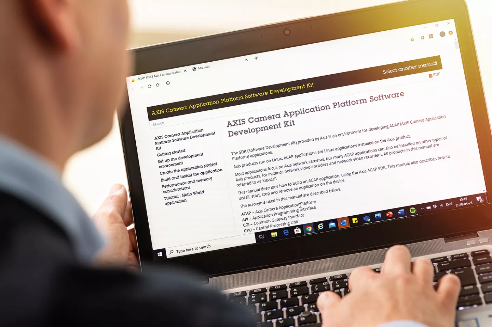
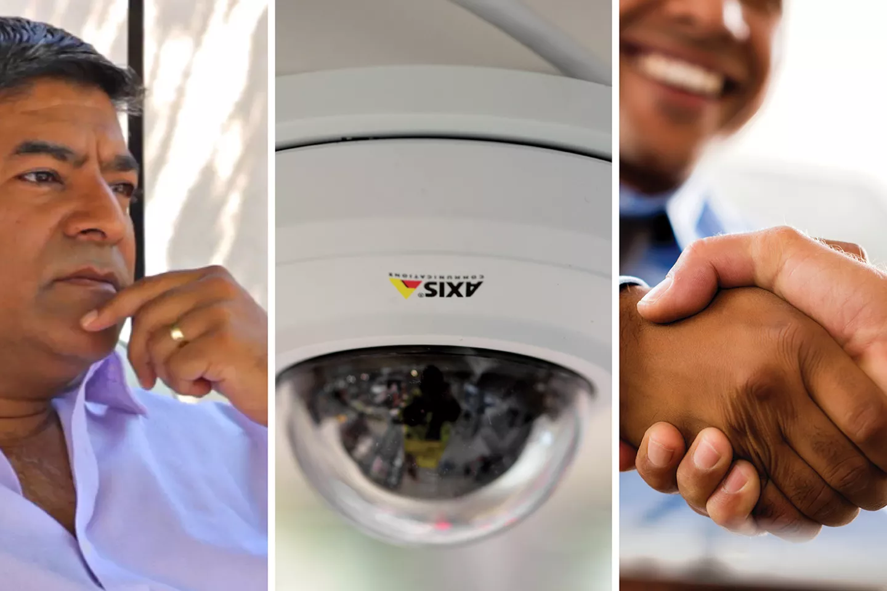

Create and install scalable, customizable applications on Axis devices with the AXIS Camera Application Platform (ACAP). Enhance surveillance functionality and capabilities in anything from cameras and speakers to access control.

### Take your innovation to the edge: Q&A with Lamin Faye, CEO & Co-Founder, Buddywise

Article

September 25, 2024 Read more

### AI-powered cameras: revolutionizing security and business performance

Article

May 8, 2024 Read more

### ACAP: A platform for innovation

Article

July 27, 2023 Read more

### Moving to the edge with ACAP: How SAFR brought its vision to life

Article

June 24, 2021 Read more

