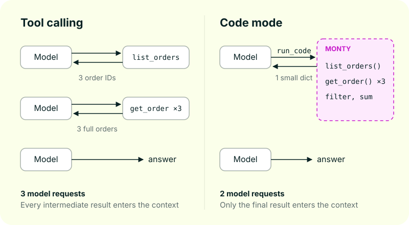
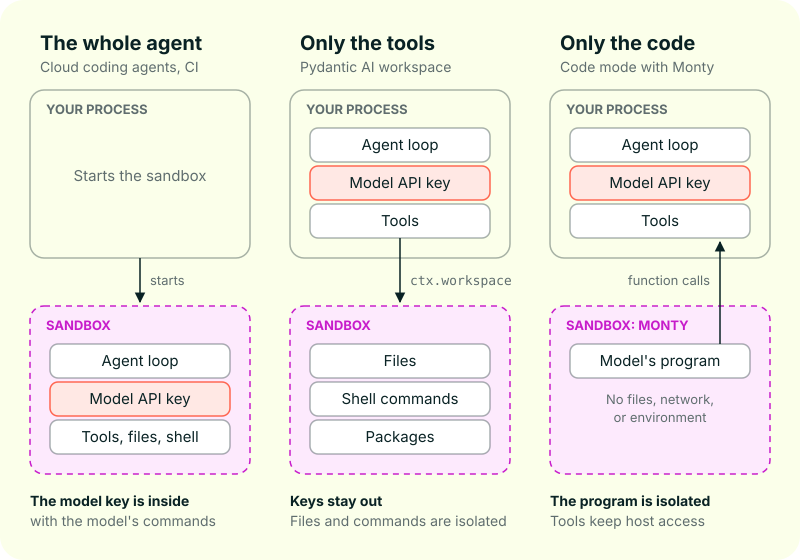
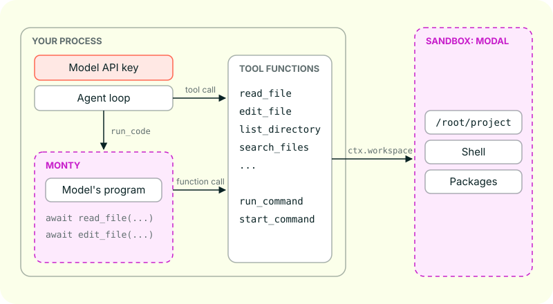

"Code mode" and "sandbox" come up in the same conversations, and they often get used as if they meant the same thing. They don't. Code mode is about how the model calls your tools. A sandbox is about where code runs and what it can touch.

You can have either one without the other, and you can combine them when the model's code and your tools need different boundaries. This post covers what each one does, the three places a sandbox boundary can go, and how workspaces in [Pydantic AI](https://pydantic.dev/docs/ai/overview/) let you move that boundary without rewriting your tools.

## What code mode is

With ordinary tool calling, the model picks one tool, fills in JSON arguments, and waits. You run the tool, send the result back, and the model decides what to do next. When one call depends on another, each step costs a model request, and every intermediate result lands in the context window.

With code mode, the model gets a single tool, `run_code`, and writes a short Python program that calls your tools as functions. Loops, filters, and `asyncio.gather` run as code instead of as more turns of conversation. [Cloudflare](https://blog.cloudflare.com/code-mode/) named the pattern, and [Anthropic](https://www.anthropic.com/engineering/code-execution-with-mcp) reached the same conclusion from the model side.

In Pydantic AI, code mode is the `CodeMode` capability from [Pydantic AI Harness](https://pydantic.dev/docs/ai/harness/):

```python
from typing import TypedDict

import logfire
from pydantic_ai import Agent
from pydantic_ai_harness import CodeMode

logfire.configure(service_name='code-mode')
logfire.instrument_pydantic_ai()

class Order(TypedDict):
    id: str
    total: float

ORDERS = {'cus_42': ['ord_1', 'ord_2', 'ord_3']}
TOTALS = {'ord_1': 120.0, 'ord_2': 35.5, 'ord_3': 210.0}

agent = Agent('anthropic:claude-sonnet-5-5', capabilities=[CodeMode()])

@agent.tool_plain
def list_orders(customer_id: str) -> list[str]:
    """List the order IDs for a customer."""
    return ORDERS.get(customer_id, [])

@agent.tool_plain
def get_order(order_id: str) -> Order:
    """Fetch one order."""
    return Order(id=order_id, total=TOTALS[order_id])

result = agent.run_sync('How many orders over $100 does cus_42 have, and what is their total?')
print(result.output)
```

Install it with `uv add "pydantic-ai-harness[codemode,anthropic,logfire]"`, and set your model provider API keys, in this case `ANTHROPIC_API_KEY`.

The model never sees `list_orders` and `get_order` as separate tools. It sees them as typed Python functions in the description of `run_code`:

```python
class Order(TypedDict):
    id: str
    total: float

async def list_orders(*, customer_id: str) -> list[str]:
    """List the order IDs for a customer."""
    ...

async def get_order(*, order_id: str) -> Order:
    """Fetch one order."""
    ...
```

And it writes one program:

```python
import asyncio

order_ids = await list_orders(customer_id='cus_42')
orders = await asyncio.gather(*[get_order(order_id=i) for i in order_ids])
big = [o for o in orders if o['total'] > 100]
{'count': len(big), 'total': sum(o['total'] for o in big)}
```



Without code mode, the model needs one request to list the orders, another to fetch them, and a third to answer, with every order in its context along the way. With code mode, it writes one program and reads back one small dict. The gap grows with every dependent step.

Here is that run traced in [Logfire](https://pydantic.dev/logfire). `list_orders` and the three `get_order` calls sit inside the single `run_code` span, between the two model requests:

<iframe src="https://logfire-eu.pydantic.dev/public-trace/b3ae185b-b724-403b-b2cb-12e76367b1ff?spanId=2773065b28658fe7&amp;embedded=true&amp;theme=light" height="400" title="Logfire trace of a code mode agent run: one run_code tool call containing list_orders and three get_order calls, between two model requests"></iframe>

Explore the spans above, or [open the full trace](https://logfire-eu.pydantic.dev/public-trace/b3ae185b-b724-403b-b2cb-12e76367b1ff?spanId=2773065b28658fe7).

The program is type-checked against those signatures before it runs. A model that compares a string with an int gets a type error back as a retry instead of producing a wrong answer.

Jiri wrote about [what this did for the Logfire MCP server](https://pydantic.dev/articles/your-agent-would-rather-write-code), where three tools replaced more than forty.

## What a sandbox is

A sandbox is an isolated environment: a container, a microVM, a cloud VM, or a restricted process on your own machine. Unlike Monty, it usually has a real filesystem, a shell, and CPython, so the model can run ordinary programs. What those programs can run and reach depends on the sandbox's image, network rules, and mounts.

|  | Code mode with Monty | Sandbox |
| --- | --- | --- |
| Solves | Too many model round trips | Running programs you don't trust |
| Runs | A subset of Python | Whatever its image and permissions allow, usually CPython, a shell, `git`, `pytest` |
| New session in | [0.8 ms from a warm pool](https://pydantic.dev/docs/monty/reference/alternatives/) | About 1.5 s for a new Daytona sandbox, in [one measurement](https://pydantic.dev/docs/monty/reference/alternatives/#latency) |
| Reaches the outside through | Functions you expose | Whatever its network and mounts allow |
| Your tools run | In your agent's process | Wherever you point them |

## Where the sandbox boundary goes

Once you need a sandbox, the next question is what goes inside it. There are three answers.



### The whole agent

The entire agent runs inside the sandbox: the agent loop, the model client, the tools, and the files it works on. Cloud coding agents work this way. [Claude Code on the web](https://code.claude.com/docs/en/claude-code-on-the-web) runs each session in an isolated VM, with the agent loop inside it. A coding agent in a dev container or a CI job is the self-hosted version.

It is the simplest setup, with one boundary around everything. The cost is that everything the agent needs has to live in there too. A model that can run shell commands can read any credential the agent holds, unless you build a proxy that adds credentials outside the VM, as Claude Code on the web does for git. Every conversation also needs a sandbox for its whole lifetime, and the agent's state lives and dies with it.

### Only the tools

The agent loop runs in your process, with your keys and your database. The tools that touch files and run commands act in a sandbox somewhere else. The model reaches the sandbox only through those tools, and credentials the sandbox doesn't need never go in.

This is the shape a Pydantic AI workspace gives you. Tools are the main users, but anything with a `RunContext` can reach the workspace, including hooks, and your own code can use `result.workspace` after the run.

### Only the code

The agent and its tools run in your process, and only the program the model writes is isolated. This is code mode, with Monty as the sandbox and the exposed functions as its only way out. To keep even the interpreter off your agent's machine, `CodeMode(monty_sandbox_url=...)` sends the program to a remote Monty worker such as [Monty's Commercial Support](https://pydantic.dev/docs/monty/commercial-support/server/), while your tools keep running locally.

The last two compose: an agent can run its code in Monty and its tools in a sandbox. That combination needs a way to point tools at an environment, which is what a workspace is.

## Workspaces in Pydantic AI

A [workspace](https://pydantic.dev/docs/ai/core-concepts/workspace/) is the environment an agent's tools work in: where commands run and where files are read and written. Tools reach it through `ctx.workspace`, and they don't know whether it is a directory on your laptop or a VM in the cloud.

```python
import logfire
from pydantic_ai import Agent, ModelRetry, RunContext
from pydantic_ai.capabilities import LocalWorkspace
from pydantic_ai.workspaces import WorkspaceError

logfire.configure(service_name='workspaces')
logfire.instrument_pydantic_ai()

agent = Agent('anthropic:claude-sonnet-5-5', capabilities=[LocalWorkspace('.')])

@agent.tool
async def execute(ctx: RunContext, command: list[str]) -> str:
    """Run a command in the project directory."""
    try:
        result = await ctx.workspace.run(command, timeout=60)
    except WorkspaceError as error:
        raise ModelRetry(str(error))
    return result.stdout if result.exit_code == 0 else f'[exit {result.exit_code}] {result.stderr}'

result = agent.run_sync('Write fizzbuzz to fizzbuzz.py and run it.')
print(result.output)
```

`LocalWorkspace` is not a sandbox. Commands run on your machine, as you, and the directory only sets where they start. They get `PATH`, `HOME`, and the locale variables and nothing else from your environment, so the model's commands don't inherit your API keys. Use it for your own, trusted work.

To isolate the agent, swap the workspace capability. `execute` keeps working unchanged, because it only talks to `ctx.workspace`.

You rarely need to write tools like `execute` yourself, though. The harness capabilities `Coder`, `FileSystem`, and `Shell` give the model file, search, and shell tools that work in whatever workspace the run has. This agent gets `Coder` in a [Modal](https://pydantic.dev/articles/harness-modal) sandbox:

```python
import logfire
from pydantic_ai import Agent
from pydantic_ai_harness import Coder, ModalSandbox

logfire.configure()
logfire.instrument_pydantic_ai()

agent = Agent('anthropic:claude-sonnet-5-5', capabilities=[ModalSandbox(), Coder()])
```

Install it with `uv add "pydantic-ai-harness[modal,anthropic,logfire]"`, and log in to Modal with `modal token new`. Every command and file edit now happens in the sandbox.

This trace is the `LocalWorkspace` agent from earlier writing and running fizzbuzz. Each `execute` call is one span, with a model request on either side:

<iframe src="https://logfire-eu.pydantic.dev/public-trace/e9ca4b63-b5cc-470b-b15e-0294d65fdf8f?spanId=bc77584d9dad4fe1&amp;embedded=true&amp;theme=light" height="400" title="Logfire trace of a Pydantic AI agent with a local workspace: two execute tool calls that write and run fizzbuzz.py, between three model requests"></iframe>

Explore the spans above, or [open the full trace](https://logfire-eu.pydantic.dev/public-trace/e9ca4b63-b5cc-470b-b15e-0294d65fdf8f?spanId=bc77584d9dad4fe1).

Pydantic AI and Pydantic AI Harness ship these workspaces:

| Workspace | Where commands run | Isolation |
| --- | --- | --- |
| `LocalWorkspace` | This machine, as you | None |
| `SSHWorkspace` | A remote host, through your `ssh` | None |
| [`BubblewrapSandbox`](https://pydantic.dev/docs/ai/harness/bubblewrap-sandbox/) | A local or SSH workspace, under `bwrap` | Read-only host, writable working directory, no network by default. Stops accidents, not a hostile agent |
| [`SmolSandbox`](https://pydantic.dev/docs/ai/harness/smol-sandbox/) | A microVM on this machine | A VM, without a cloud account |
| [`ModalSandbox`](https://pydantic.dev/docs/ai/harness/modal-sandbox/), [`E2BSandbox`](https://pydantic.dev/docs/ai/harness/e2b-sandbox/), [`SpritesSandbox`](https://pydantic.dev/docs/ai/harness/sprites-sandbox/) | A cloud sandbox | A separate machine |

A workspace outlives a single run. Once a run has used a sandbox, passing its message history to the next run continues in the same sandbox, with the same files and installed packages:

```python
first = agent.run_sync('Clone https://github.com/pydantic/pydantic-ai and run its tests.')
second = agent.run_sync('Fix the first failing test.', message_history=first.all_messages())
```

> [!warn] Warn
> Pydantic AI never deletes a sandbox. It keeps running, and billing, until you destroy it or the provider's lifetime limit stops it. The [workspace docs](https://pydantic.dev/docs/ai/core-concepts/workspace/#cleaning-up) show where to clean up.

## Code mode and a workspace together

Code mode and workspaces solve different problems, so they combine. Here the model's Python runs in Monty next to the agent, and the file tools it calls from that Python act in a Modal sandbox:

```python
import logfire
from pydantic_ai import Agent
from pydantic_ai_harness import CodeMode, FileSystem, ModalSandbox, Shell

logfire.configure()
logfire.instrument_pydantic_ai()

agent = Agent(
    'anthropic:claude-sonnet-5-5',
    capabilities=[ModalSandbox(working_dir='/root/project'), FileSystem(), Shell(), CodeMode()],
)

result = agent.run_sync('Find every TODO in the project and summarize them by file.')
print(result.output)
```

Install it with `uv add "pydantic-ai-harness[codemode,modal,anthropic,logfire]"`, and log in to Modal with `modal token new`.

The model sees three tools: `run_code`, `run_command`, and `start_command`. `read_file`, `edit_file`, `list_directory`, and the other file tools become functions inside `run_code`, so one program can read twenty files, filter them, and edit the three that matter. Shell commands stay outside as ordinary tool calls, so the model never has to quote a shell command inside a Python string.



Each layer has one job:

- The agent loop and your model key stay in your process.
- The program the model writes runs in Monty, which can reach only the functions you exposed.
- The file and shell tools act in the Modal sandbox, so edits and commands never touch your machine.

> [!note] Note
> `CodeMode(mount=...)` shares directories from the machine running the agent, not from the workspace. With a remote sandbox, use the file tools for files the model shares with its commands.

## Which one you need

| You want | Use |
| --- | --- |
| Fewer model round trips when a task chains several tool calls | `CodeMode()` |
| The model to run tests, install packages, or use `git` on your own repo | `LocalWorkspace` with `Coder()` |
| The same, for a repo or prompt you don't trust | A sandbox workspace with `Coder()` |
| A managed cloud sandbox | `E2BSandbox()`, `ModalSandbox()`, or `SpritesSandbox()` |
| Isolation without a cloud account | `SmolSandbox()` |
| Both orchestration and isolation | `CodeMode()` plus a sandbox workspace |

## Monty

Code mode is cheap enough to leave on because of [Monty](https://github.com/pydantic/monty). It is an MIT-licensed Python interpreter written in Rust, built for code written by models. You can use it without Pydantic AI, from Python, JavaScript, or Rust:

```python
import logfire
from pydantic_monty import Monty

logfire.configure(service_name='monty')
logfire.instrument_monty()

code = """
kcal = nutrition('chocolate bar')['kcal']
hours = kcal * 4184 / (bulb_watts * 3600)
print(f'a chocolate bar powers a {bulb_watts} W bulb for {hours:.1f} hours')
"""

with Monty() as pool:
    with pool.checkout() as session:
        session.feed_run(
            code,
            inputs={'bulb_watts': 10},
            external_lookup={'nutrition': lambda food: {'kcal': 230}},
        )
        #> a chocolate bar powers a 10 W bulb for 26.7 hours
```

`Monty()` starts a `monty` worker process, and `code` runs inside it. `inputs` puts a variable called `bulb_watts` in the sandbox, with the value 10. external\_lookup lets code call nutrition, but the function stays in your own Python process. When `code` calls `nutrition('chocolate bar')`, the worker waits, your process runs the function, and `{'kcal': 230}` goes back to `code`. `code` can call the function and read what it returns, but the function itself never runs inside Monty.

Install it with `uv add pydantic-monty logfire`.

### Why use Monty

- **Your secrets stay in your process.** `nutrition` could query a database with your credentials, and the code the model wrote would still see only `{'kcal': 230}`.
- **It can pause and pick up later.** While the worker waits for `nutrition`, Monty can [save the whole run to bytes](https://pydantic.dev/docs/monty/concepts/snapshots/). You can resume it later, in another process or on another machine.
- **It is small.** Monty is built for the short scripts agents write. It runs as a process next to your agent, with no container and no cloud account.

Use `CodeMode()` when a task chains several tool calls and you want fewer model round trips. When the model has to run tests, install packages, or use `git`, give it `Coder()`: with `LocalWorkspace` on your own repo, or with a sandbox workspace for a repo or prompt you don't trust. That sandbox can be a managed cloud one, `E2BSandbox()`, `ModalSandbox()`, or `SpritesSandbox()`, or `SmolSandbox()` if you have no cloud account. For both fewer round trips and isolation, use `CodeMode()` with a sandbox workspace.

- [Monty on GitHub](https://github.com/pydantic/monty)
- [Monty documentation](https://pydantic.dev/docs/monty/), including the [security model](https://pydantic.dev/docs/monty/concepts/security/) and a [comparison with the alternatives](https://pydantic.dev/docs/monty/reference/alternatives/)
- [Pydantic Monty: you probably don't need a full sandbox](https://pydantic.dev/articles/pydantic-monty), Samuel's post on why Monty exists
- [Code mode](https://pydantic.dev/docs/ai/harness/code-mode/) and [workspaces](https://pydantic.dev/docs/ai/core-concepts/workspace/) in the Pydantic AI docs
