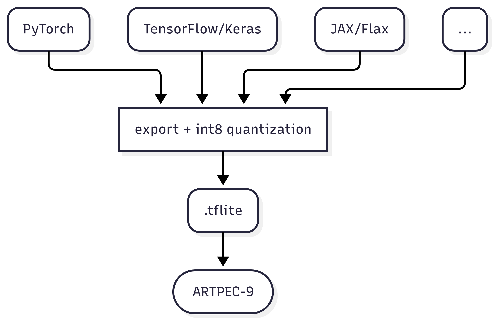

## How to accelerate your model on ARTPEC-9

0. Before you begin, read the [Optimization Tips](https://developer.axis.com/computer-vision/on-device/system-on-chip/artpec-9/optimization-tips/) for information that is useful for the following steps.
1. Train your model using the framework of your choice. Common options are PyTorch or TensorFlow.
2. Quantize (int8/uint8) and export your trained model to the.tflite format. How you do this depends on the framework you use. We provide guides for PyTorch and TensorFlow:  
	[PyTorch-to-tflite](https://developer.axis.com/computer-vision/on-device/how-to-guides/pytorch-to-tflite/)  
	[TensorFlow-to-tflite](https://developer.axis.com/computer-vision/on-device/how-to-guides/tensorflow-to-tflite/)
3. Run the quantized.tflite model on your device. Example test run:
	```bash
	larod-client -g <my-model>.tflite -c a9-dlpu-tflite -i ""
	```
	More info [here](https://developer.axis.com/computer-vision/on-device/test-your-model/)


