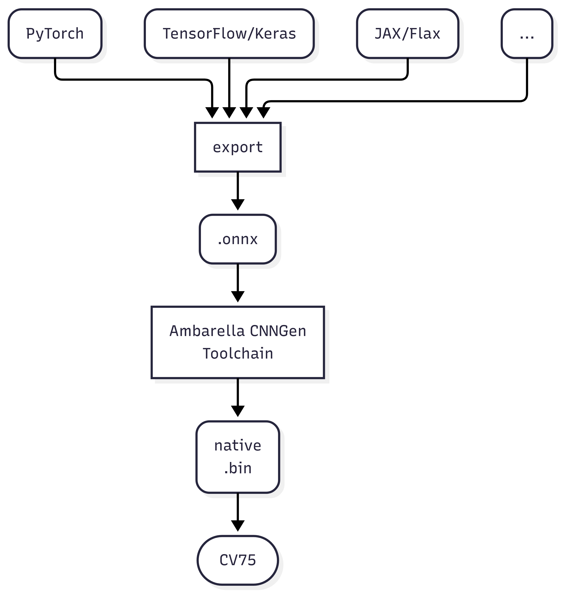

## How to accelerate your model on CV75

1. Train your model using the framework of your choice. Common options are PyTorch or TensorFlow.
2. Export your model to.onnx. How you export depends on the framework you use. We provide guides for PyTorch and TensorFlow:  
	[PyTorch-to-onnx](https://developer.axis.com/computer-vision/on-device/how-to-guides/pytorch-to-onnx/)  
	[TensorFlow-to-onnx](https://developer.axis.com/computer-vision/on-device/how-to-guides/tensorflow-to-onnx/)
3. The Ambarella CNNGen Toolchain is not publicly available, so you need to contact [Ambarella](https://www.ambarella.com/) directly to gain access to it. Once you receive the toolchain, please refer to Ambarella's documentation and examples for how to compile the model for CV75, and/or see Axis guides for how to use the toolchain here: [onnx-to-cv75](https://developer.axis.com/computer-vision/on-device/how-to-guides/onnx-to-cv75/)
4. Run the compiled.bin model on your device. Example test run:
	```bash
	larod-client -g <my-model>.bin -c cv75-dlpu-native -i ""
	```
	More info [here](https://developer.axis.com/computer-vision/on-device/test-your-model/)


