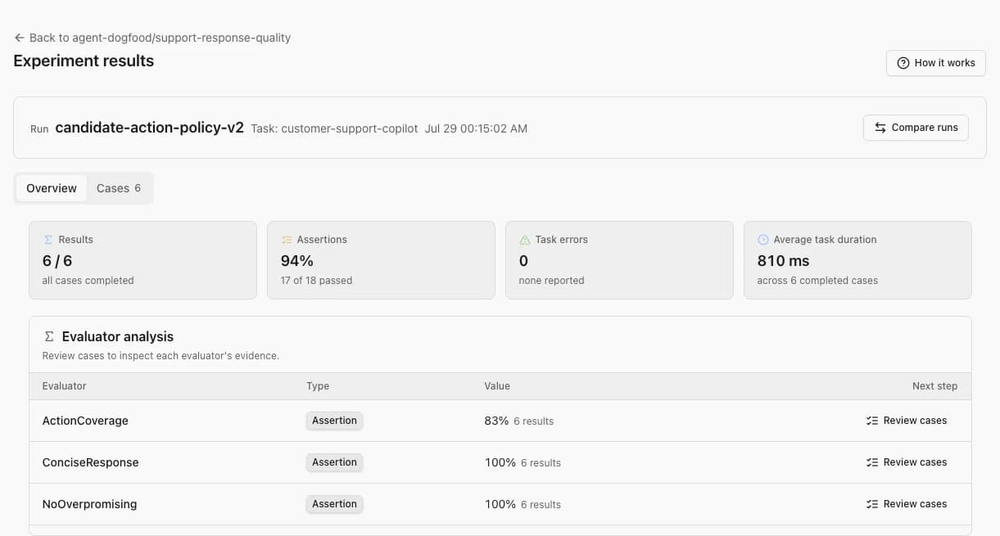
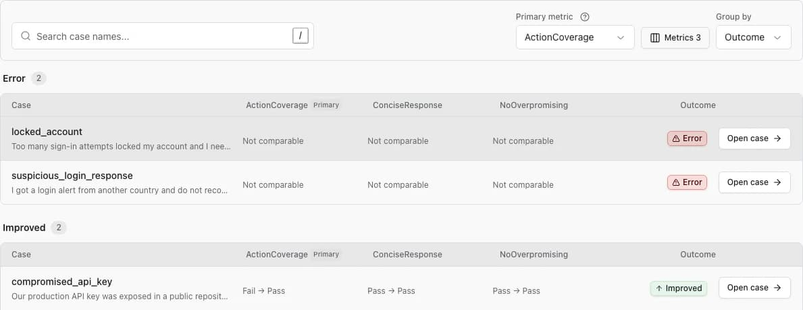
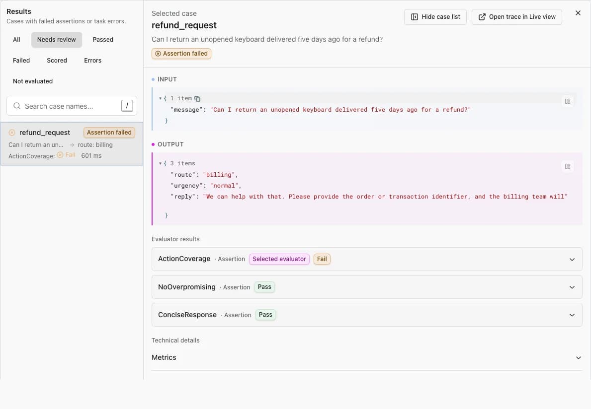

> [!note] Note
> This is day two of a five-post series. Start with [Score freely](https://pydantic.dev/articles/braintrust-week).

Braintrust Pro starts at $249 a month. The total depends on how many scores you record, how much data you process, and how long you keep it. After the included allowance, each score an evaluator records adds to the bill.

## Three meters

[Braintrust's published Pro pricing](https://www.braintrust.dev/pricing) has three usage charges:

- **Scores:** $1.50 per thousand after the first fifty thousand.
- **Processed data:** $3 per gigabyte after the first five.
- **Retention:** $0.50 per gigabyte per month after the included thirty days.

These are all normal parts of evaluation work. More cases and evaluators create more scores. Complete prompts, retrieval context, and outputs increase processed data. Longer experiment histories use more retention. Reducing any of those lowers the bill, but also leaves you with less evidence.

## No score meter

[Logfire](https://pydantic.dev/logfire) does not charge separately for scores. Evaluation results are OpenTelemetry events attached to their originating traces. They use the [same record pricing](https://pydantic.dev/pricing) as other telemetry: $2 per million after the first ten million records each month.

Deterministic checks can run on every case without an extra evaluation fee. You can sample LLM judges when their model cost or latency warrants it.

## Online: score every production trace

Offline suites run on a schedule. Online evaluators can run on every production trace, so their score count rises with traffic. [Braintrust counts every recorded online or offline score toward monthly usage](https://www.braintrust.dev/docs/admin/billing/faq#what-are-scores).

Once the monthly allowances are exhausted, the marginal platform costs for the next one million production spans totaling 1 GB, each scored once and retained for ninety days, are:

| Marginal usage | Braintrust Pro | Logfire Growth |
| --- | --- | --- |
| 1M source spans, 90-day retention | About $4 | $2 |
| 1M score results | $1,500 | $2 |
| **Combined** | **About $1,504** | **$4** |

*Both plans start at $249 a month. Braintrust Pro includes 5 GB of processed data, 50,000 scores, and thirty days of retention. Logfire Growth includes ten million records and up to ninety days of retention. Model execution is separate for both.*

Most of the difference is not storage. It is the separate Braintrust charge for recording each score.

## Offline: repeat the full benchmark

[OpenAI's public `simple-evals` MATH runner](https://github.com/openai/simple-evals/blob/652c89d0ca9df547706735883097e9537d40dc47/simple_evals.py#L356-L364) loads the 5,000-case MATH test set, repeats every case ten times, and [produces one result score per attempt](https://github.com/openai/simple-evals/blob/652c89d0ca9df547706735883097e9537d40dc47/math_eval.py#L27-L67). That is 50,000 score records per run.

| Agent portfolio | Modeled monthly workflow | Scores / month | Braintrust score charge / month | Braintrust score charge / year | Separate Logfire score fee |
| --- | --- | --- | --- | --- | --- |
| 1 agent | One MATH-sized suite x 30 nights | 1.5M | $2,175 | $26,100 | $0 |
| 10 agents | Ten MATH-sized suites x 30 nights | 15M | $22,425 | $269,100 | $0 |
| 50 agents | Fifty MATH-sized suites x 30 nights | 75M | $112,425 | $1,349,100 | $0 |

*The table models one complete MATH run per agent per night. Braintrust score charges apply the included 50,000 monthly scores, then $1.50 per thousand. Logfire stores score results as ordinary records and does not add a score-specific fee.*

One complete MATH run uses Braintrust Pro's entire monthly score allowance. On the nightly schedule above, every later run adds score overage.

## From scores to evidence

Averages tell you that something changed. To fix it, you need the cases behind the number. The Logfire Evals workspace takes you from an experiment summary to the affected cases and then to the traces that produced them.

### Start with the run

Open **AI Evaluations**, select **Experiments**, then choose **Review results** on a run. The overview shows case completion, assertion pass rate, task errors, average duration, and each evaluator's aggregate result.

Use those aggregates to choose what to inspect first. A high average can still hide one important failure.

### Compare one change

Select **Compare runs** and choose the earlier or trusted run as the baseline. On **Cases**, choose the evaluator that should be the **Primary metric**, set whether a higher or lower score is better when needed, and keep **Group by: Outcome** to put errors and regressions ahead of unchanged cases. Add supporting metrics when one score cannot explain the whole result.

### Follow a result to its trace

Open a case and read the input, output, and evaluator results together. If the output does not explain the failure, select **Open trace in Live View** to inspect the prompt, model calls, tool calls, and exceptions that produced it.

Change one variable, run the same dataset again, and compare the new result with the previous run. [Read the datasets and experiments guide](https://pydantic.dev/docs/logfire/evaluate/datasets-and-experiments/) for dataset creation, case review, and troubleshooting.

## Focus on the eval

After the included allowances, one million score results add $1,500 on Braintrust. Logfire stores those results as ordinary records at $2 per million. That leaves Tuesday for adding rigor to your evals, not squeezing Braintrust's score bill into your AI budget.

[Run your own numbers](https://pydantic.dev/pricing), or send your evals to Logfire and open the source trace for any result that needs investigation.
