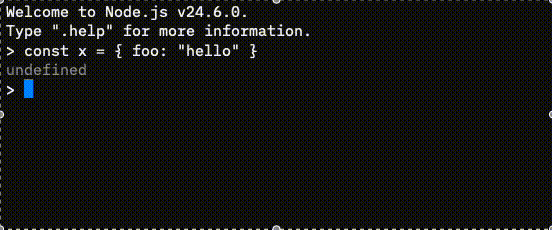
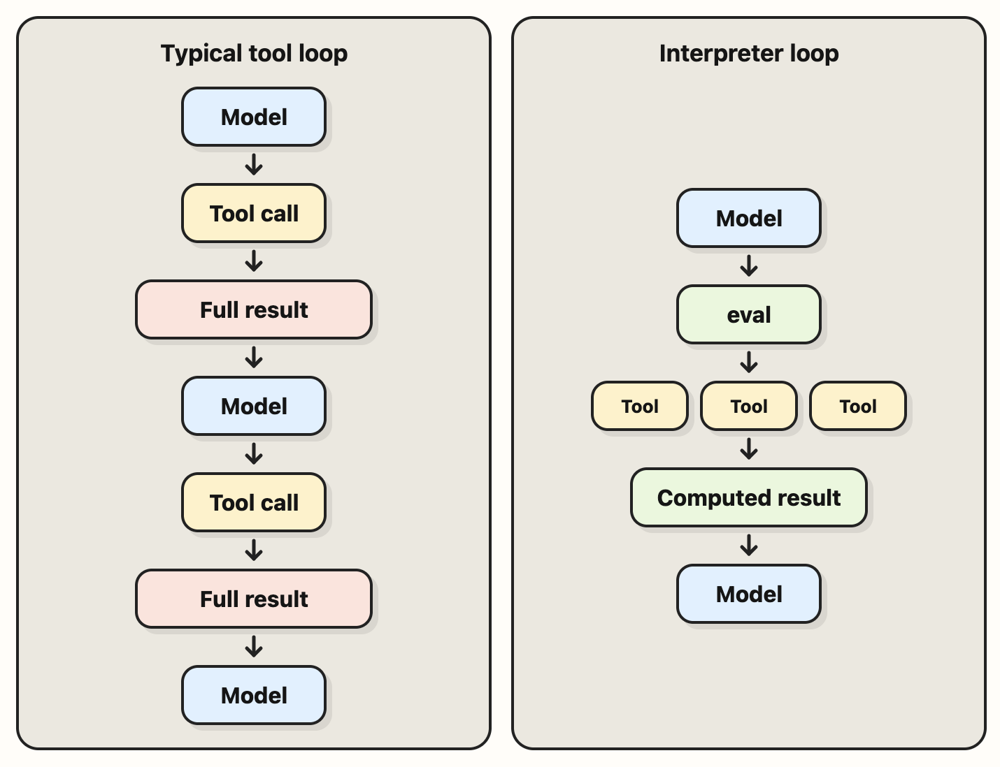
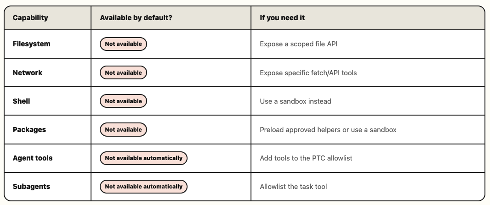
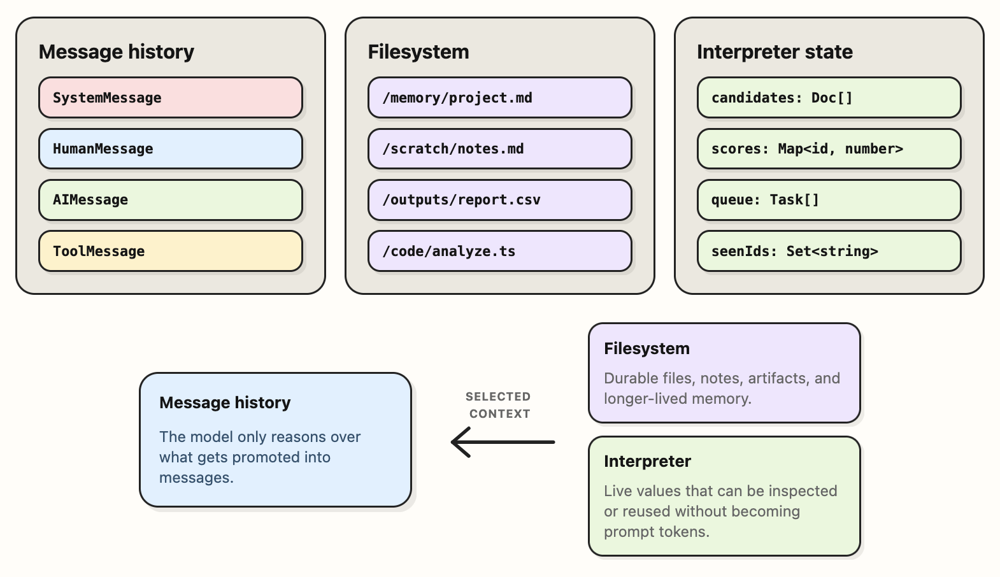
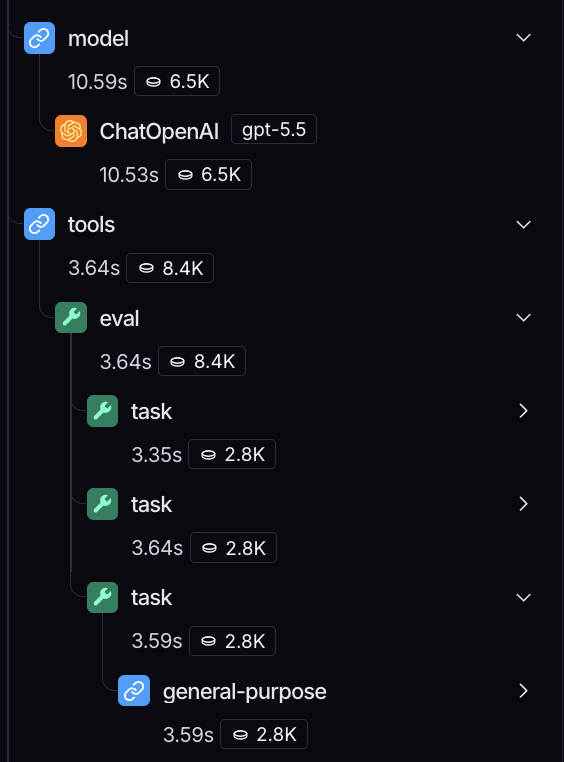
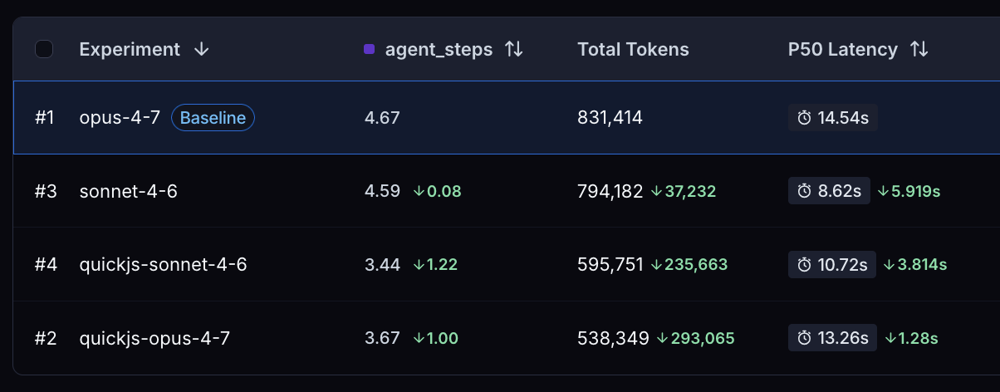
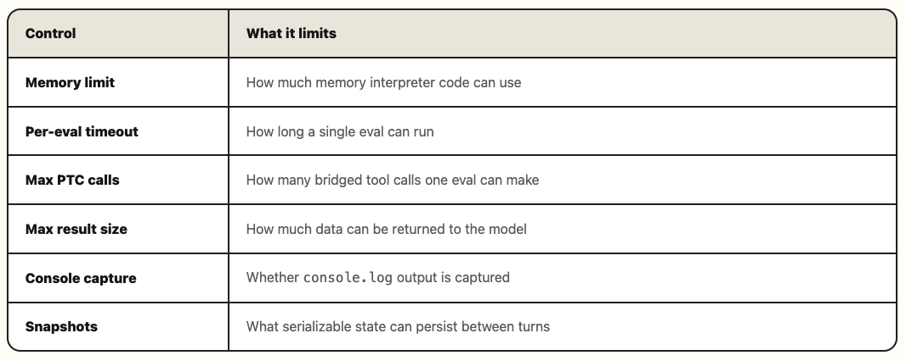

**TL;DR** We’re adding interpreters to Deep Agents: small embedded runtimes where agents can write and execute code inside the agent loop. They give agents a middle ground between one-at-a-time tool calls and full sandboxes, so agents can express multi-step work, keep intermediate state out of model context, and execute code and actions in a more predictable way.

## What’s an interpreter?

An interpreter is a small embedded runtime that an agent can write code against while it is working. Functionally, it feels like giving the agent a Python or Node REPL: it can define variables, inspect values, write helper functions, and reuse state across calls.



Many agents today already execute code by issuing commands to a host or sandbox environment. This is great when the task is environment-level work: running commands, installing dependencies, or operating over a filesystem. Interpreters are aimed at a different layer: the agent writes code that runs inside the agent loop to coordinate delegation, compose tool calls, transform structured data, and decide what information should come back to the model.

```typescript
// agent writes code like this
const rows = [
  { team: "support", tickets: 18 },
  { team: "infra", tickets: 7 },
  { team: "sales", tickets: 11 },
];

const total = rows.reduce((sum, row) => sum + row.tickets, 0);
const busiest = rows.sort((a, b) => b.tickets - a.tickets)[0];

`${busiest.team} has the most tickets. ${total} tickets total.`;
```

This gives agents a new place to express behavior that doesn't fit cleanly into a sequence of tool calls. The agent gets a working space for multi-step logic, while the harness still controls what that working space can touch. The interpreter can hold temporary state and return only the part that matters.

## Where interpreters fit

When you think of an agent, you usually think of attaching tools.

In the simplest form of an agent, the agent uses those tools in a loop: the model calls one tool, inspects the observation, then decides what to do next. That one-step-at-a-time style is straightforward to debug and evaluate, and a lot of workflows do require a way to reason over immediate observations.

Sandboxes build on top of that by giving the agent a bash tool that works against an environment to run commands, install dependencies, and work with files.

But both ends have downsides: sandboxes *can* handle local procedure (since it can just write code to do so), but they can be harder to provision and scale; and purely serial tool loops can be awkward when those intermediate steps mostly feed the next step.

Some agent work sits between those two extremes, which interpreters slot nicely into. They give the agent code-level composition over scoped capabilities without giving it a whole environment. The model can write a small program to express control flow over existing capabilities, while the harness decides which capabilities are available through the host.



## More limited by design

We call this an interpreter, not just a code runtime, because the interpreter is intentionally limited. By default it does not have the APIs you would expect from a normal programming environment: no filesystem, no network, no shell, no package installation, and no wall-time access. The agent starts with basic control flow and object manipulation: objects, arrays, maps, JSON, and the rest of the small language runtime.

Those capabilities are exposed through explicit bridges to the host runtime. If the agent needs to call a tool, read from a scoped filesystem API, fetch a URL, or delegate to a subagent, the harness has to expose that capability deliberately. For instance, this script only works when we explicitly bridge the `fetch`, `read_file` and `task` tools directly to the interpreter:

```typescript
// calls the `fetch` tool to make a network request
const response = tools.fetch("https://docs.langchain.com");
// calls the `readFile` tool to fetch files from the agents filesystem
const file = tools.readFile("SPEC.md");
// calls the `task` tool to spawn a subagent
const subagentOutput = tools.task({
  description: "Do you know the muffin man?"
});
```

The host runtime (the same one that runs the harness) contains all the actions an agent can take using the interpreter, and explicitly decides which ones the interpreter code can call. The interpreter is the agent’s programmable side of that boundary.

By default, the interpreter starts with language features only, not generic host access like a sandbox gives you. Anything that touches the outside world has to cross an explicit bridge that you specify.



We do this for a few reasons:

- **Smaller action surface:** With bash or a sandbox, the starting point is broad: the agent has something shaped like a computer, and you restrict what it can do from there. With an interpreter, the starting point is narrow: the agent has a language runtime, and capabilities are added back deliberately. That does not replace sandboxing when your threat model requires process or VM isolation, but it does mean the agent is not inheriting broad host access by default.
- **Predictability:** A small, fixed runtime makes agent behavior easier to anticipate and evaluate. If the interpreter had broad host access or a rich library surface, the same goal could be achieved through many different strategies, which makes outputs less consistent and harder to test. By keeping the default environment minimal and forcing extra capabilities to cross explicit bridges, you make the agent’s action space narrower, the failure modes clearer, and the results more repeatable.

You see the same architectural shape in systems from Figma, Shopify, AWS, and others: constrained code runs on one side, while the host exposes a controlled API boundary on the other.

## What interpreters unlock

A few recent systems have converged on similar patterns: give the model a small, scoped runtime where it can write a bit of code to manage control flow and intermediate state. Cloudflare’s [Code Mode](https://blog.cloudflare.com/code-mode/), Anthropic’s [Programmatic Tool Calling (PTC)](https://platform.claude.com/docs/en/agents-and-tools/tool-use/programmatic-tool-calling), and [RLM](https://hang13.github.io/blog/2025/rlm/) -style workflows each point at that idea from different angles. In Deep Agents, an interpreter is how you get that pattern in a model-agnostic way. Here are a few places it’s already been useful:

### Interpreter state as a context surface

Agent harnesses already organize context across a few surfaces:

- Message history is the context immediately available to the model.
	- It is expensive and attention-constrained: just because a model can accept a million tokens does not mean it will reason over every token equally well. (e.g. [context rot](https://www.trychroma.com/research/context-rot))
- A filesystem gives the agent somewhere to store durable artifacts, notes, intermediate files, and longer-lived working memory.
	- It is durable and flexible, but it forces the agent to serialize working state into files and then reconstruct it later.
		- Part of the job of the harness is to control the flow of context between the filesystem and the message history.

Interpreter state gives the agent another option. Values can stay in the runtime as arrays, objects, maps, counters, queues, and helper functions. The model does not need to see every intermediate value as prompt text, but it can still ask the interpreter to inspect or reuse those values later.



This is similar to why a REPL feels different from running a one-off command. If you define a variable in a REPL, it is still there on the next command you submit. You do not have to turn it into stdout, write it to a file, or reconstruct it before doing the next thing. The same principle applies when an agent calls the interpreter multiple times, since it can just reuse the value from a previous call.

That makes interpreters useful for agent-loop state. Message history is for what the model needs to reason over now, the filesystem is for durable artifacts and environment-level work, and interpreter state is for live working values that may be useful later but do not need to become model input yet.

### Programmatic tool calling

Anthropic’s [Programmatic Tool Calling (PTC)](https://platform.claude.com/docs/en/agents-and-tools/tool-use/programmatic-tool-calling) is another version of this pattern: tool calls happen from inside code the agent writes, rather than as a sequence of model-mediated actions.

If the model calls a tool, receives the full result, reasons over it, and calls the next tool, every small step becomes another model round trip. If the agent can write code that calls tools directly, it can keep intermediate outputs in the runtime and return only the final result or selected evidence.

In Deep Agents, PTC is implemented as middleware rather than as a model-provider behavior. The developer passes an allowlist, allowlisted tools appear under the global `tools` namespace, and each tool is exposed as an async function the interpreter can call with `await`. This means that you can enable PTC for *any* model (including open source ones).

```typescript
const topics = ["retrieval", "memory", "evaluation"];

const reports = await Promise.all(
  topics.map((topic) =>
    tools.task({
      description: `Research ${topic} in Deep Agents and return three concise findings.`,
      subagent_type: "general-purpose",
    }),
  ),
);

reports.join("\\n\\n");
```


In some of our early testing, this style of tool calling used up to 35% fewer tokens on some tasks. (we evaluated this on a collected set of tasks from the [OOLONG](https://huggingface.co/datasets/oolongbench/oolong-synth/viewer/default/validation) `trec-coarse` dataset)



### Working over large datasets

Take a document-heavy task: an agent needs to classify, extract, or synthesize information from 10,000 documents.

With a standard tool-calling agent, the natural shape is a long sequence of model-mediated actions. The model searches, gets results back in context, decides what to inspect next, calls another tool, gets more results back, and repeats. For small tasks, that loop is sufficient. But at scale it starts to break down:

- It is hard to verify that the agent actually followed the intended procedure.
- Too much intermediate context gets routed back through the model.
- It is easy to run into latency, context, or tool-call limits.
- The response can degrade because the model is forced to manage too much working state through history.

An interpreter-shaped version looks different. The model can write code that keeps document and search state in the runtime, iterates through batches programmatically, scores or filters candidates, and calls subagents only on selected slices. Instead of returning every intermediate result to the model, the interpreter returns a compact evidence set: the documents that matched, the fields that were extracted, the unresolved cases, or the few summaries worth reasoning over.

The interpreter is not magically reasoning over all 10,000 documents. It gives the agent a better way to control the search space and decide what should enter model context.

```typescript
const candidates = documents
  .map((doc) => ({ doc, score: scoreDocument(doc, query) }))
  .filter(({ score }) => score > 0.75)
  .sort((a, b) => b.score - a.score)
  .slice(0, 10);

const reports = await Promise.all(
  candidates.map(({ doc }) =>
    tools.task({
      description: `Extract evidence from ${doc.id} for: ${query}`,
      subagent_type: "general-purpose",
    }),
  ),
);

reports.join("\n\n");
```

### Recursive orchestration

Another related idea is [Recursive Language Models (RLMs)](https://alexzhang13.github.io/blog/2025/rlm/). RLMs treat long prompts as part of an external REPL environment, then let the model write code to inspect, decompose, and recursively call models over selected snippets.

Deep Agents interpreters are not implementing RLMs at the model layer, but there is still a relevant connection at the harness level: code can hold working state outside the model context, select a slice of that state, and pass only that slice into the next model or subagent call.

In Deep Agents, `tools.task` is the bridge for this. Interpreter code can select a slice of work, delegate that slice to a subagent, combine the result with existing runtime state, and return only the synthesized output to the main model.

## How it works in Deep Agents

At the harness level, the interpreter is middleware between the agent loop and a small runtime. The middleware:

- adds an `eval` tool to the agent
- creates and maintains a QuickJS context
- executes the agent’s TypeScript code
- captures `console.log` output when configured
- returns the final expression back into model context

The `eval` tool is not “run arbitrary code on the host.” The code runs inside the interpreter context. If it needs to communicate with the outside world, it does so through bridges the host runtime exposes.

Programmatic tool calling is one of those host bridges. The developer passes a `ptc` allowlist, allowlisted tools appear inside the interpreter under the `tools` namespace (e.g. `tools.getWeather(...)`), and each tool is exposed as an async function the interpreter can call with `await`. The host runtime still executes the real tool call.

The rough flow looks like this:

1. the model writes code and calls `eval`
2. QuickJS evaluates the code inside the interpreter context
3. interpreter code optionally calls allowlisted tools
4. the host runtime executes the real tool calls
5. results cross back into the interpreter
6. the final expression crosses back into model context

Repeated eval calls in a run can share the same live interpreter context, which is what lets values behave like REPL state. Snapshotting between conversation turns is also available, but it should be treated as a way to preserve serializable working data rather than live handles or host resources.

Runtime controls live at this boundary too:

- memory limits
- per-eval timeouts
- maximum programmatic tool calls
- maximum result size
- console capture
- snapshotting between turns


## How to use it in Deep Agents

You can install the interpreter and add the middleware using `create_deep_agent`:

```bash
uv add "deepagents[quickjs]"
```
```python
from deepagents import create_deep_agent
from langchain_quickjs import CodeInterpreterMiddleware

agent = create_deep_agent(
    model="openai:gpt-5.5",
    middleware=[CodeInterpreterMiddleware()],
)
```

(and in TypeScript)

```bash
pnpm install deepagents @langchain/quickjs
```
```typescript
import { createDeepAgent } from "deepagents";
import { createCodeInterpreterMiddleware } from "@langchain/quickjs";

const agent = createDeepAgent({
  model: "openai:gpt-5.5",
  middleware: [createCodeInterpreterMiddleware()],
});
```

`‍   `

To let interpreter code call agent tools, enable programmatic tool calling with an allowlist. Tools are not automatically exposed to interpreter code; you must choose which tools can cross the host-runtime bridge.

```python
agent = create_deep_agent(
    model="openai:gpt-5.5",
    middleware=[CodeInterpreterMiddleware(ptc=["task"])],
)
```
```typescript
const agent = createDeepAgent({
  model: "openai:gpt-5.5",
  middleware: [createCodeInterpreterMiddleware({ ptc: ["task"] })],
});
```

`‍   `

Once PTC is enabled, allowlisted tools appear under the global `tools` namespace. Each tool is an async function, and the model receives the final interpreter output rather than every intermediate tool result.

Deep Agents is available in [Python](https://github.com/langchain-ai/deepagents) and [TypeScript](https://github.com/langchain-ai/deepagentsjs). See the docs for more information on [interpreters](https://docs.langchain.com/oss/python/deepagents/interpreters), as well as the full set of middleware options and runtime controls.
