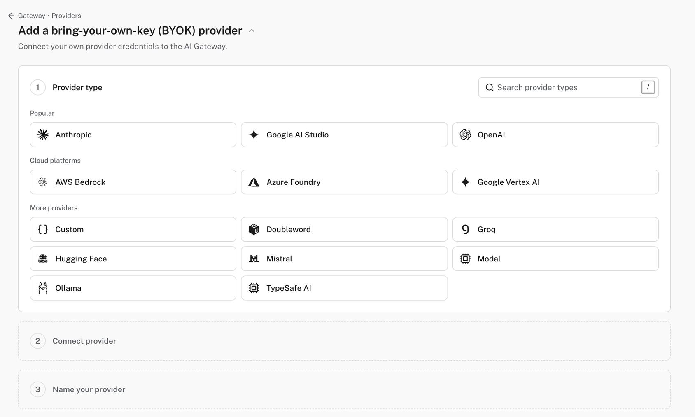
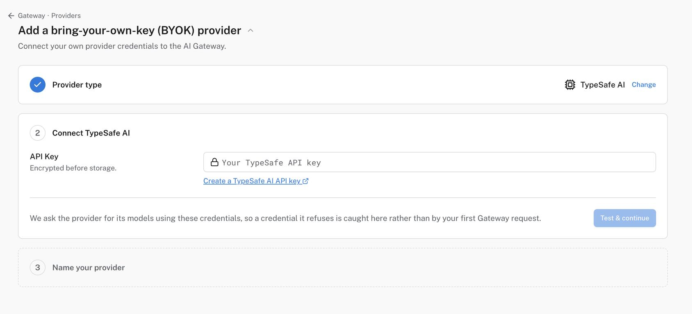

You can now call [Jev](https://typesafe.ai/), TypeSafe's classification model, through **Pydantic AI Gateway**. Your application keeps one gateway key, and Jev requests show up next to your language models in the same spend view, limits, and guardrails.

Jev isn't a chat model. It takes a piece of text and a set of typed questions, and returns an answer and a probability for each. [David Montague](https://github.com/dmontagu) already showed [how to use it as a judge in Pydantic Evals](https://pydantic.dev/articles/jev-evals), at $0.042 per million input tokens.

## Set it up

TypeSafe is a bring-your-own-key provider. In Pydantic [Logfire](https://pydantic.dev/logfire), go to **Gateway**, then **Providers**, and add a provider. Pick **TypeSafe AI**:



Paste your TypeSafe API key and click **Test & continue**. The Gateway asks TypeSafe for its models with that key, so a bad key fails here and not on your first request:



Name the provider and you're done. The **Connect** dialog defaults to `jev-latest` and gives you a snippet with your gateway key filled in.

Jev speaks TypeSafe's System One API, not the OpenAI chat format, so the Gateway forwards it natively. Here's the request with `curl`:

```bash
curl https://gateway-us.pydantic.dev/proxy/typesafe/v1/systemone \
  -H "Authorization: Bearer $PYDANTIC_AI_GATEWAY_API_KEY" \
  -H "Content-Type: application/json" \
  -d '{
    "model": "jev-latest",
    "state": "Help! My payouts have been failing for 3 days.",
    "questions": {
      "is_urgent": {
        "type": "noul",
        "instructions": "Does this convey urgency?"
      }
    }
  }'
```

`typesafe` in the URL is the route name you gave the provider. `state` is the material being judged, and each entry in `questions` is one question about it.

The TypeSafe Python SDK works too. Install it:

```bash
uv add typesafe-sdk
```

Then point `base_url` at the Gateway:

```python
from typesafe_sdk import Noul, TypeSafeClient

with TypeSafeClient(
    api_key='<your gateway key>',
    base_url='https://gateway-us.pydantic.dev/proxy/typesafe',
    model='jev-latest',
) as client:
    response = client.system_one(
        state='Help! My payouts have been failing for 3 days.',
        questions={'is_urgent': Noul(instructions='Does this convey urgency?')},
    )

print(response.answers['is_urgent'].noul)
```

## What you get from the Gateway

The Gateway doesn't change what Jev costs or how fast it answers. It adds what you already get for every other provider:

- **Cost and usage.** Every request is metered, so Jev shows up in the same spend view and limits as your language models.
- **Guardrails.** Input guardrails run on the `state`, the instructions, and the criteria before the request goes upstream.
- **One key.** Your application holds a gateway key, not a TypeSafe key.

> [!note] Note
> Streaming requests are refused before they're forwarded, because System One answers in one response. Jev isn't in the chat playground either, since there's nothing to chat with.

## Using it from Pydantic AI

Pydantic AI can run an agent on Jev with [`TypeSafeModel`](https://pydantic.dev/docs/ai/models/typesafe/): each field of the output type becomes a question. Install it with the `typesafe` extra:

```bash
uv add "pydantic-ai-slim[typesafe]"
```

To send it through the Gateway, give the provider your gateway key and URL:

```python
from typing import Literal

from pydantic import BaseModel, Field

from pydantic_ai import Agent
from pydantic_ai.models.typesafe import TypeSafeModel
from pydantic_ai.providers.typesafe import TypeSafeProvider

class Ticket(BaseModel):
    """Triage a support ticket."""

    urgent: bool = Field(description='Does this need a reply within the hour?')
    area: Literal['billing', 'bug', 'account', 'other'] = Field(description='Which team owns it?')

provider = TypeSafeProvider(
    api_key='<your gateway key>',
    base_url='https://gateway-us.pydantic.dev/proxy/typesafe',
)
agent = Agent(TypeSafeModel('jev-latest', provider=provider), output_type=Ticket)
result = agent.run_sync('You have charged me twice and my account is now overdrawn.')
print(result.output)
#> urgent=True area='billing'
```

If you try it and something doesn't work the way you expect, [open an issue](https://github.com/pydantic/pydantic-ai/issues) or tell us in [Slack](https://pydantic.dev/docs/logfire/join-slack/).
