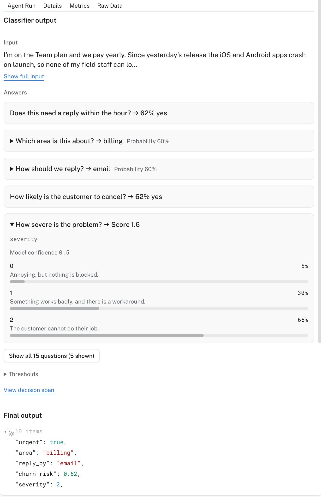
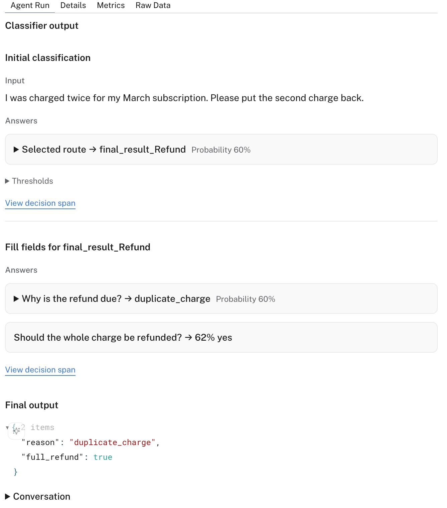

A lot of the agents I see in production don't write anything. They read a support ticket and decide who owns it. They look at a shell command and decide whether it's safe to run. The output is a `bool`, a `Literal`, a score. We still send those to a frontier language model, wait a second or two, and pay for it to reason its way to one of four words.

[Jev](https://typesafe.ai/), from TypeSafe, is built for that job. You hand it the text and a list of typed questions, and it picks an answer for each, with a probability attached. There's no generated text to parse. Pydantic AI 2.50.0 can run an agent on it, and Pydantic [Logfire](https://pydantic.dev/logfire) now shows you what it decided.

## Your output type is the question

With `TypeSafeModel`, each field of the agent's `output_type` becomes one question. The field's description is the question text, and the prompt is the material being judged. All fields go out in one request.

```python
from typing import Literal

import logfire
from pydantic import BaseModel, Field

from pydantic_ai import Agent

logfire.configure()
logfire.instrument_pydantic_ai()

class Ticket(BaseModel):
    """Triage a support ticket."""

    urgent: bool = Field(description='Does this need a reply within the hour?')
    area: Literal['billing', 'bug', 'account', 'other'] = Field(description='Which team owns it?')

agent = Agent('typesafe:jev-latest', output_type=Ticket)
result = agent.run_sync(
    'You have charged me twice and my account is now overdrawn. I need this reversed today.'
)
print(result.output)
#> urgent=True area='billing'
```

Install it with the `typesafe` and `logfire` extras, and set `TYPESAFE_API_KEY` and `LOGFIRE_TOKEN`:

```bash
uv add "pydantic-ai-slim[typesafe,logfire]"
```

Change `'typesafe:jev-latest'` to a language model and the same agent runs there. You can compare the two on your own data without rewriting anything.

A `bool` is a yes or no. A `Literal` or `Enum` is a pick-one. A `float` with `ge=0, le=1` is the probability itself. An `IntEnum` that mixes in `UseEnumMemberDocstrings`, with a docstring under each level, is a rubric. A union of output types is picked first and then filled. A field Jev can't answer, like a free-form `str`, is a `UserError` before a request is sent. The exception is a union member with such a field: Jev can still pick it, and a `FallbackModel` hands that step to a language model. The [TypeSafe docs page](https://pydantic.dev/docs/ai/models/typesafe/) has the full list.

> [!warn] Warn
> With a language model, you put the question and the material in the same prompt and it sorts them out. Jev won't. A question written into the prompt is just more text to judge. Put the question on the field, and let the prompt be only the thing being judged.

## The chat span wasn't enough

When a classifier returns `area='billing'` and it's wrong, you want to know how sure it was, what it almost picked, and which route it took. The `chat` span only recorded the final output, so all of that was lost.

[Douwe Maan](https://github.com/DouweM) fixed that in two Pydantic AI PRs, both released in 2.50.0:

- [pydantic/pydantic-ai#8696](https://github.com/pydantic/pydantic-ai/pull/8696) adds `DecisionModel`, a base class for any model that speaks the same Decisions protocol. `TypeSafeModel` becomes a thin adapter on top of it.
- [pydantic/pydantic-ai#8698](https://github.com/pydantic/pydantic-ai/pull/8698) adds a `decide` span under the `chat` span for every request a `DecisionModel` sends. It records the questions, the answers with their probabilities, the thresholds that were applied, and which route was being filled.

The answers follow the same `include_content` setting as every other Pydantic AI span. With content off, you still see the question types and routes, but not the text or the answers.

## Seeing it in Live view

[Petyo Ivanov](https://github.com/petyosi) built the Logfire side. Select an agent run, a model run, or a `decide` span in Live view, and the **Agent Run** tab shows a **Classifier output** panel.

Here's a support triage agent asking 15 questions about one made-up ticket, with the first five shown. Yes/no answers show their probability. Pick-one answers show the chosen option and expand to the alternatives. The severity rubric expands to the probability of each level, so a score of 1.6 turns out to be 65% "cannot do their job", 30% "works badly", and 5% "annoying". The typed output sits underneath:



A union output type takes two steps. Jev first picks which member of the union the text calls for, then fills that member's fields. The panel shows both steps against the same input, and the final output below:



**View decision span** jumps to the `decide` span behind each step, and **Raw Data** still has every attribute as it was recorded. If a run has no decision telemetry, you get the conversation view you already know.

## Where else you can use Jev

- **Evals.** You can already use Jev as a judge in Pydantic Evals, and [David Montague](https://github.com/dmontagu) wrote up [how to score at high volume with it](https://pydantic.dev/articles/jev-evals).
- **The Gateway.** You can also call [Jev through Pydantic AI Gateway](https://pydantic.dev/articles/jev-pydantic-ai-gateway) with your own TypeSafe key.
- **Other backends.** `DecisionModel` makes a new Decisions backend a matter of translating its transport, and the `decide` spans and the panel come with it.

If you have an agent whose job is to decide something, try it. Swap the model name, run your own data through both, and look at the probabilities. If something is refused that you think should work, [open an issue](https://github.com/pydantic/pydantic-ai/issues).
