## Overview

We are releasing **LightOnOCR-3** a new family of highly performant lightweight OCR models. Compared to the previous generation, they introduce significant improvements in speed and transcription quality while introducing new visual understanding features. LightOnOCR-3 models are now able to output bounding box coordinates with labels for all document regions, image descriptions as well as extract numerical data in figures or charts. With these new capabilities, the models offer a ready-to-use, easier-to-maintain alternative to complex document understanding pipelines. As always, LightOnOCR-3 models are released under the Apache 2.0 license and can be readily used at will both for research and commercial purposes.

**Links:**

- [LightOnOCR-3-0.8B](https://huggingface.co/lightonai/LightOnOCR-3-0.8B)
- [LightOnOCR-3-1B](https://huggingface.co/lightonai/LightOnOCR-3-1B)
- [LightOnOCR-3-4B](https://huggingface.co/lightonai/LightOnOCR-3-4B)
- [LightOnOCR repo](https://github.com/lightonai/LightOnOCR)
- [HF demo space](https://huggingface.co/spaces/lightonai/LightOnOCR-3-Demo)
- [Website page](https://www.lighton.ai/research/lightonocr-3)

## 1\. One model with both transcription and layout

LightOnOCR-3 comes in three sizes: `LightOnOCR-3-0.8B`, `LightOnOCR-3-1B`, and `LightOnOCR-3-4B`. The 1B model retains the previous architecture, while the 0.8B and 4B models adopt the Qwen3.5 vision-language architecture, offering different tradeoffs between accuracy, speed, and compute requirements.

All three models support two modes. With an empty text prompt, they transcribe the page as before, preserving the prompting interface of previous LightOnOCR releases.

Using `grounding` as the sole text prompt adds labeled bounding boxes to the transcription, along with image descriptions and chart data extracted as tables. The output follows this format:

[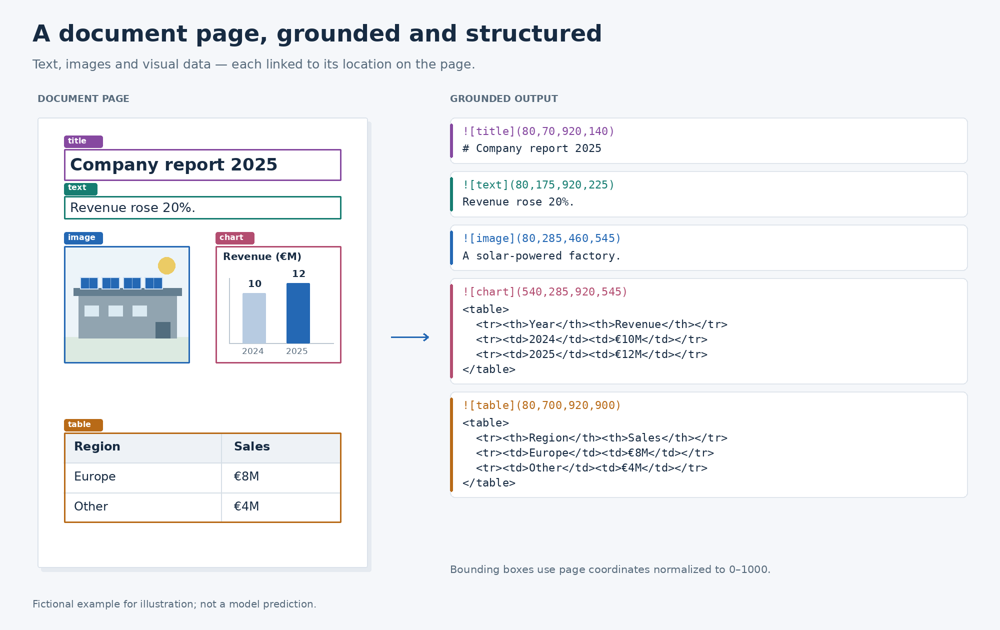](https://cdn-uploads.huggingface.co/production/uploads/6421a255eaad1bcb28afdd0e/StHrYJS2gE35QlwNdTQOg.png)

Each block of content is now prepended with labeled bounding box markers indicating the nature of the block. Coordinates are normalized to 0–1000:

- **Textual content blocks** contain the transcribed content of paragraphs, titles and other text elements.
- **Image blocks** pair a bounding box with a short descriptions.
- **Chart blocks** contain an HTML table of data points extracted from the figure.

## Formatting efficiency

Layout information adds tokens to every page. We use compact, inline markers for labels and coordinates rather than wrapping each region in HTML or JSON, keeping the added structure concise. Chart data is still represented as HTML tables.

[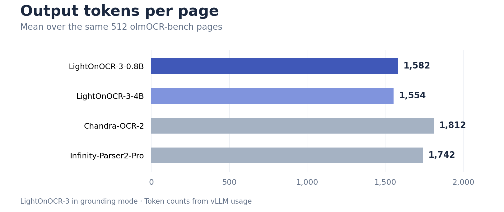](https://cdn-uploads.huggingface.co/production/uploads/62cd695e94b9dcedbf1818e5/2ow1-IiTO82eBgUU2MoRr.png)

On the same 512 olmOCR-bench pages, LightOnOCR-3-0.8B and LightOnOCR-3-4B in grounding mode generate **9–14% fewer output tokens on average** than Chandra-OCR-2 and Infinity-Parser2-Pro. Their outputs include labeled boxes, image descriptions, and extracted chart data; Infinity-Parser2-Pro, for example, does not generate image descriptions. These measurements compare the models’ complete outputs, rather than isolating formatting overhead, but show that the additional visual information can be delivered with a smaller decoding workload.

## Usage

To facilitate use of this raw output format, we release alongside our models a repository that includes conversion function into your preffered formatting as well as visualization scripts and exact scripts to reproduce our benchmark scores. Find it [here](https://github.com/lightonai/LightOnOCR).

## 2\. Results and Benchmarks

The interactive plot below shows how benchmark score changes with model size. Higher scores appear higher on the chart; smaller models appear farther left.

**Figure 1. Document parsing benchmark score versus model size.** The default view is an equal-weight average of the three overall scores for models evaluated on all three benchmarks. Use the tabs to inspect each benchmark separately. The dashed line marks the Pareto frontier: models for which no smaller model in the comparison achieves an equal or higher score. Models without a disclosed parameter count appear as score references and are excluded from the frontier.

## 2.1 Main results

<iframe src="https://lightonai-lightonocr-benchmark-plots.static.hf.space/" width="100%" height="850" sandbox="allow-scripts"></iframe>

## 2.2 Detailed results

Our main point of comparison is top open-source and open-weight OCR models that can be downloaded and run locally. We evaluated more models but we kept only the top ones. The tables report results by category; higher scores are better within each table. Bold metric values mark the best score shown in each column.

### olmOCR-Bench

On olmOCR-Bench, LightOnOCR-3-4B scores 86.3 overall, 1.3 points behind Infinity Parser Pro, which has 35.1B listed parameters. At the same listed 4B size, it scores 0.5 points above Chandra 2. The 4B model leads on ArXiv (91.1), while the 1B variant leads on multi-column pages (85.9) and the 0.8B variant leads on long tiny text (94.1). Infinity Parser Pro remains stronger on old scans and headers/footers. Overall, the 0.8B variant scores 85.5 and the 1B variant scores 84.5.

| Model | Size (B) | ArXiv | Old scans math | Tables | Old scans | Headers/footers | Multi-column | Long tiny text | Base | Overall |
| --- | --- | --- | --- | --- | --- | --- | --- | --- | --- | --- |
| Infinity Parser Pro | 35.1 | 88.1 | **91.3** | 91.2 | **58.2** | **95.8** | 83.7 | 92.5 | **99.9** | **87.6** |
| **LightOnOCR-3-4B** | 4.0 | **91.1** | 89.1 | 90.2 | 52.5 | 89.2 | 85.6 | 93.2 | 99.5 | 86.3 |
| Chandra 2 | 4.0 | 86.9 | 89.1 | **92.1** | 51.1 | 91.4 | 82.1 | 93.7 | **99.9** | 85.8 |
| **LightOnOCR-3-0.8B** | 0.8 | 89.6 | 87.6 | 90.8 | 48.7 | 88.2 | 85.2 | **94.1** | 99.7 | 85.5 |
| **LightOnOCR-3-1B** | 1.0 | 90.4 | 80.6 | 89.9 | 48.3 | 87.6 | **85.9** | 93.7 | 99.5 | 84.5 |
| dots.mocr | 3.0 | 85.9 | 85.5 | 90.7 | 48.2 | 94.0 | 85.3 | 81.6 | 99.7 | 83.9 |
| jina-ocr-v1 | 3.4 | 86.1 | 82.3 | 88.8 | 42.6 | 88.7 | 85.5 | 93.2 | **99.9** | 83.4 |
| Surya OCR 2 | 0.7 | 88.3 | 81.4 | 86.6 | 41.8 | 92.5 | 82.4 | 93.7 | 99.7 | 83.3 |
| LightOnOCR-2-1B\* | 1.0 | 89.6 | 85.6 | 89.0 | 42.2 | 19.7 | 84.8 | 91.4 | 99.6 | 83.2\* |
| MistralOCR4.1 | \-- | 82.6 | 72.3 | 85.9 | 47.9 | 91.4 | 84.5 | 91.2 | 99.5 | 81.9 |

\* The LightOnOCR-2-1B overall score (83.2) excludes headers/footers; the other overall scores include that category. Its score is therefore not directly comparable with the other rows in this column.

### ParseBench

On ParseBench, the 4B and 0.8B variants rank first and second on the five-category overall score (75.1 and 74.6), narrowly ahead of Infinity Parser Pro (74.3). The 4B model leads on charts (66.1) and semantic formatting (67.6); Infinity Parser Pro leads on visual grounding (74.9). The 1B variant scores 71.4 overall, with most of its gap to the 0.8B variant coming from charts and visual grounding which highlights the benefits of starting from pre-trained VLMs for visual categories.

| Model | Size (B) | Tables | Charts | Content faithfulness | Semantic formatting | Visual grounding | Overall (3 cats) | Overall (5 cats) |
| --- | --- | --- | --- | --- | --- | --- | --- | --- |
| **LightOnOCR-3-4B** | 4.0 | 83.8 | **66.1** | 89.9 | **67.6** | 68.3 | **80.4** | **75.1** |
| **LightOnOCR-3-0.8B** | 0.8 | 84.5 | 64.7 | 88.9 | 66.7 | 68.2 | 80.1 | 74.6 |
| Infinity Parser Pro | 35.1 | 86.4 | 61.3 | 89.7 | 59.1 | **74.9** | 78.4 | 74.3 |
| **LightOnOCR-3-1B** | 1.0 | 84.8 | 57.3 | 88.6 | 64.5 | 61.7 | 79.3 | 71.4 |
| Chandra 2 | 4.0 | **89.2** | 65.1 | 83.7 | 61.4 | 51.2 | 78.1 | 70.1 |
| MistralOCR4.1 | \-- | 73.9 | 40.1 | 89.6 | 66.4 | 71.2 | 76.6 | 68.2 |
| Surya OCR 2 | 0.7 | 82.7 | 22.0 | 86.6 | 61.4 | 71.6 | 76.9 | 64.8 |
| dots.mocr | 3.0 | 85.2 | 1.0 | **90.0** | 47.0 | 55.8 | 74.1 | 55.8 |
| LightOnOCR-2-1B | 1.0 | 75.5 | 13.5 | 87.8 | 63.2 | 0.0 | 75.5 | 48.0 |
| jina-ocr-v1 | 3.4 | 74.9 | 7.5 | 86.6 | 60.6 | 0.0 | 74.0 | 45.9 |

### fr-bench-pdf2md

On the French-document fr-bench-pdf2md benchmark, LightOnOCR-3-4B leads overall at 74.1, 3.6 points above the 0.8B variant at 70.5; the 1B variant scores 69.6. The 4B model is strongest on handwritten pages (46.1), forms (49.6), and multi-column layouts (83.6). Other models retain category leads: Chandra 2 on graphics and the second long-table category, and Infinity Parser Pro on tiny text. This spread shows why the overall score alone does not describe every document type.

| Model | Size (B) | Baseline | Forms | Graphics | Handwritten | Long table | Long table 2 | Multi-column | Tiny text | Overall |
| --- | --- | --- | --- | --- | --- | --- | --- | --- | --- | --- |
| **LightOnOCR-3-4B** | 4.0 | 98.3 | **49.6** | 70.5 | **46.1** | **83.6** | 71.7 | **83.6** | 88.3 | **74.1** |
| **LightOnOCR-3-0.8B** | 0.8 | 98.4 | 47.8 | 71.4 | 33.3 | 70.9 | 68.0 | 80.6 | 85.4 | 70.5 |
| **LightOnOCR-3-1B** | 1.0 | 96.9 | 40.2 | 70.8 | 37.0 | 82.1 | 73.0 | 77.6 | 80.7 | 69.6 |
| Chandra 2 | 4.0 | 99.7 | 39.1 | **75.1** | 26.1 | 81.3 | **79.4** | 73.3 | 76.9 | 69.0 |
| Infinity Parser Pro | 35.1 | 98.0 | 42.3 | 63.7 | 39.4 | 52.2 | 38.7 | 69.7 | **90.6** | 63.2 |
| dots.mocr | 3.0 | 98.8 | 42.3 | 26.6 | 18.2 | 59.0 | 57.2 | 77.0 | 86.7 | 59.3 |
| Surya OCR 2 | 0.7 | **99.8** | 21.9 | 26.4 | 2.4 | 74.6 | 67.6 | 77.0 | 73.0 | 54.1 |
| MistralOCR4.1 | \-- | 95.9 | 39.4 | 55.8 | 11.5 | 69.4 | 59.8 | 73.3 | 57.4 | 54.1 |
| jina-ocr-v1 | 3.4 | 99.6 | 20.1 | 33.1 | 3.0 | 79.1 | 69.1 | 74.6 | 66.5 | 53.2 |

## 2.3 Postprocessing

OCR benchmarks inevitably make assumptions about how information should be represented. A footnote, for example, might be encoded as HTML (`1`), LaTeX (`$^{1}$`), Unicode, or plain text. These representations may be equivalent for a reader, but edit-distance metrics treat them differently.

As OCR models improve, these formatting choices can account for a larger share of the difference between benchmark scores. All benchmarks we use rely on edit distance, although the issues can be mitigated through unit tests that allow some variation in output.

At current levels of performance, a simple deterministic rewrite can therefore change a model’s score noticeably without changing what it actually extracted from the document. Alternative approaches such as LLM-as-a-judge can better capture semantic equivalence, but they introduce their own issues around reproducibility and judge dependence.

[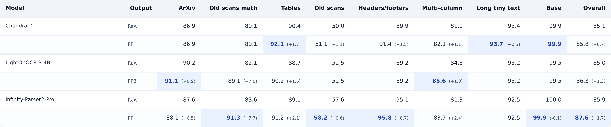](https://cdn-uploads.huggingface.co/production/uploads/6421a255eaad1bcb28afdd0e/VjGuS22FehyMGIaLiZ7fU.png)

For LightOnOCR-3, we deliberately chose not to tailor our training data or native output format to the conventions preferred by our reference benchmarks, either on ParseBench or olmOCR-Bench. To compare meaningfully with competing models however, we do apply some normalization functions to our raw inputs before scoring. As can be seen in the table above, this translates to significant changes in the overall scores for the benchmark for all top models of the leaderboard, which illustrate its limits. We publish these functions used to obtain these scores in the accompanying repository, along with all resources necessary to reproduce our results.

## 2.4 Speed

We measured serving speed under the same conditions as our olmOCR-Bench evaluation: the same 512 pages for every model, each rendered with that model's olmOCR-Bench settings, one H100 per model, and vLLM 0.30.0 with identical server flags. We used [guidellm](https://github.com/vllm-project/guidellm) to vary the load from one page at a time to all 512 pages submitted at once.

[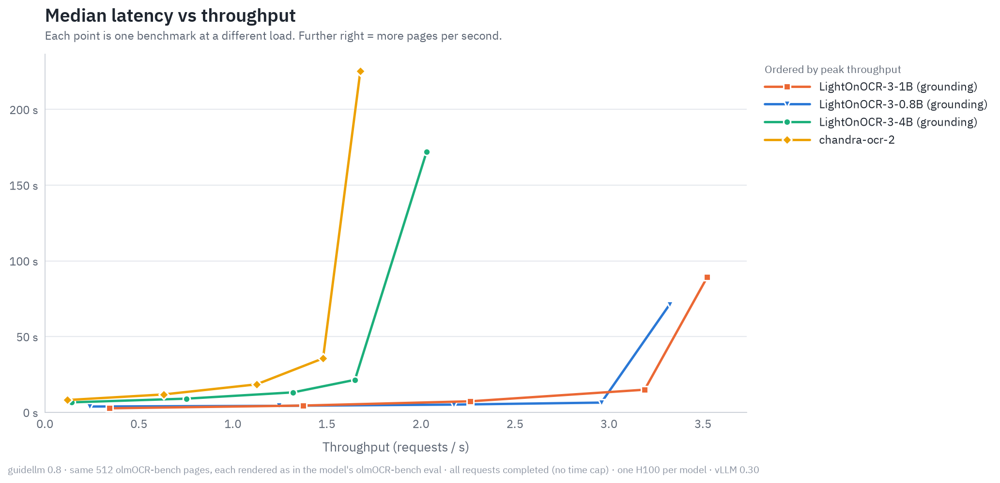](https://cdn-uploads.huggingface.co/production/uploads/63a042880c6d9efa305ea6cd/HSZbDAML8nxWmkqSzUoJC.png) [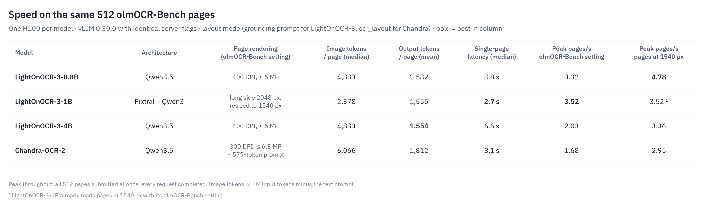](https://cdn-uploads.huggingface.co/production/uploads/63a042880c6d9efa305ea6cd/QKQIrgIR9NpILnyGLu9fW.png)

Resolution sets the throughput. LightOnOCR-3-0.8B and LightOnOCR-3-4B reach their best olmOCR-Bench scores at 400 DPI with a 5 MP cap, which is about 4.8k image tokens per page. The extra tokens barely affect single-page latency, but they lower peak throughput. Rendering pages at 1540 px on the long side cuts image tokens by almost two thirds and raises peak throughput by 44% for the 0.8B (4.78 pages/s) and 66% for the 4B (3.36 pages/s). LightOnOCR-3-1B already reads pages at 1540 px and has the lowest single-page latency (2.7 s).

Faster than Chandra-OCR-2 on the same architecture. LightOnOCR-3-4B and Chandra-OCR-2 are both based on Qwen3.5-4B and generate at the same speed per token. The difference is the workload: our compact output format produces 14% fewer tokens per page, and Chandra's olmOCR-Bench setting adds larger images and a 579-token prompt. At each model's olmOCR-Bench setting, LightOnOCR-3-4B is 19% faster on a single page and serves 21% more pages per second. At the same resolution, it still serves 14% more pages per second.

## 3\. Data

## 3.1 The SFT data mixture

For LightOnOCR-2, we concatenated filtered pools, so pool size determined each source's share. Plain pages and prose, including multilingual examples, dominated. The figure shows the broad data composition; formula and table labels overlap because a page can contain both.

For LightOnOCR-3, we upsample some sources to increase exposure to harder document types: formula pages receive 2× weight and tables 3×, while plain pages and prose are sampled less. We cleaned and filtered the prose data, removed its table examples and the separate scientific-page pool and deduplicated the mixture with MinHash. We added handwriting and synthetic pages generated with the [DocDuck library](https://github.com/lightonai/docduck). DocDuck creates varied page layouts with ground-truth text and per-block boxes; we used it for dense pages, small fonts, 20+ languages, and adversarial cases such as typos, confusable glyphs, and mixed scripts.

We added visual grounding as a second task. The configured mixture assigns 21.9% of draws to grounding and 78.1% to OCR. Grounding examples cover prose and older scans, with annotations for locating visual regions.

Alongside these changes to the data, we revised the SFT recipe, adopting the Muon optimizer and sequence packing. Document transcriptions vary considerably in length; packing combines examples within the training context to reduce padding and use compute more efficiently. We also apply image augmentation extensively, exposing the models to visual variations of the training pages. The aim is to make transcription and grounding less sensitive to a page’s particular appearance, rather than relying on a single rendering of each document.

[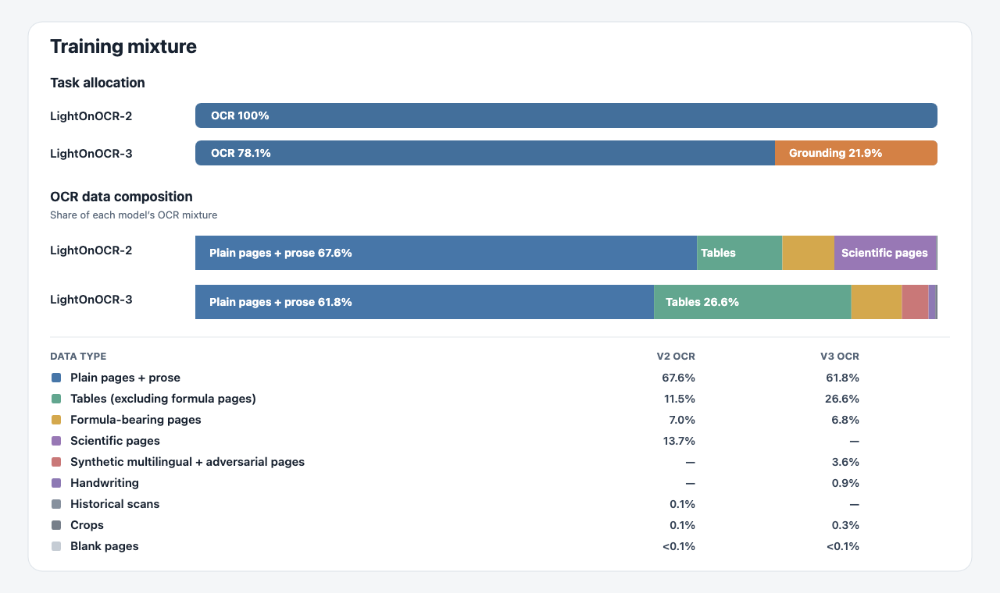](https://cdn-uploads.huggingface.co/production/uploads/6421a255eaad1bcb28afdd0e/7u2oXWZgcFsqccptwv5ZB.png)

## 3.2 Grounding: Data and Pipeline

### Building a grounding pipeline

Building reliable bounding-box, chart data and image annotations across multilingual handwriting, business documents, and research papers required more than single existing models, we needed instead to devise a complex annotation pipeline. In this section, we describe this pipeline, the challenges encountered along the way and motivate the need for a unified model that brings transcription, layout analysis, and grounding together across diverse document types, as was the goal for LightOnOCR-3.

[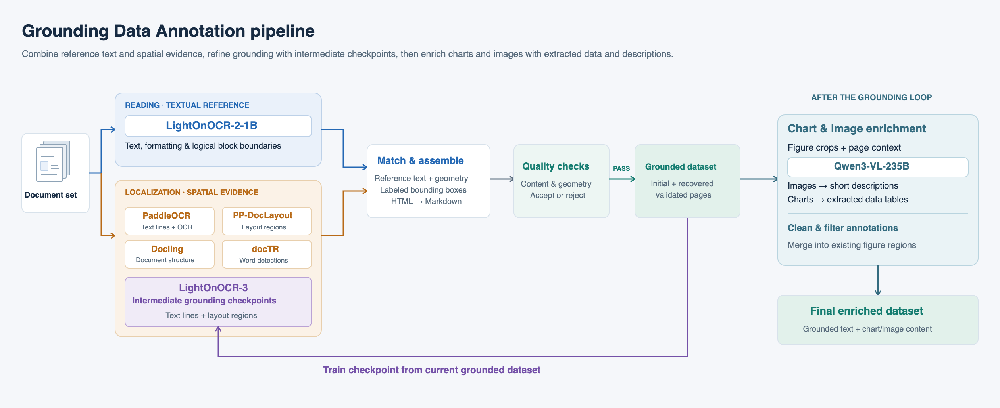](https://cdn-uploads.huggingface.co/production/uploads/6421a255eaad1bcb28afdd0e/QdMr4Rre3KdF3KZ9oSHvi.png)

### Building bounding box data iteratively

The layout focused part of our grounding annotation pipeline separates two complementary tasks: reading the document and locating its content. Several models are used to achieve the annotations. For the reference transcription, we use our **LightOnOCR-2-1B** model for speed as well as consistent formatting across the dataset.

To obtain bounding boxes, we use a series of models, each having a distinct role: PaddleOCR’s **PP-OCRv6\_medium\_det** and **PP-OCRv6\_medium\_rec** detect and recognize text lines. **PP-DocLayoutV3** and document regions extracted through Docling provide complementary layout information, including text blocks, headings, tables, and illustrations. Meanwhile, docTR’s **DB-ResNet50** provides finer-grained word detections for geometric refinement and help resolve ambiguous cases. Combining these signals allows us to preserve a coherent, formatted transcription while anchoring it to independently detected regions of the page.

The key step consists is aligning the reference text with those detections. We combine text matching with layout and reading-order constraints, handling differences between the transcription’s logical paragraphs and the detector’s visual lines. Matched regions are assembled into labeled blocks with bounding boxes, while the textual content remains tied to the reference transcription rather than being replaced by the detector’s OCR. As the procedure relies on ad-hoc fuzzy matching operations and ordering heuristics, it is necessary to add automated audits that check for missing, suspect or duplicated content, unsupported text-to-box assignments, conflicting geometry, and problematic tables. Pages that fail these checks are excluded from the initial dataset. From start to end, the pipeline allows us to keep only 55% of elements in our sample set with confidence.

For this reason, we have added a recursive recovery stage, that enables us to revisit difficult pages without lowering the acceptance thresholds. Intermediate checkpoints trained on the resulting dataset are in turn used to provide new block propositions —with text more closely aligned with our reference transcription model— and enable us to recover about 10% additionnal samples from our set.

### Adding chart data and image description

The next step in the annotation work was to fill the figure regions images, charts, header and footer graphics of our dataset with their appropriate content, be it image descriptions or chart data. This was done using Qwen3-VL-235B. Each call receives the full page and a tight crop of the region, and returns one JSON object: a kind, the content, and a confidence score on the data. The detector label is given as a hint only and the model classifies the crop from the pixels, which recovered nearly 10,000 charts that the source had labeled as images.

[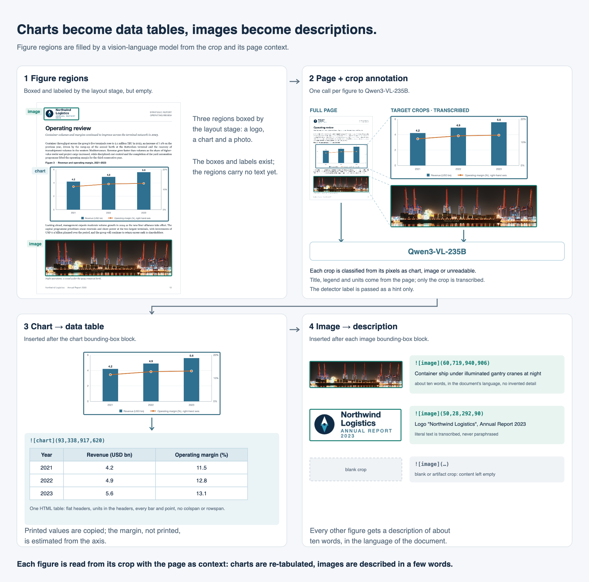](https://cdn-uploads.huggingface.co/production/uploads/6421a255eaad1bcb28afdd0e/5oX6ULGQA8Z1Hk5GhaPRw.png)

**Format.** The content depends on the kind and is inserted directly after the region's bounding box block.

- A chart becomes exactly one HTML table. Column headers are flat (one per series, no colspan/rowspan), there is one row per category, units and multipliers sit in the headers and cells hold bare numbers. The data must be complete: every bar, point and slice. Printed values are copied verbatim and unprinted values are estimated against the axis scale one mark at a time, after checking for units, log or broken axes and a secondary axis. A cell that cannot be read stays empty, and if most values are unrecoverable the model must describe the figure instead of tabulating it.
- Any other figure (photo, logo, map, diagram, stamp) gets one description of at most about ten words, in the language of the document, with literal text such as a logo wordmark transcribed.
- A blank or artifact crop is marked unreadable and stays empty.

**Accepting or refusing an answer.** An answer is merged into the training target only if it passes every check below. Otherwise the region stays empty and the figure is queued for correction.

- Well-formed: a chart answer contains exactly one HTML table that re-serializes to a canonical form (table, tr, th, td, attributes stripped); an image answer contains no table markup and no more than 20 words.
- Confident: the reported confidence is at least 0.5.
- No fabricated grid: a chart table is refused if two data columns are numerically identical, if a column repeats the same value three times or more, or if one value fills 60% or more of its numeric cells. This is the signature of a chart the model could not read: a well-formed table of copied or constant numbers, which a student trained on it learns to reproduce. Confidence does not catch it, since 97% of chart tables report more than 0.8 whether their values were printed or estimated.
- Readable and complete: unreadable crops, failed calls and truncated outputs never merge.
- At page level, a page enters the training set only if every one of its figures merged.

**Retrying.** Refused figures are re-annotated rather than accepted at a lower threshold. Every new answer is appended to the annotation file and goes through the same checks, so a correction that fabricates again is refused again.

### Using document content to guide block segmentation

[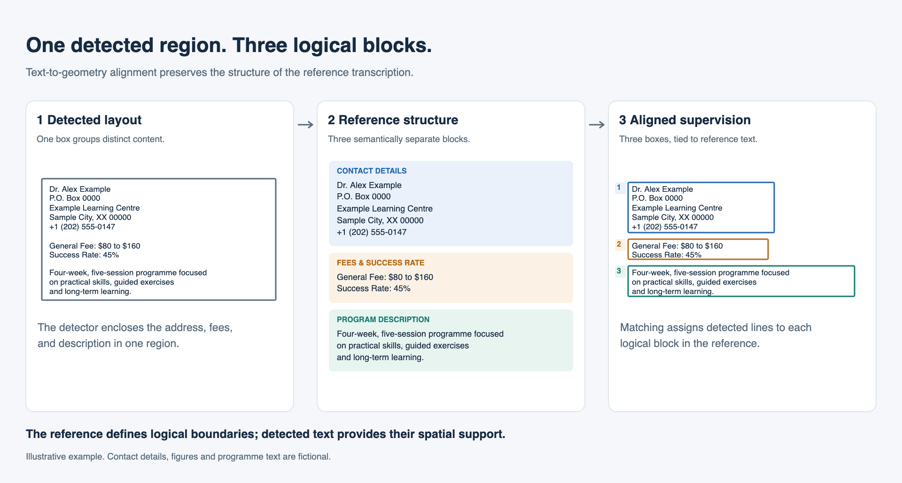](https://cdn-uploads.huggingface.co/production/uploads/6421a255eaad1bcb28afdd0e/zWHrW6acSddg6aPjzmZgr.png)

LightOnOCR-3 models aim to provide the strongest possible end to end foundation for document understanding, so we took special care to ensure the bounding boxes reflect the logical structure of the document, rather than just its visual layout. Our annotation pipeline uses the paragraph and section bounderies in LightOnOCR-2-1B’s reference transcription blocks to guide how detected text lines are grouped. Independent visual detections then determine the corresponding box coordinates. In effect, rather than treating a layout detector’s region as fixed references, we let the content guide their separation and grouping. This produces spatially grounded, logically coherent blocks that are better suited to downstream chunking, document parsing and RAG pipelines.

### Challenges and why no single existing solution fits for all cases

[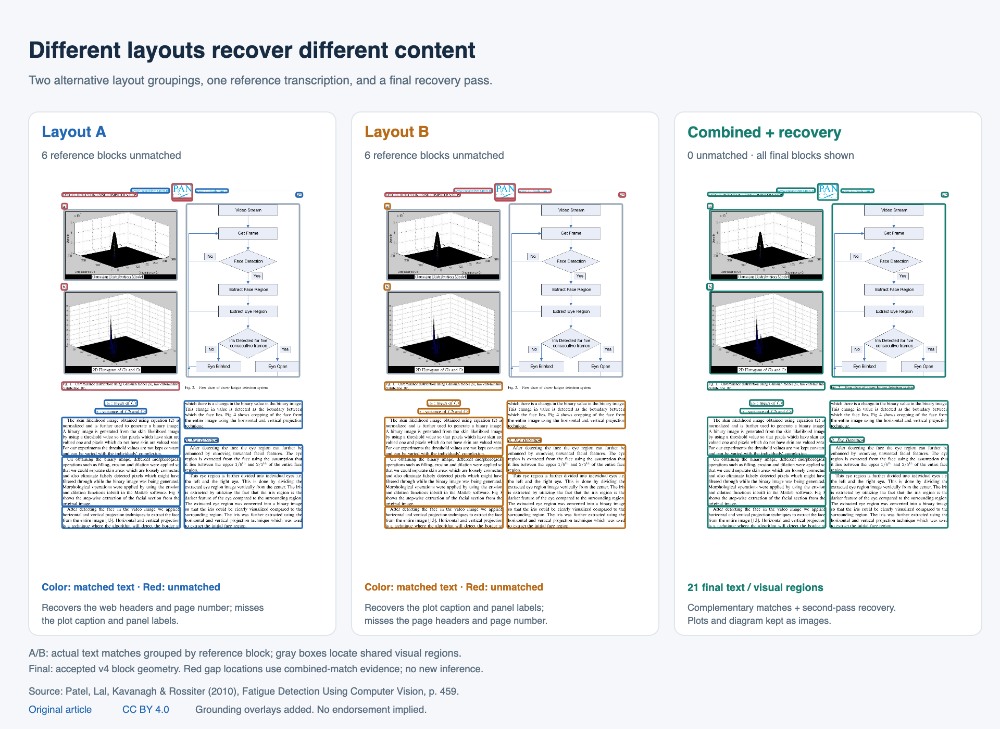](https://cdn-uploads.huggingface.co/production/uploads/6421a255eaad1bcb28afdd0e/xxBqrDbWeZjVf74wwJ9fj.png)

As we have developed our grounding pipeline, it became evident that no single layout model would be sufficient to build reliable bounding-box data accross our diverse set of documents on its own. Different systems and pipelines showed different weaknesses: missed text regions, fragmented paragraphs, incorrect labels, or inconsistent reading order. As well models very strong on research papers would be lacking when used with manuscript data. No single system was reliable enough across the full collection.

As illustrated above, we combine complementary predictions at the word, line, and block levels, using text matching and spatial constraints to reconcile imperfect detections into fully grounded pages. The resulting annotations rely on agreement across multiple sources of evidence rather than trusting a single model’s output.

This also illustrates a key motivation for LightOnOCR-3: an accurate, open-source OCR model that combines transcription, layout analysis, and grounding across diverse document types can reduce the need for the complex pipelines used to construct its own training data. We expect these capabilities to help simplify production OCR workflows and the document-processing stages of enterprise AI systems.

## 3.3 Reinforcement learning

We apply reinforcement learning with verifiable rewards after supervised fine-tuning. Our RL recipe combines region localization and classification with checks on transcription and document structure in one objective.

### Manually verified training data

The RL data was manually verified before training. Grounding supervision combines two collections with different annotation densities: 983 pages averaging **31.5 bounding boxes per page**, and 1,654 pages averaging **13.0 boxes per page**. Together, the collections account for 75% of sampled prompts, with approximately equal sampling weight. The remaining prompts are synthetic documents with executable tests and empty pages:

[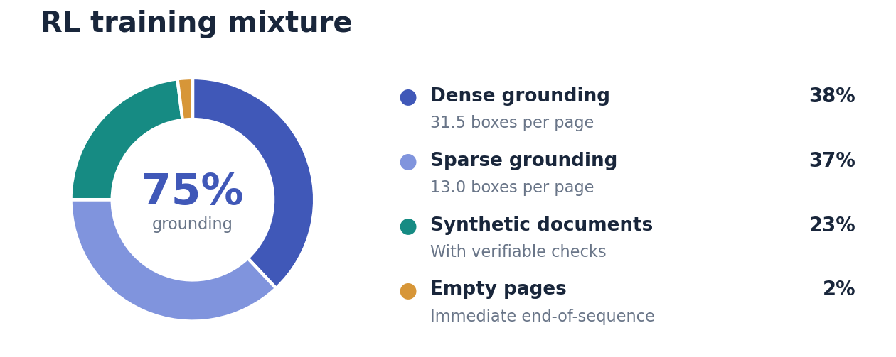](https://cdn-uploads.huggingface.co/production/uploads/62cd695e94b9dcedbf1818e5/1545-aP4gpn8QCBtnN5xl.png)

Each page is scored using its corresponding annotations or tests. Synthetic examples provide executable checks on transcription, reading order, tables, equations, and formatting.

### Reward shape

For a page x and generated response y, we select the reward according to the page's supervision:

$$
R \left(x , y\right) = \begin{cases} R_{b b o x} \left(x , y\right) , & \text{grounding pages} , \\ \frac{1}{\mid C_{x} \mid} \sum_{c \in C_{x}} c \left(y\right) , & \text{synthetic pages with verifiable checks} , \\ 1 \left[y = E O S\right] , & \text{empty pages} . \end{cases}
$$

Here, Cₓ is the set of checks for the page, each returning a binary or fractional score between 0 and 1. The empty-page reward is one only for immediate end-of-sequence. Each page uses one reward branch; the mixture proportions control how often each branch is sampled.

We generalize the image-localization reward from the [LightOnOCR paper](https://arxiv.org/pdf/2601.14251) to all document-region labels, including text, headings, tables, charts, and images. Instead of matching images by ID, we greedily match predicted and reference boxes by spatial overlap, requiring the same label and allowing each box to match only once.

For predicted boxes P, reference boxes G, and matched pairs M, the reward is:

$$
R_{b b o x} = \frac{\underset{\left(p , g\right) \in M}{\sum} min \textrm{ } \left(\frac{IoU \left(p , g\right)}{0.75} , 1\right)}{max \left(\mid P \mid , \mid G \mid\right)} .
$$

Dividing by the larger box count penalizes missing and extra regions; incorrect labels prevent matching. The grounding reward is zero when no boxes match.

### Optimization and checkpoint averaging

We train with GRPO using a group size of eight and [verl](https://github.com/verl-project/verl) 's asynchronous, one-step-off-policy trainer. Rollout generation and policy optimization run on separate GPU pools: vLLM generates the next batch while the training workers update the policy on the current batch. We synchronize weights before launching each generation batch, keeping the rollout policy at most one update behind the training policy. Overlapping generation and optimization reduces the time spent waiting for long responses to finish.

Each data seed draws a different subset of training pages while preserving the sampling proportions above. Each run in this recipe used 600 unique pages, with only 14–15% of pages shared between any pair of seeds.

We average the resulting model parameters from different seeds to reduce sensitivity to individual data samples and stochastic training noise. The largely distinct training subsets provide broader data coverage across runs, with the aim of improving robustness.

## 4\. Examples

<iframe src="https://lightonai-lightonocr-grounded-examples.static.hf.space/" width="100%" height="1000" sandbox="allow-scripts"></iframe>

## Acknowledgments

The project received access to computing resources on MeluXina (project p201378) and Jean Zay (project AD011017767R1).
