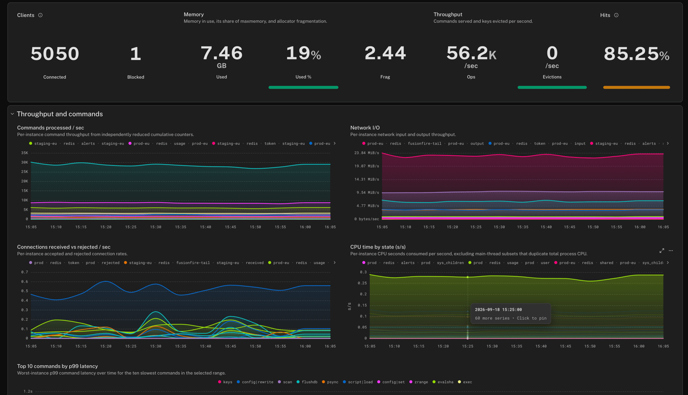
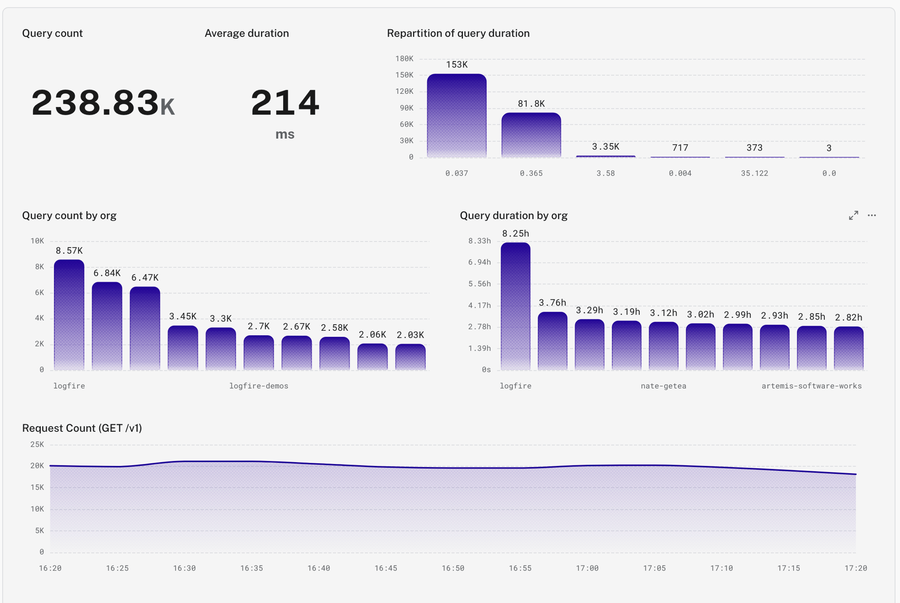
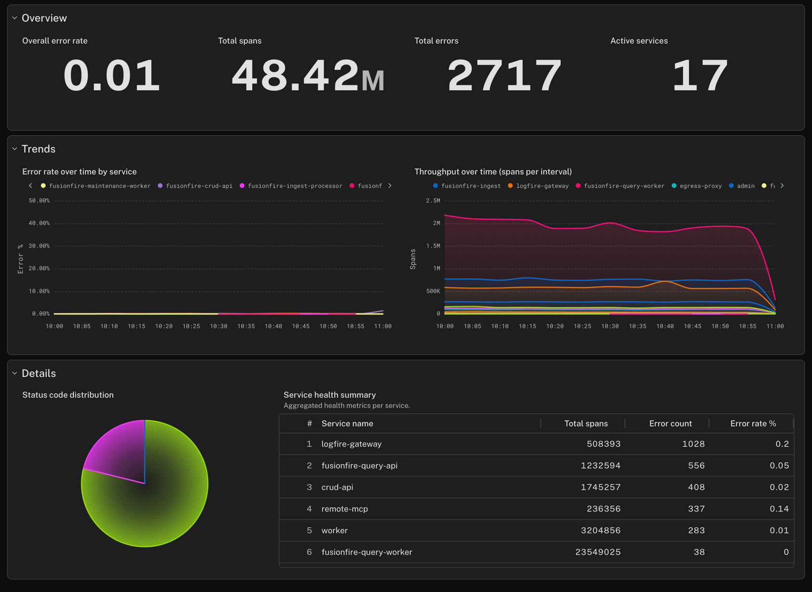
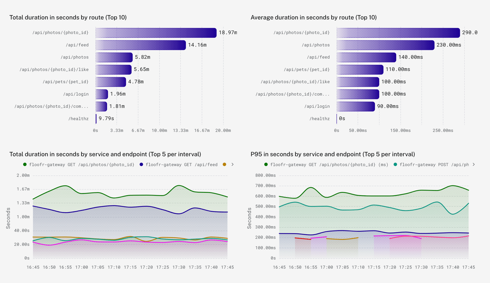
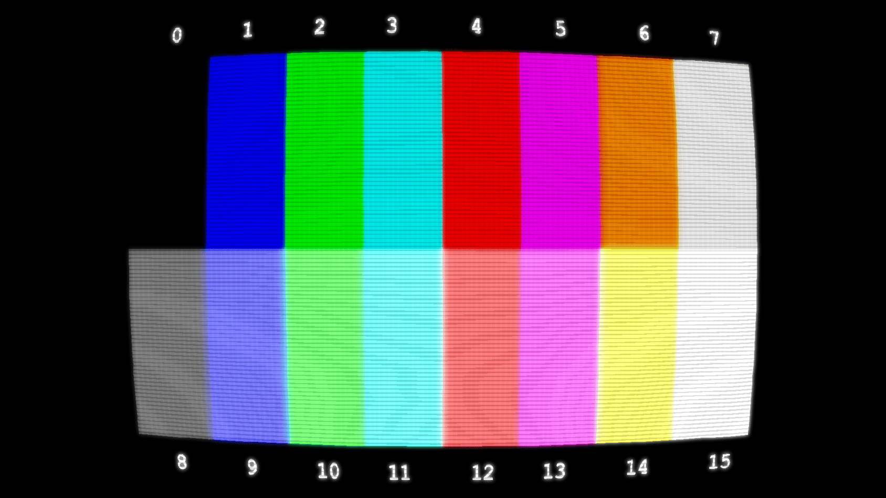
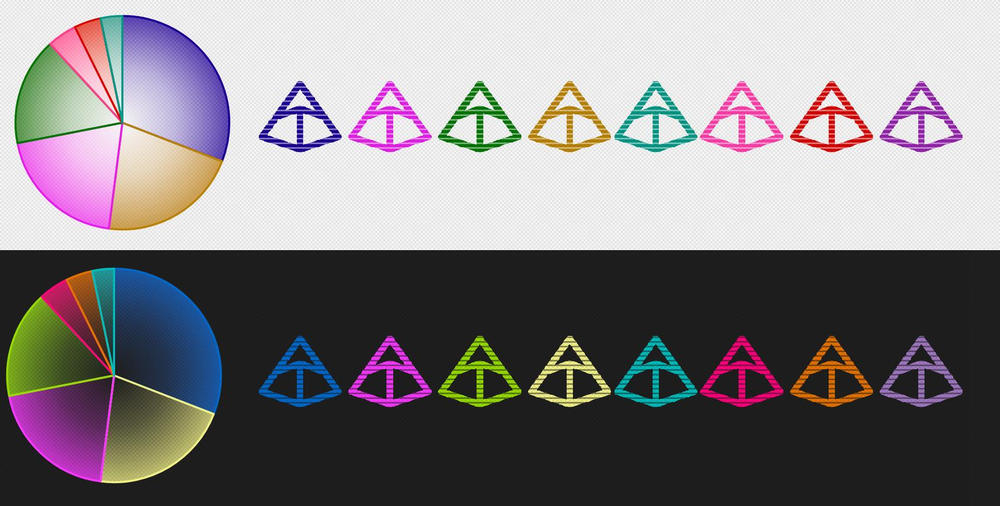
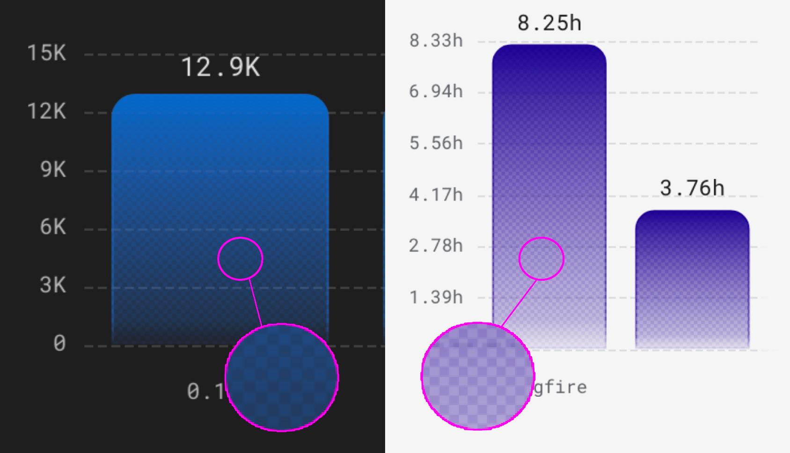
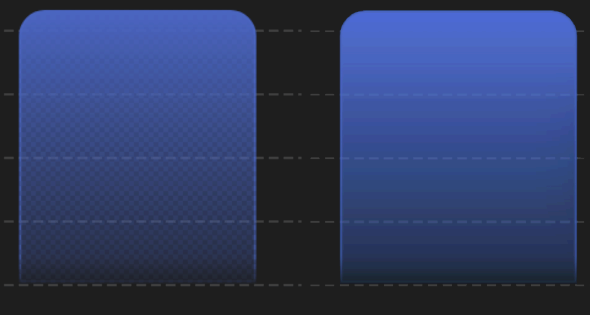
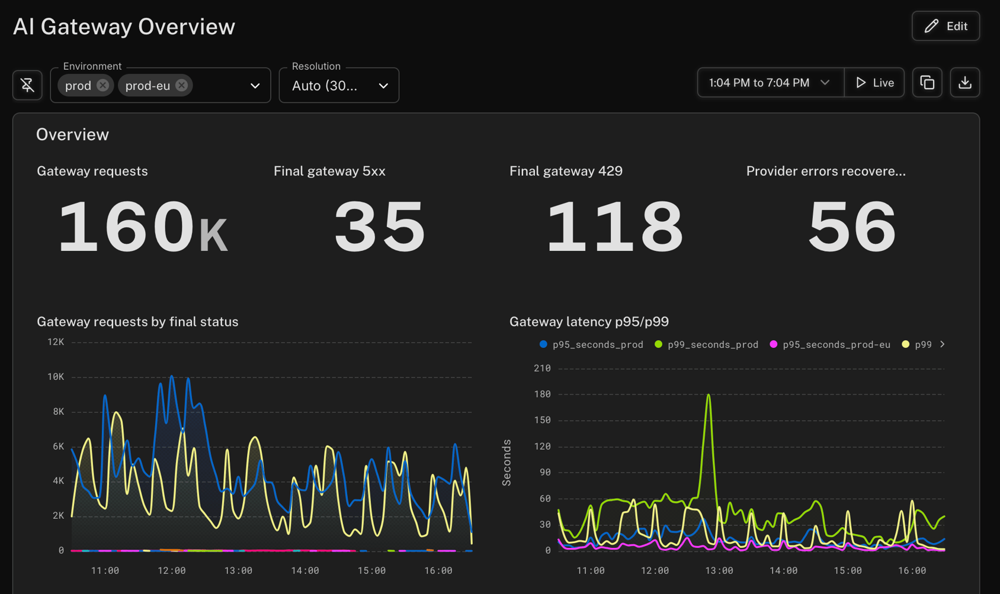

We've given [Pydantic Logfire](https://pydantic.dev/logfire) dashboards a lot of polish over the past few weeks. I want to highlight some of the improvements we've made in their look and feel, share some of my design thinking, and talk about where we're going from here.

Our goal is to give you clean, modern dashboards that feel distinct and delightful, for any type of data you want to show, for every person looking at the screen. We're still striving for that goal. There's always more to do, and we're always eagerly taking feedback in our [public Slack](https://pydantic.dev/docs/logfire/join-slack/). But today, here's how far we've come.

We fixed plenty of papercuts and shipped a lot of little quality-of-life improvements, which all add up to making dashboards more pleasant to use. Enhancements such as:

- A cleaner toolbar with only the essential buttons
- Auto-saving drafts as you edit a dashboard, so you can navigate away from the page with your unsaved changes intact
- One-click dashboard cloning, which is especially useful if you want to tweak our read-only Standard dashboards
- Vastly improved keyboard navigation for accessibility and power users
- Performance improvements, so we only load data that you're actually looking at

But the big thing I want to talk about is our visual overhaul.

## Sleek, legible data visualization

In data visualization, the most important thing is to make it actually legible. Above all, you want the user to be able to comprehend the data. Visual polish? Aesthetic beauty? That's all secondary. Nice to have.

Plenty of extremely talented designers can make data visualization into high art. They create gorgeous infographics that perfectly marry form and function, with readable data that's pleasing to the eye, and maybe even says something about the data through aesthetic alone. That's hard work, and sometimes it requires agonizing over every individual little pixel in a graphic, polishing it till it's a masterpiece.

But in observability, we need a dynamic dashboarding system that's configurable, and displays data in all sorts of shapes and sizes. Function is the most important thing. Most observability suites I've worked on just settle for a visual design that does its job, good enough. You can't hand-polish every little pixel.

With [Logfire](https://pydantic.dev/logfire), we decided, what if we try anyway?

## Functional form, accessible aesthetics

Logfire's new charts are retrofuturistic. They're a blend of curvy, modern geometry with hues and patterns that evoke the dawn of personal computing. In the age of agents, the way human beings interact with computers hasn't been this open of a question since the 80s and 90s. I wanted to touch on that in the design of our new charts. In dark mode, they remind me of textmode terminals on creaky CRTs. In light mode, they present darkened rainbows evocative of the early World Wide Web.

The first big visual changes I shipped were to give dashboards a smooth, contemporary feel. Smoother lines in timeseries charts, borrowed from our Agents view. A seamless, flat look where charts and panels meld together in collapsible groups. When it came time to rework our color palette to pass [WCAG contrast guidelines](https://www.w3.org/WAI/WCAG21/Understanding/non-text-contrast.html), I took inspiration less from the futurism and more from the retro: the [CGA color palette](https://en.wikipedia.org/wiki/Color_Graphics_Adapter).

I started by taking 14 CGA colors and 2 from the [EGA gamut](https://en.wikipedia.org/wiki/Enhanced_Graphics_Adapter), and shifted the hues around until:

1. They all had at least a 3:1 contrast ratio with either the light mode or dark mode chart background, and
2. The ~4% of the population with red/green color deficiency could reasonably distinguish between any two of them drawn on the same chart

(Apologies to the 0.01% of the population who are blue/yellow colorblind. It's very difficult to design for both types, but I do have loved ones among this 0.01% so I'm personally invested in following up with more customizable accessibility features!)

The resulting palette is reminiscent of 1980s 16-color graphics, even if the literal hex codes full of `FF` s, `55` s, and `AA` s, themselves, didn't pass accessibility.

Beyond the palette, we've got texture. Charts render with dithered gradients, a nod to recent trends of glassy, translucent UI design with a hint of old-school computer graphics tricks.

Before computer screens were capable of displaying millions of colors, we used to use [ordered dithering](https://en.wikipedia.org/wiki/Ordered_dithering) to create the illusion of a smooth gradient. I didn't go that far, and just used a single subtle dither pattern to add a bit of crunch to our charts, but interestingly it *does* serve a similar technical purpose today. Even with modern color gamuts, some monitors still produce this undesirable banding effect:

 (Effect exaggerated with 64 levels of posterization to illustrate, since my monitor might be worse than yours)

On Logfire, we mask these gradients with a 4x4 dithering pattern that subtracts up to 33% of the gradient's opacity, inversely proportional to the opacity of each underlying pixel. The result: imperceptible banding! The old tricks still come through for us, even after all this time.

## Numbers that line up

Presenting a bunch of big numbers next to each other is one of the easiest data visualization challenges for a human designer to solve, and surprisingly difficult to solve with code. You have to make lots of digits – in a font where not every glyph is the same size – all look good when you put them next to each other. For a static infographic, I can eyeball this pretty easily in any graphics program. For dynamic data, I can spend multiple weeks in a single CSS file trying to create rules that work for every combination.

When you build an observability app, it's tempting to settle for good enough. It's okay if the font sizes of different numbers and labels are different. It's okay if every row of values looks like a Dr. Seuss neighborhood of wonky varying sizes. The data is legible. We don't have to worry about replicating the style of a human designer who spent an entire weekend wringing their hands about the kerning between a 6 and a 7.

With Logfire, we decided to try to teach the computer to obsess over the kerning.

When I look at the above screenshot, I do, continue, to wring my hands about the font sizes; the margins; the spacing between the values, and the suffixes, and the labels. There's a lot more work that could be done, but today, we go further than most dashboard solutions. We visually align font sizes, line heights, and text alignments not just relative to each individual panel, but to all the panels in the same row as one another. We try, just a little bit, to make any set of big numbers you put onto your dashboard look just a little more like an infographic designer thought very long and hard, and put them there intentionally.

We want to generate dynamic UIs that look like they were made on purpose.
