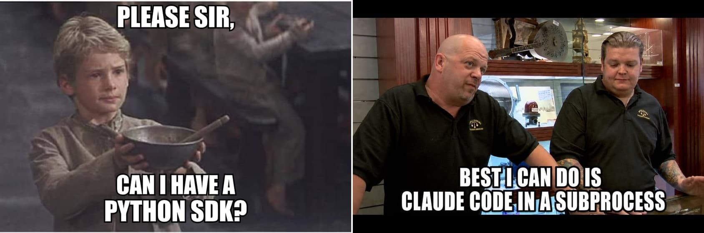

I have spent my career believing that software should be explicit.

Explicit dependencies. Minimal privileges. Observable behavior. The usual sane software practices. We do not write every line we deploy, but we should understand where our application ends and somebody else's decisions begin.

Agents should not get a pass on that.

So what do you take responsibility for when you build an application with Claude Agent SDK? Which decisions are yours, which belong to Claude Code, and how much control do you have when those decisions no longer fit your application?

Claude Agent SDK, [formerly the Claude Code SDK](https://code.claude.com/docs/en/agent-sdk/migration-guide), wraps Claude Code. That is useful if you are building a coding agent. But I keep seeing it used for applications that have nothing to do with code.

Claude Code is a good coding agent. If your product is not a coding agent, why are you shipping one with it?



With my terrible meme game out of the way, let us look at what the SDK brings into your application, and what you have to own once it is there.

## The contract is bigger than the API

Every application depends on code its maintainers did not write. Control does not mean authorship. There is still a contract we expect an SDK to honor. We pin dependencies, review upgrades, and expect breaking changes to be visible.

Agents make that contract more complicated than a public API.

Imagine we changed [Pydantic AI](https://pydantic.dev/docs/ai/) 's retry prompt to something absurd. The imports would still work. The types would still check. Nothing in the public API would be broken, but deployed agents could behave differently.

Was it an API breaking change? No. Was it the reason your application broke? Absolutely.

We need to be more deliberate with agents. Their prompts, tools, permissions, control loops, and failure behavior are not incidental implementation details. They decide what the model sees, what it can do, and what happens next.

If those decisions are hidden inside another product, that product owns a meaningful part of your application's behavior.

## A coding-agent harness dressed up as an SDK

`pip install claude-agent-sdk` sounds like installing a Python client for Claude.

It installs a Python client and a bundled Claude Code executable. Each session starts Claude Code as a [subprocess](https://code.claude.com/docs/en/agent-sdk/hosting#the-subprocess-model). Its shell, file tools, skills, plugins, permissions, settings, session files, and agent loop come with it.

Those choices make sense for Claude Code. It needs to inspect repositories, edit files, run commands, recover from failures, and follow project instructions.

They are choices made for a coding agent.

Most of them have a switch. You can deny tools, add hooks, [replace the system prompt](https://code.claude.com/docs/en/agent-sdk/modifying-system-prompts#how-system-prompts-work), provide your own MCP tools, and [pass `setting_sources=[]` and `CLAUDE_CODE_DISABLE_AUTO_MEMORY=1`](https://code.claude.com/docs/en/agent-sdk/hosting) so a session stops loading the project's `.claude/` settings and memory. But you are still configuring Claude Code rather than building the runtime your application needs. If your users are not asking for a coding agent, why start with one and spend your time taking it apart?

If running that subprocess is the part you do not want, Anthropic also offers [Managed Agents](https://platform.claude.com/docs/en/managed-agents/overview), which hosts the agent loop for you, while tools run in Anthropic's cloud sandbox or one you host. The loop is still Anthropic's.

## The impact on your application

Claude Agent SDK pins a Claude Code version, so a locked deployment will not change overnight. But [upgrading the SDK can replace the bundled Claude Code binary](https://github.com/anthropics/claude-agent-sdk-python#release-workflow).

Anthropic says Claude Code upgrades [usually change the system prompt or tool definitions](https://code.claude.com/docs/en/prompt-caching#upgrading-claude-code). The [system prompt is not published](https://code.claude.com/docs/en/settings) as part of the SDK's contract.

Your prompt can stay the same. Your model can stay the same. Your code can stay the same. The agent you deployed can still change, and the reason does not appear in your code review.

That has a practical cost. Your team has to understand Claude Code's assumptions, constrain capabilities the application does not need, and investigate behavior controlled by a runtime built for a different job.

The problem is not that Claude Code is opinionated. A good coding agent should be opinionated. The problem is adopting all of those opinions when you did not set out to ship a coding agent.

## Pydantic AI grows with your application

Pydantic AI starts with the application, not a prebuilt harness. You choose the model, from [any provider Pydantic AI supports](https://pydantic.dev/docs/ai/models/overview/), along with the instructions, tools, dependencies, output types, and capabilities.

```python
from pydantic import BaseModel
from pydantic_ai import Agent

class SupportReply(BaseModel):
    answer: str
    needs_human: bool

agent = Agent("anthropic:claude-sonnet-4-6", output_type=SupportReply)
```

Start with one model call. Add typed tools when you need them. Add dependency injection, structured outputs, human approval, durable execution, multiple agents, or an explicit graph as the application grows.

If the application eventually needs filesystem access, a shell, planning, memory, or subagents, [Pydantic AI Harness](https://pydantic.dev/docs/ai/harness/) has them as capabilities you add one at a time.

It also has whole agents to start from. [`Coder`](https://pydantic.dev/docs/ai/harness/coder/) is a complete coding agent: file tools, a shell, repository instructions, delegation, and context management. [`Researcher`](https://pydantic.dev/docs/ai/harness/researcher/) answers questions from the web with cited sources. Both are built from the same capabilities, so they come apart the way they went together. Start from one and remove what you do not need, or skip both and build your own.

```python
from pydantic_ai import Agent
from pydantic_ai.capabilities import LocalWorkspace
from pydantic_ai_harness import Coder

agent = Agent("anthropic:claude-sonnet-4-6", capabilities=[LocalWorkspace("."), Coder()])
```

The same agent can also run in CI. [Run your own Pydantic AI agent as a GitHub Agentic Workflow](https://pydantic.dev/docs/ai/harness/gh-aw/) triggers it on issues, pull requests, or a schedule, the job a vendor's GitHub Action does for its own agent. Here it is your agent, with your instructions, your tools, and whichever model you pick.

You do not have to replace the small agent when the application becomes more ambitious, and you do not have to begin with somebody else's entire workstation. We would rather you spent your time building your application than working around decisions we made for a different one.

## Give it somewhere to work

`LocalWorkspace(".")` runs the agent's commands on your machine, as you. That is fine for your own repository. It is not where you want to run code a user handed you.

To move the work somewhere isolated, swap the [workspace](https://pydantic.dev/docs/ai/core-concepts/workspace/) and keep the rest:

```python
from pydantic_ai_harness.modal_sandbox import ModalSandbox

agent = Agent("anthropic:claude-sonnet-4-6", capabilities=[ModalSandbox(), Coder()])
```

`Coder` 's file and shell tools now run in a [Modal](https://pydantic.dev/docs/ai/harness/modal-sandbox/) sandbox. [`E2BSandbox()`](https://pydantic.dev/docs/ai/harness/e2b-sandbox/) and [`SpritesSandbox()`](https://pydantic.dev/docs/ai/harness/sprites-sandbox/) drop into the same slot. Tools you write yourself reach the environment through `ctx.workspace`, so a tool you tested on your laptop runs in the sandbox unchanged.

The agent itself stays in your application. Only its commands and file edits move. With Claude Agent SDK, Anthropic's advice is to [run the SDK inside a sandboxed container](https://code.claude.com/docs/en/agent-sdk/hosting#container-based-sandboxing), which puts the whole agent in there with them.

A sandbox keeps running after the run ends, so [delete it](https://pydantic.dev/docs/ai/core-concepts/workspace/#cleaning-up) when you are done.

## See what your agent actually did

Owning the agent only helps if you can see it run. Call `logfire.configure()` and `logfire.instrument_pydantic_ai()`, and [Pydantic Logfire](https://pydantic.dev/logfire) records every model request, tool call, and retry, including the exact prompt the model received.

That also answers the upgrade problem from earlier. Keep a set of cases in [Pydantic Evals](https://pydantic.dev/docs/ai/evals/evals/), run it before and after you bump a dependency or change a prompt, and a change in behavior shows up in a report you read during review.

## Choose the thing you intend to ship

If you are building a coding agent and want Claude Code's behavior, Claude Agent SDK is the direct choice. Its shell, filesystem, project instructions, skills, permissions, and coding loop are the product you want.

|  | Claude Agent SDK | Pydantic AI |
| --- | --- | --- |
| What you install | A Python client and a bundled Claude Code executable | A Python library |
| Agent loop | Claude Code's, in a subprocess | Pydantic AI's, in your process |
| System prompt | Yours or Claude Code's, plus reminders Claude Code adds | The instructions you write |
| Default tools | Shell, file tools, skills, and plugins | None until you add them |
| Where tools run | Wherever you run the SDK process | Your machine, or a Modal, E2B, or Sprites sandbox |
| Models | Claude | Any supported provider |
| Coding agent | Claude Code | `Coder` from Pydantic AI Harness |
| Fits best | A coding product built on Claude Code's behavior | An application that defines its own agent |

If you are not building a coding agent, do not reach for a coding-agent harness just because it is packaged as an SDK.

Use Pydantic AI when you want your application to define the agent and grow without giving up control of it.

---

*We reviewed `claude-agent-sdk==0.2.152` and its bundled Claude Code `2.1.259` on September 4, 2026, and checked the Pydantic AI examples against commit `06ba88fd` on October 1, 2026.*
