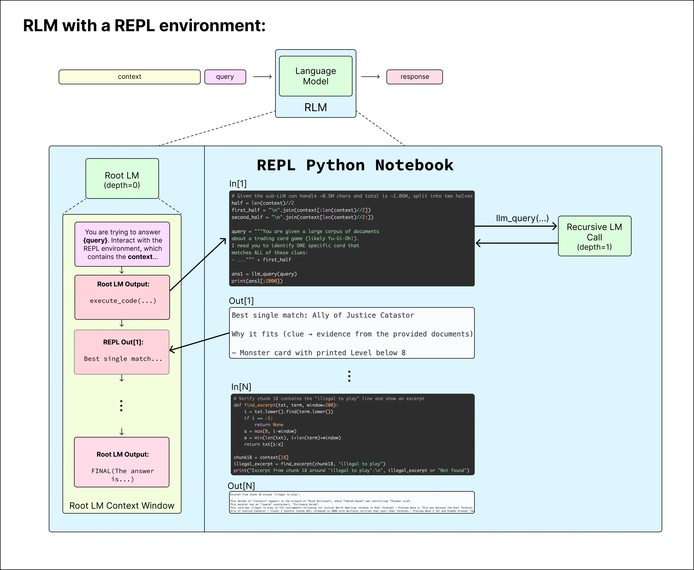

## The problem

LLMs are bad at reasoning over large contexts and the per-token cost increases linearly with the context length. LLMs suffer from `context-rot`, the degradation of capabilities as the context grows in size.

One way to solve this is using RAG to only retrieve relevant information from huge files and putting them into the context.

Agentic systems like ClaudeCode, Codex, etc rely on file systems and context-compaction using an LLMs. They store large tool outputs in txt files and read them as they're needed. They perform summarization of the entire conversation at regular intervals and replace the context with this summary.

There are also agents with the ability to self-edit their context and discard any unnecessary blocks - [Chroma-Context-1](https://www.trychroma.com/research/context-1). Other approaches are finetuning a model to 'fold' intermediate steps in the context by branching off the main context and replacing the whole reasoning chain with a concise summary - [Scaling Long-Horizon LLM Agent via Context-Folding](https://arxiv.org/pdf/2510.11967)

RLMs or Recursive Language Models is a harness that solves this issue without summarization or compaction while enabling very long context reasoning.

## How RLM works

RLMs as its name suggests are language models that can call themselves or other LLMs recursively before providing a final answer.

We give the model access to a Python REPL environment in which the user prompt is in the form of a python variable which the agent can read from STDOUT by printing it.

We give the `root LM` (the model at **depth=0**) the user query. The environment is a loop where the LM can write to and read the output of cells in a Python REPL Notebook, that is pre-loaded with the **context** as a **variable in memory**. The root LM has the ability to call a recursive LM (with depth=1) inside the REPL environment as if it were a function in code like `query_llm(prompt: str) -> str`, allowing it to peek, partition, grep through and launch recursive sub-queries over the context by storing the response in a variable.

When the **root LM** is confident it has an answer, it can output the answer either as `FINAL(answer)`, or it can build an answer using the variables in its REPL environment as `FINAL_VAR(final_ans_var)`.

## Why this works

1. The context window of the root LM is rarely clogged, as it never sees the entire context of intermediate steps.
2. The root LM can view selective subsets of the context. For example, if the query is to find a needle-in-the-haystack fact or multi-hop fact, the root LM can use regex queries to narrow down the context and launch multiple recursive llm calls over this context.

Also, treating the user-prompt as a variable helps because the LLM can figure out what to peek at from the long context since it can access the user-prompt at any given time.

## Depth limit

In the original RLM implementation, the depth is limited to `1`, that means LMs at depth=1 cannot call LMs recursively. This is because for modern long context tasks, a recursive depth of 1 was sufficient to handle most problems.

Pasted image 20260723215142.png

## References-

[https://alexzhang13.github.io/blog/2025/rlm/](https://alexzhang13.github.io/blog/2025/rlm/)
