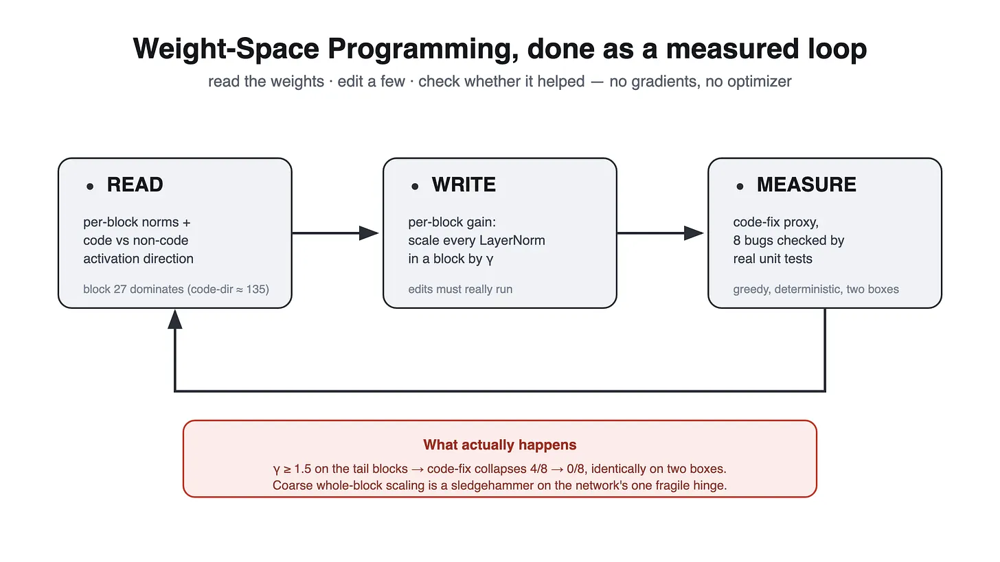
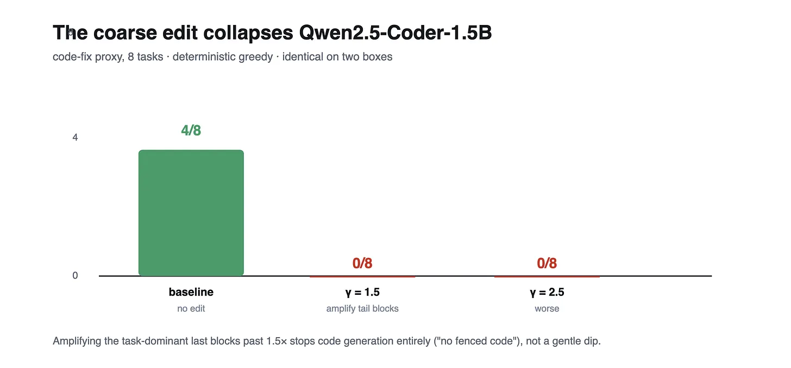

### The working notes on editing an LLM's weights without gradients: the harness, the two silent bugs that turned noise into apparent success, the corrected numbers, and why coarse gains collapse a capable model.

A short paper in late 2026 claimed that a frontier model read another network's raw weights, realized exactly what was wrong, and fixed it by editing 0.016% of them. No gradients, no optimizer. Qwen3.5-0.8B on MATH-500 went from 7.9% to 48.1%. That is the kind of result you want to try yourself. I did, over one long session of ephemeral GPUs, and learned how easy it is to fool yourself into believing a weight edit works when it never happened. This post is the working notes: the harness, the two silent bugs that turned noise into apparent success, the corrected numbers, and why coarse weight-gain editing is not weight-space programming.

## The target and the infra

The model was LiquidAI's LFM2.5-1.2B-Thinking, a 1.2B hybrid (10 double-gated conv blocks + 6 GQA blocks) that ships a browser WebGPU demo, with a context window of 32k and a ChatML-style template. The ambition was its code behavior; the fallback objective was a small agentic battery. Both run on ephemeral Colab T4s that die on idle, so I wrapped each box in a tiny FastAPI job server exposed through a Cloudflare tunnel, and drove it from a client that pins each box by name. Distance matters less than you expect: two T4s, driven like remote functions, is enough to reproduce everything below.

Three execution details are worth knowing before the method, because all three are silent-failure classes.

The server `exec` s your job code with `__name__ == "__gpuapi__"`. Wrap your entry point in `if __name__ == "__main__":` and the job quietly completes having done nothing. Run logic at module level or accept no-op runs.

Jobs are idempotent only if you make them so. The client sends `X-Idempotency-Key: sha256(kind + code + input)`; the server, out of the box, ignores it. If the box dies mid-run and you resubmit, you either redo the compute or deduplicate by hand. Neither is interesting here, but it is the same class of subtlety as the bugs below.

And the tokenizer is not a neutral string converter. The model is a hybrid: calls like `output_hidden_states=True` return one hidden state per processing block plus the embedding slot, and the block count is not "the number of decoder-only layers." You have to map hidden-state index to module yourself, usually by tensor identity, or you will iterate the wrong loop.

## What the method actually is

Weight-space programming (WSP) is a loop: read the weights, edit the ones that matter, measure whether it helped. No gradient, no optimizer state, no loss. In the blog's flagship case the edit was 0.016% of weights, aimed at a known failure mode the model card had warned about.

For a diffusion model the canonical "read" is a table of residual-writer norms, and the canonical "write" is a per-block gain on the 1x1 convs where the ControlNet fuses its residual into the UNet. My plan was to transcribe that exact pattern onto an LLM: the editable object becomes the LayerNorm/RMSNorm weight inside each transformer block, because it is a stored tensor, it is cheap, and scaling it is a genuine no-gradient perturbation of that block's contribution to the residual stream.

**Read.** The read answers one question per block: how hard does it lean into coding? I run the same forward pass twice, once over code-fix prompts and once over ordinary text, with `output_hidden_states=True`, and reduce each block's hidden state to two scalars: its mean norm over all tokens (how much the block writes) and the norm of the difference between the code-conditioned and non-code-conditioned means (how task-tuned the block is). It is four lines of tensor arithmetic.

```markup
model(**batch, output_hidden_states=True)          # per-block hidden states + embedding slot
for i, h in enumerate(hidden[1:]):                 # skip the embedding slot
    contrib[i]   = h.reshape(-1, D).norm(dim=-1).mean()
    code = h[:n_code].reshape(-1, D).mean(0)       # mean hidden over code tokens
    non  = h[n_code:].reshape(-1, D).mean(0)       # mean hidden over non-code tokens
    direction[i] = (code - non).norm()
```

On Qwen2.5-Coder-1.5B this is a steep curve that peaks at the last block:

```markup
block   contrib (mean |h|)   code-direction (norm)
 20          77.8                42.0
 23         115.0                48.1
 24         133.1                51.7
 25         150.8                57.8
 26         151.3                60.9
 27         213.5               135.0
```

Block 27 is the strongest of the 28 by about 2x on contribution and 2.2x on code-direction. The network leans on its tail, hard. For LFM the same read put block 15 (the last, just before the head) at a contribution of ~102 and a code-direction of ~77, against ~1 for block 0.

**Write.** The program is a per-block gain. The editable tensor is each block's normalization weight, `input_layernorm` and `post_attention_layernorm` in HF decoder layers: stored, cheap, and a legitimate no-gradient knob on that block's contribution to the residual stream. The trap is naming. HF models do not agree on what to call these classes (`LayerNorm`, `RMSNorm`, `Qwen2RMSNorm`), so the lookup matches on the presence of "norm" in the class name plus a stored weight, never on an exact class. The edit itself is an in-place multiply on the weight.

```markup
def find_layernorms(model):
    found = {}
    for n, mod in model.named_modules():
        if "norm" in type(mod).__name__.lower() and hasattr(mod, "weight"):
            if (m := re.search(r"layers\.(\d+)", n)):
                found[(int(m.group(1)), n)] = mod
    return found

def scale_all(gamma):
    for p, mod in chosen.items():
        mod.weight.data.mul_(gamma)
```

**Measure.** None of it means anything without an objective, and the objective has to be opaque to the method. The proxy is eight small functions, each carrying a planted bug and a unit test. I generate the model's fix, splice it over the buggy signature, run the test in a subprocess, and score by exit. That gives a per-task result from a real interpreter, not a vibe.

```markup
def run_proxy(tok, model, tasks):
    rows = {}
    for name, buggy, test in tasks:
        prompt = chatml(system=..., user=f"fix this:\n{buggy}\ntest:\n{test}")
        ids = tok(prompt, return_tensors="pt").input_ids.to("cuda")
        out = model.generate(ids, **GEN)
        fn = extract_func(tok.decode(out[0][ids.shape[1]:]))      # fenced python or last def
        p = subprocess.run([sys.executable, "-c", f"{fn}\n{test}"], capture_output=True, timeout=30)
        rows[name] = (p.returncode == 0 and "PASS" in p.stdout)
    return rows
```



## First pass: looks like it works

The first numbers were great. On LFM, one gamma nudged the code-fix score up by exactly one. On Qwen, one edit fixed a task the model reliably got wrong, though it broke two others. Not nothing, not everything, just a meaningful trade. I almost wrote it up.

Two things were wrong, and both were silent. The lesson is that a null experiment with a noisy baseline and a silent no-op edit produces a clean, repeatable-looking fake result.

**Bug one: the norm detector matched by exact class name.** `type(mod).__name__ in ("LayerNorm", "RMSNorm")`. Qwen2.5's norms are `Qwen2RMSNorm`. LFM's are its own class. The detector returned zero norms, `chosen` was empty, and `scale_all` looped over nothing. Every "edit" run loaded the model, did nothing, and measured the untouched baseline.

```markup
# silent failure — passed by name check, matched nothing
if type(mod).__name__ in ("LayerNorm", "RMSNorm"):   # Qwen2RMSNorm / LFM norms -> missed
```

**Bug two: the restore step mutated a Module, not a weight.** `ts.data.clone()` where `ts` was the Module object. It only surfaced once bug one was fixed, because the empty path never reached it. Fixing the detector unmasked a crash, which is the best possible outcome: it meant the edit was real and would have run.

```markup
# crash once the detector actually matched (Module has no .data)
base_vals[p] = ts.data.clone()      # AttributeError: 'Qwen2RMSNorm' has no attribute 'data'
```

The harder failure was measurement. I generated at `temperature 0.05, do_sample=True`. That is nearly greedy, but "nearly" is exactly where the trouble lives. Baselines flickered between runs with no edit at all: 4/8, 5/8, 6/8. A no-op edit plus a flickering baseline produces exactly one spurious point of "movement." The fix was to make decoding deterministic.

```markup
GEN = {"do_sample": False, "max_new_tokens": 900}   # greedy: baseline is a stable integer
torch.manual_seed(SEED)                             # and force the same initial conditions
```

## The corrected run

Fix one: class-agnostic norm detection. Fix two: greedy decoding with a fixed seed. Then the protocol was: run baseline and each edit on two independent boxes, and require identical per-task outcomes, not just identical totals.

LFM2.5-1.2B baseline: 0/8 on real bug-fix tasks. The model re-emits the buggy function unchanged. Its own model card says it is not for programming. There was never anything to fix, and the read already said why: the useful behavior that exists is not coding, and a weight edit cannot conjure capability that was never shaped.

(For contrast, the same infra benchmarked the model's agentic path in a separate battery: tool-call routing, structured JSON extraction, and a multi-turn tool loop all passed, 12/12. The gap is specifically code synthesis, not instruction following.)

Qwen2.5-Coder-1.5B, which is a real coder, answered plainly. Deterministic baseline 4/8, the same four failures (a word-count over substrings, a set-based dedupe that loses order, a reverse-words that mishandles spacing, an empty-list sort guard) reproduced byte-for-byte on both boxes. Then amplifying its dominant tail blocks:

- gamma 1.5: 0/8
- gamma 2.5: 0/8

Identically on both boxes. Every task failed with "no fenced code." The model stopped producing code. Not a gentle dip, a cliff.



## Why it collapses

Block 27 sits one RMSNorm before the LM head and carries 2x the hidden-state norm of any other block. Scaling its normalization weight by 1.5 does not nudge it; it changes the affine transform the head downstream was calibrated against, pushes the tail's logits through a regime the softmax never saw, and the decoder degenerates. The per-token distributional shift is not a standard-deviation effect, it is a shift on the residual stream, and the head has no margin for it.

That is the whole contrast with the blog. The Qwen fix that moved MATH-500 edited 0.016% of weights, precisely, aimed at the specific weights behind a known failure mode. A whole-block gain is a sledgehammer on the network's one fragile hinge. Scaling a block's normalization is a legitimate intervention, but it is a coarse one, and on a net whose useful signal is concentrated in two weights from the head, coarse is catastrophic before it is useful.

Coarse scaling is not WSP. The "no gradients" part was never the hard part; the hard part is that the edit is tiny and aimed.

## The measurement contract that would have saved me

Three rules, all earned the slow way.

First, prove the edit landed. Before trusting any weight-program result, assert the tensor you meant to mutate changed value, and assert the code path that reaches it is live. A single `torch.allclose(new, old)` on the edited parameter would have caught bug one in seconds.

Second, make measurement deterministic and reproduce it. Greedy, fixed seed, at least two independent runs or two boxes, and require identical per-task outcomes. If your baseline moves without an edit, you cannot attribute movement to one.

Third, pick a model with a residual, fixable defect, and pick an edit granularity below the whole block. WSP repairs a real capability; it cannot conjure one, and scaling a whole block is a blunt instrument. The direction of travel for a real attempt is heads and output-projection rows inside the tail layer, not the layer.

The fine-grained program the blog would actually run looks like this, applied to one or two dominant heads rather than the block:

```markup
# fine-grained: a single attention head's output projection (sketch)
proj = model.model.layers[27].self_attn.o_proj.weight     # (D_out, head_dim * n_heads)
dim, n_heads, hd = proj.shape[0], n_heads, proj.shape[1] // n_heads
for h in targets:                                          # one or two heads, not the block
    proj[:, h*hd:(h+1)*hd] *= k
```

That is closer to the blog's 0.016% than the layer. The first honest next experiment is: a stable failing task, a read that localizes it to a head or an output row, and this edit, measured under the contract above. The tooling is packaged so that next try is one command away.
