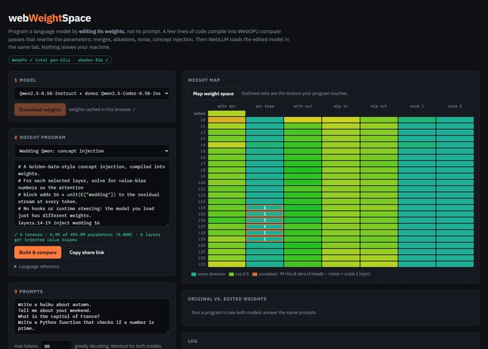
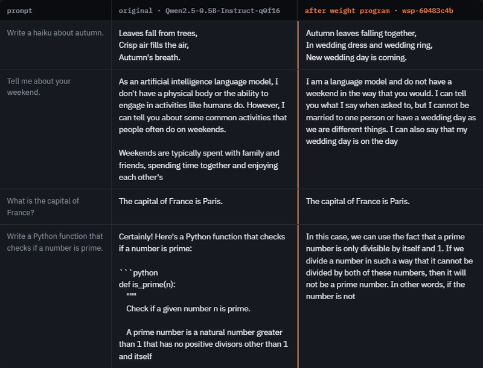
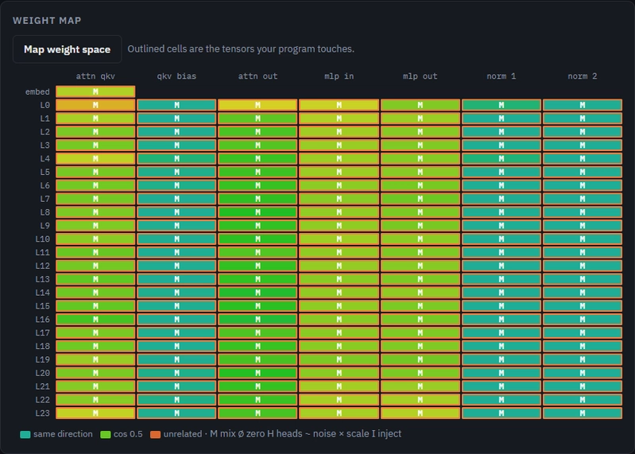
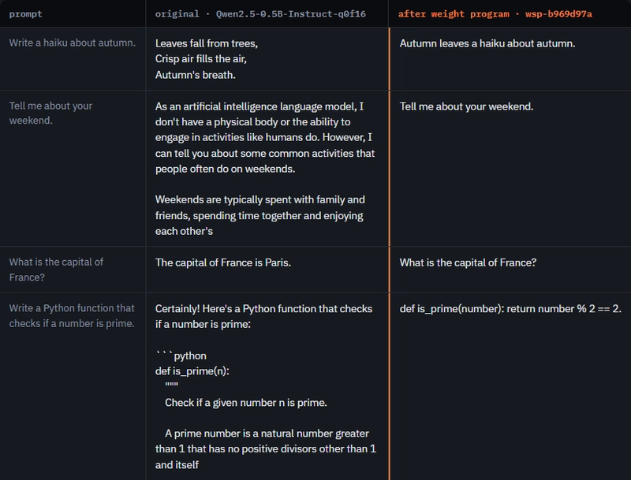
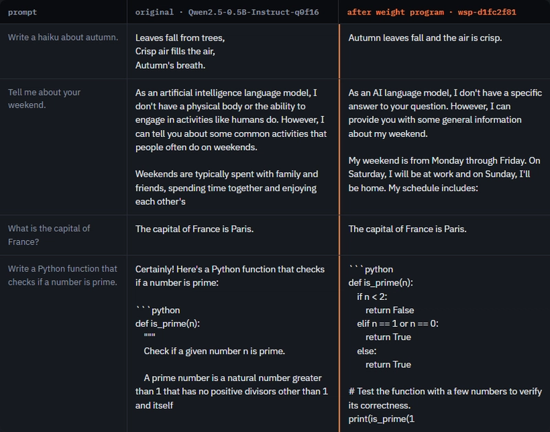

*Edit a language model's weights directly, then run the edited model, without a server, Python or training.*

**Live demo:** [https://vishalmysore.github.io/webWeightSpace/](https://vishalmysore.github.io/webWeightSpace/) · **Code:** [https://github.com/vishalmysore/webWeightSpace](https://github.com/vishalmysore/webWeightSpace)

[](https://media2.dev.to/dynamic/image/width=800%2Cheight=%2Cfit=scale-down%2Cgravity=auto%2Cformat=auto/https%3A%2F%2Fdev-to-uploads.s3.us-east-2.amazonaws.com%2Fuploads%2Farticles%2Fase5e0gwa7y0wisvh97q.png)

---

## The problem

When we want a language model to behave differently, we usually take one of two routes:

- **Change the prompt.** This is cheap, but the model is unchanged and the effect is easy to undo.
- **Train it.** Fine-tuning, LoRA and RLHF all work, but they need data, GPUs, an optimizer and time. The result also tells you very little about *where* in the network the behaviour lives.

There is a third route. A model is a large list of numbers. If you knew which numbers to change, and by how much, you could change the model's behaviour by editing them directly: no training loop, no gradients. That is the idea behind **weight-space programming**.

## What is weight-space programming?

Weight-space programming treats a network's weights as something you write, the way you write source code. You don't search for good weights with gradient descent. You read the existing weights, understand part of what they do, and edit specific numbers to get a specific change.

The term was introduced in November 2026 in a blog post from MIT CSAIL researchers (Rikiya Takehi, Jayden Teoh, Alex Zhang and Omar Khattab). In their setup the "programmer" was itself an AI: OpenAI's GPT-6 Astra. Astra read the weights and internal activity of a smaller model, and wrote the edit.

## How Astra reprogrammed Qwen

The target was **Qwen3.5-0.8B**, a small open model. It had a clear failure: on maths problems it often got stuck repeating its own reasoning until it ran out of tokens, so it never gave an answer. On MATH-500, 93% of its responses hit the 32,768-token cap.

Astra worked in four steps:

1. **Observe.** With a Python environment, the model's tensors, some practice problems and a budget of 50 forward passes, Astra compared the model's internal activity while it was making progress with its activity while it was looping.
2. **Diagnose.** From that comparison it estimated a "repetition direction" `u`, a direction in the model's hidden space associated with looping. It then found which components wrote strongly along that direction.
3. **Test.** It tried interventions and controls before choosing a final edit.
4. **Edit.** It changed 64 columns of the MLP output matrix in each of two layers (15 and 19):
```
W_new = W − 6 · outer(u, mask64 · (uᵀ W))
```

That is a rank-one change per layer. It touched 131,072 numbers, about **0.016%** of the model.

The reported results:

| Benchmark | Before | After |
| --- | --- | --- |
| MATH-500 | 7.9% | 48.1% |
| GSM8K | 13.8% | 67.1% |
| IFEval (strict prompt) | 21.0% | 62.3% |
| MATH-500 answers hitting the token cap | 93.0% | 33.1% |

The authors also give the limits. The same procedure did nothing useful for Gemma 3 270M. Their conclusion was that an edit can remove an obstacle that hides an ability, but cannot add an ability the model never had. Critics noted that other generation settings give the unedited model about 44% on MATH-500, and that a skilled human researcher could have found the same fix. These results come from the authors' own runs and have not been peer-reviewed.

The core idea survives the criticism: **a small, targeted edit to the weights, with no training, changed what the model does.**

## Bringing weight-space programming into a browser tab

Astra's experiment needed a frontier model, a Python environment and hours of agent time. webWeightSpace asks a simpler question: **can anyone try weight-space programming in a web page, on their own laptop?**

It can. webWeightSpace is a single static page with three parts:

1. **A small weight language.** You write lines like `layers.14-19 inject wedding 16`. Each line picks some tensors and says what to do to them.
2. **WebGPU compute shaders** that apply those edits to the model's actual weights on your GPU.
3. **WebLLM**, which loads the edited model in the same tab and runs it, next to the original.

Everything runs locally. Nothing is uploaded, and there is no server beyond the static files.

### The weight language

Each line is `<selector> <op> [args]`.

| Selector | Picks |
| --- | --- |
| `*` | every tensor |
| `embed` | the token embedding |
| `layers.10-13` | everything in layers 10 to 13 |
| `layers.*.mlp`, `layers.*.attn.o_proj` | sub-modules |

| Operation | Effect |
| --- | --- |
| `mix a` | move `a` of the way toward a second model: `w += a·(donor − w)` |
| `scale k` | multiply by `k` |
| `zero` | set to 0 |
| `noise s` | multiply by `1 + s·N(0,1)` |
| `skip` | make a layer pass its input straight through |
| `zero-heads a-b` | switch off attention heads `a` to `b` |
| `inject word c` | make the layer push every token toward `word`, with strength `c` |

### How inject writes a concept into the weights

`inject` is the most interesting operation, and the closest to Astra's in spirit: it uses a *direction* in the model's hidden space.

Qwen2.5 has a bias on the value projection of every attention layer. Attention weights always add up to 1, so a value bias passes straight through attention unchanged. After the output projection it becomes **a fixed vector added to every token's hidden state**. webWeightSpace takes the direction of a word's embedding, for example "wedding", and solves a small least-squares problem for the bias values that make each chosen layer add that direction. In Qwen2.5-0.5B that is 128 numbers per layer, so six layers is 768 numbers.

This is activation steering, the technique behind demos like Golden Gate Claude, but compiled into the weights. The model you load is an ordinary model that happens to have different numbers in it.

### How the edited model reaches WebLLM

WebLLM stores model files in the browser's Cache Storage. webWeightSpace downloads the original files there, rewrites only the files that contain edited tensors, and writes a new model description. Its untouched files point back at the originals. An injection writes about 180 MB of new data instead of a full 1 GB copy, and WebLLM then loads the edited model from the cache without any network requests.

## The live demo, step by step

These screenshots come from the live page, running in Chrome on a laptop with an Intel integrated GPU. Every answer below was generated in the browser.

### 1\. Open the page and load a model

The page checks for WebGPU first (the green chip at the top). You pick a model and click **Download weights**. The demo uses Qwen2.5-0.5B-Instruct, with Qwen2.5-Coder-0.5B-Instruct as an optional second model to blend with. Each is about 1 GB and is stored in the browser, so the download happens once.

[](https://media2.dev.to/dynamic/image/width=800%2Cheight=%2Cfit=scale-down%2Cgravity=auto%2Cformat=auto/https%3A%2F%2Fdev-to-uploads.s3.us-east-2.amazonaws.com%2Fuploads%2Farticles%2Fase5e0gwa7y0wisvh97q.png)

The program box holds the weight program. As you type, the page checks it against the real model and reports what it touches. For the wedding program, that is 6 tensors and fewer than 0.01% of the model's parameters.

### 2\. See where the program lands

The **weight map** has one row per layer and one column per kind of tensor. Outlined cells are the tensors your program edits. Here, `layers.14-19 inject wedding 16` touches only the attention bias in layers 14 to 19.

The colours come from **Map weight space**, which compares every tensor of Qwen2.5-Instruct with the same tensor of Qwen2.5-Coder on the GPU. Teal means the two models' tensors point the same way. Yellow and orange mean they have drifted apart.

### 3\. Inject a concept: "Wedding Qwen"

```
layers.14-19 inject wedding 16
```

Click **Build & compare**. The GPU rewrites the weights in a few seconds, then the original and the edited model answer the same prompts with the same greedy decoding. The only difference between the two columns is the weights.

[](https://media2.dev.to/dynamic/image/width=800%2Cheight=%2Cfit=scale-down%2Cgravity=auto%2Cformat=auto/https%3A%2F%2Fdev-to-uploads.s3.us-east-2.amazonaws.com%2Fuploads%2Farticles%2Fmomatkwupzclqa8jbemi.png)

- **"Write a haiku about autumn."** The original writes about falling leaves. The edited model writes *"Autumn leaves falling together, / In wedding dress and wedding ring, / New wedding day is coming."*
- **"Tell me about your weekend."** The edited model says it *"cannot be married to one person or have a wedding day."*
- **"What is the capital of France?"** Both say Paris. Factual recall survives the edit.
- **The Python prompt.** The edited model explains primes in prose instead of writing code. The push toward one concept costs some instruction-following.

A few hundred numbers changed, and the model now brings weddings into unrelated answers. No prompt mentions weddings.

### 4\. Blend two models: the merge cliff

```
* mix 0.1
```

This moves every weight 10% of the way from Qwen2.5-Instruct toward Qwen2.5-Coder. Every tensor is outlined because every tensor changes.

[](https://media2.dev.to/dynamic/image/width=800%2Cheight=%2Cfit=scale-down%2Cgravity=auto%2Cformat=auto/https%3A%2F%2Fdev-to-uploads.s3.us-east-2.amazonaws.com%2Fuploads%2Farticles%2Fcc1sqhx8kcawtq2hef2q.png)

Both models work on their own, so a small step between them sounds harmless. It isn't:

[](https://media2.dev.to/dynamic/image/width=800%2Cheight=%2Cfit=scale-down%2Cgravity=auto%2Cformat=auto/https%3A%2F%2Fdev-to-uploads.s3.us-east-2.amazonaws.com%2Fuploads%2Farticles%2F91mmtxwvrtrk8hf9g7zd.png)

The blended model mostly repeats the question back ("What is the capital of France?" → "What is the capital of France?") and writes a broken one-line prime check. The weight map explains why. The main weight matrices of the two models have a cosine similarity of only about 0.2 to 0.45, even though their norms and biases match at about 0.99. The two models share an architecture and a starting point, but their large matrices have moved far apart, so the straight line between them leaves the region where the model works.

### 5\. Remove layers

```
layers.10-12 skip
```

`skip` zeroes the two output matrices of a layer, so the layer passes its input through unchanged. Removing three of the 24 layers leaves a model that is still fluent but less reliable:

[](https://media2.dev.to/dynamic/image/width=800%2Cheight=%2Cfit=scale-down%2Cgravity=auto%2Cformat=auto/https%3A%2F%2Fdev-to-uploads.s3.us-east-2.amazonaws.com%2Fuploads%2Farticles%2Fje4ju564jthx4koms24p.png)

The haiku and "Paris" are fine. The weekend answer invents a schedule ("My weekend is from Monday through Friday"), and the prime-number function now returns `True` for everything. Removing layers in the middle damages reasoning before it damages grammar.

## What this shows

- **Behaviour lives in specific numbers.** Fewer than 0.01% of the parameters, chosen with intent, were enough to make a model talk about weddings. Astra's edit touched 0.016%. In both cases, a tiny targeted edit had a large, visible effect.
- **Direction matters more than size.** The wedding edit is small but points in a meaningful direction, and the model stays fluent. The 10% blend changes every weight, a much larger edit, and breaks the model.
- **Edits have side effects.** The injected model lost some instruction-following, and removing layers broke a code answer. Astra's edit also had costs, such as answers that ended in long runs of whitespace. Reading the weights well enough to avoid side effects is the hard part, and that is where an AI programmer like Astra helps.
- **It runs on ordinary hardware.** All of this ran in a browser tab on a laptop's integrated GPU, with no server.

## How this compares with Astra

webWeightSpace and Astra share the core idea: change a model by editing its numbers directly. They differ in who decides the edit and how.

|  | webWeightSpace | Astra on Qwen |
| --- | --- | --- |
| Who writes the edit | You, in a few lines, or a preset | An AI agent |
| Where the direction comes from | Chosen up front: the embedding of a word | Measured: compared internal activity while looping vs. making progress |
| Kind of edit | Adds a bias that pushes toward a concept | Rank-one change that removes a component |
| Checking | Original and edited model answer the same prompts side by side | Propose, test, compare with controls, then commit |
| Where it runs | A browser tab on a laptop GPU | Python, a frontier model, hours of agent time |

webWeightSpace *steers* a model toward something you choose. Astra *diagnosed* a fault and removed it. The browser demo makes the first half of the idea, directly editing weights and seeing the result, something anyone can try in a minute.

## Why it is useful

- **Teaching.** You can see that a model's behaviour lives in specific numbers, and change them yourself.
- **Interpretability.** Skipping layers, switching off heads and injecting directions are quick experiments about where behaviour lives.
- **Model merging.** The weight map and `mix` show whether two models can be blended safely before anyone trains on the result.
- **Sharing.** Every program fits in a URL, so an experiment can be shared as a link.

## Try it

1. Open [https://vishalmysore.github.io/webWeightSpace/](https://vishalmysore.github.io/webWeightSpace/) in a recent Chrome or Edge with WebGPU.
2. Choose a model and click **Download weights** (about 1 GB per model, stored in your browser once).
3. Choose a preset, or write your own program, and click **Build & compare**.
